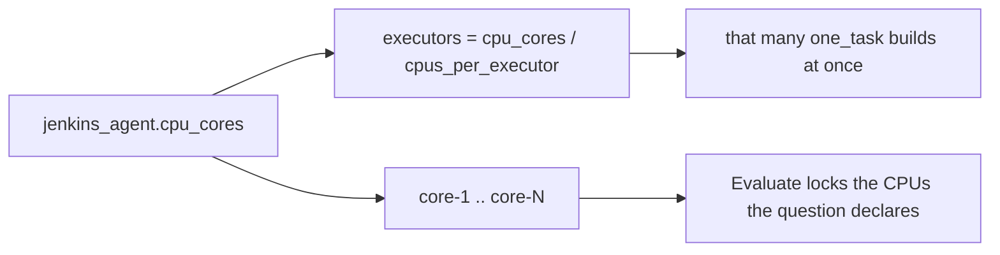

# Configuration

## Config file location

| Path | Purpose |
|------|---------|
| `~/.config/mac-k3d/config.yaml` | User configuration (created by `prepare --init-config`) |
| `~/.local/state/mac-k3d/` | Runtime state written by `start` (not user-edited) |

Override config path with `--config /path/to/config.yaml`.

## Schema

```yaml
role: standalone          # standalone | controller | worker

cluster:
  name: mac-k3d           # k3d cluster name
  agents: 0               # agent node count
  ports:
    - host: 8080          # host port on macOS
      container: 80       # LB target port in cluster
    - host: 8443
      container: 443

jenkins:
  enabled: false          # set true or use `start --jenkins in-cluster`
  namespace: jenkins
  release_name: jenkins
  host_port: 17070         # localhost URL for Jenkins UI

docker:
  startup_timeout_secs: 120

# Set by `mac-k3d prepare` wizard — large artifacts and caches
storage:
  base_dir: /Volumes/1TB.large/mac-k3d
  docker: /Volumes/1TB.large/mac-k3d/docker
  k3d: /Volumes/1TB.large/mac-k3d/k3d
  jenkins: /Volumes/1TB.large/mac-k3d/jenkins
  downloads: /Volumes/1TB.large/mac-k3d/downloads

# Set by `mac-k3d prepare` wizard — how each tool is resolved
dependencies:
  docker:
    source: existing      # existing | install | skip
    binary: /usr/local/bin/docker
    app: /Applications/Docker.app
  k3d:
    source: existing
    binary: /opt/homebrew/bin/k3d
  kubectl:
    source: install
    binary: /opt/homebrew/bin/kubectl
  helm:
    source: skip
  harbor:
    source: skip          # worker / standalone eval: setup installs HARBOR_VERSION from pipeline/config/toolchain.env with uv
  java:
    source: skip          # required on workers (Jenkins agent)
  git:
    source: skip          # required on workers (the tasks phase clones benchmarks and iCode)

lolbench:                 # not asked any more: the pipeline clones LoLBench itself at its pin
  path: null
  source: skip            # skip | existing | clone | release
  git_url: https://github.com/MichaelLing83/LoLBench-Preview.git

jenkins_agent:
  controller_url: null    # worker: Jenkins base URL (wizard default http://43.107.42.252:17070 or $JENKINS_URL)
  name: null
  labels: [macos, docker, lolbench]
  remote_fs: null
  agent_jar: null
  cpu_cores: 0            # CPU upper limit (local 4, cloud 16); wizard default is the logical count
  cpus_per_executor: 2    # executors = cpu_cores / this
  api_user: ''            # worker: always written, '' until filled in; CLI registration only
  api_token: ''           # plaintext for now; not for LLM/Git — those live in Jenkins Credentials (see secrets.md)

resources:
  cpu_cores_label: CPU_CORES
  disk_min_gb: 0          # 0 = role default (40 / 60 / 40)
```



All fields are optional; omitted keys use defaults above.

## Field reference

### `role`

| Value | Meaning |
|-------|---------|
| `standalone` | Local k3d only |
| `controller` | Jenkins in-cluster on this Mac |
| `worker` | Jenkins agent + the pinned Harbor, Java (at least `JAVA_MAJOR`, the controller image's Java) and git; no cluster, no in-cluster Jenkins |

### `cluster`

| Field | Type | Default | Description |
|-------|------|---------|-------------|
| `name` | string | `mac-k3d` | Passed to `k3d cluster create --name` |
| `agents` | u8 | `0` | Number of k3d agent nodes |
| `ports` | list | see below | Port mappings via k3d `-p "host:container@loadbalancer"` |

Default ports expose HTTP/HTTPS on the cluster load balancer for Ingress or NodePort services.

**Validation (planned):**
- `name` must match `^[a-z0-9-]+$`
- `host` ports must be 1024–65535 (or 80/443 with rootless caveats documented)
- No duplicate `host` ports

### `jenkins`

| Field | Type | Default | Description |
|-------|------|---------|-------------|
| `enabled` | bool | `false` | Whether Jenkins is managed |
| `namespace` | string | `jenkins` | Kubernetes namespace |
| `release_name` | string | `jenkins` | Helm release name |
| `host_port` | u16 | `17070` | Local port mapped to Jenkins service |

When enabled, `start` adds a port mapping:

```text
-p "17070:8080@loadbalancer"
```

Helm values applied by `mac-k3d start` (controller):

```yaml
controller:
  serviceType: LoadBalancer
  installLatestPlugins: true
  additionalPlugins:
    - lockable-resources      # per-worker <agent>-core-N capacity locks
    - plain-credentials       # Secret text for LLM keys and forge PATs
    - file-parameters         # ICODE_RELEASE_FILE upload
    - copyartifact            # dispatcher Aggregate stage pulls each rollout build's trials
    - pipeline-utility-steps  # nodesByLabel: online workers and executors for MAX_IN_FLIGHT
    - hidden-parameter        # ui_profile=user hides developer params
```

Chart defaults still install kubernetes, workflow-aggregator, git, and configuration-as-code. `mac-k3d config` does not change this list; re-run **controller** `mac-k3d start` after a binary that added a plugin.

### `docker`

| Field | Type | Default | Description |
|-------|------|---------|-------------|
| `startup_timeout_secs` | u64 | `120` | Max wait after launching Docker Desktop |

### `storage`

Set by the [setup wizard](setup.md#storage). Paths for large artifacts; config/state stay in `~/.config` and `~/.local/state`.

| Field | Type | Default | Description |
|-------|------|---------|-------------|
| `base_dir` | path | largest free volume + `/mac-k3d` | Root for caches and data |
| `docker` | path | `{base_dir}/docker` | Docker image data (may need manual Docker Desktop move) |
| `k3d` | path | `{base_dir}/k3d` | k3d cluster and image cache |
| `jenkins` | path | `{base_dir}/jenkins` | Helm charts, plugins, Jenkins PV data |
| `downloads` | path | `{base_dir}/downloads` | Agent JARs and other large downloads |

### `dependencies`

Per-tool resolution. The prepare wizard discovers existing installs first and never removes them without explicit consent.

| Field | Type | Values | Description |
|-------|------|--------|-------------|
| `source` | string | `existing`, `install`, `skip` | Use found binary, install (apt on Linux, Homebrew on macOS; see [Install commands](#install-commands-prepare)), or skip |
| `binary` | path | — | CLI path when `source: existing` |
| `app` | path | — | App bundle (Docker Desktop only) |

| Tool | Required when |
|------|---------------|
| `docker` | Always |
| `k3d` | controller, standalone |
| `kubectl` | controller, standalone |
| `helm` | Jenkins controller (`jenkins.enabled: true`) |
| `java` | worker. Must be at least `JAVA_MAJOR` (21) from `pipeline/config/toolchain.env`, the Java of the controller image; an older one makes validation fail and the agent drop with `UnsupportedClassVersionError` |
| `git` | worker; standalone with Harbor |
| `harbor` | worker (exactly `HARBOR_VERSION`); standalone unless `source: skip` |

Versions, pins, and what installs and checks each tool on Linux and macOS: [dependencies.md](dependencies.md).

## Example: Jenkins enabled

```yaml
cluster:
  name: dev-cluster
  agents: 1
  ports:
    - host: 8080
      container: 80

jenkins:
  enabled: true
  host_port: 9090

docker:
  startup_timeout_secs: 180
```

```bash
mac-k3d start   # reads jenkins.enabled from config
# equivalent to:
mac-k3d start --jenkins in-cluster
```

CLI flag `--jenkins` overrides config for that invocation only (does not write back to file unless we add `--save` later).

## State files (planned)

### `~/.local/state/mac-k3d/cluster.json`

```json
{
  "name": "mac-k3d",
  "created_at": "2026-08-18T07:00:00Z",
  "k3d_version": "5.6.0",
  "ports": [{"host": 8080, "container": 80}]
}
```

### `~/.local/state/mac-k3d/jenkins.json`

```json
{
  "namespace": "jenkins",
  "release": "jenkins",
  "host_port": 17070,
  "chart_version": "5.1.0"
}
```

## Secrets (CI)

LLM API keys and forge PATs are **not** fields in `config.yaml`. Configure them once in the Jenkins Credentials store on the controller so every agent can use them — see [secrets.md](secrets.md).

Prepare may write pending values to `~/.config/mac-k3d/credentials.pending.yaml` (mode 0600); `mac-k3d config` creates Jenkins Secret text credentials and clears uploaded entries.

`jenkins_agent.api_user` / `api_token` are only for the mac-k3d CLI talking to Jenkins (register/clean), and are unrelated to Harbor/LLM keys. A worker's YAML always has both keys; `''` means not filled in yet, and `config` then prints which keys to fill in. `mac-k3d export` writes `api_token: ''`.

`jenkins.remote_trigger_token` is the shared secret for **Trigger builds remotely** on the nine eval jobs. It lives only in the controller `config.yaml`. `config` generates it once when the field is empty. `mac-k3d export` omits it.

### `jenkins_job` (controller)

| Field | Default | Meaning |
|-------|---------|---------|
| `default_task` | `ruff_1` | Exported as `TASK` / `ICODE_TASK` |
| `default_eval_mode` | `binary` | Jenkins `ICODE_MODE` default: `release` (`binary` alias) or `git` (see [icode-harness-inputs.md](icode-harness-inputs.md)) |
| `default_icode_release` | *(empty)* | Local persist / CLI default for a `*-full-*` path or stub `icode` (not a Jenkins UI string; Jenkins release uses `ICODE_RELEASE_FILE` upload) |
| `default_icode_git_url` | *(empty)* | Default `ICODE_GIT_URL` for git mode |
| `default_icode_git_ref` | `main` | Default git ref for git mode |
| `default_icode_args` | *(empty)* | Argv after `./icode` |
| `default_harness` | *(empty → `icode`)* | Catalog harness (`mac-k3d set --harness`) |
| `default_llm` | *(empty → `deepseek`)* | Catalog LLM family (`mac-k3d set --llm`) |
| `default_deepseek_model` | *(empty → `deepseek-flash`)* | Catalog Chat Completions id (`mac-k3d set --model`; also `deepseek-v4-pro`) |
| `default_benchmark` | *(empty)* | Which job gets TASK defaults (`deepswe` \| `lolbench` \| `swebenchpro`) |
| `ui_profile` | `user` | `user` hides developer parameters (pins, canary, `MAX_IN_FLIGHT`, `OOM_RETRIES`, `TEST_MEMORY_MB`, `TEST_MEMORY_ATTEMPTS`) as hidden parameters that keep their defaults; `developer` shows them. `mac-k3d set --ui-profile`, then `config --skip-secrets` |
| `max_in_flight` | `0` | How many `one_task` builds one dispatcher may have in Jenkins at once. `0` means twice the online executors that can run the suite. `mac-k3d set --max-in-flight` |
| `oom_retries` | `2` | An OOM rollout is appended to the queue tail at most this many times (three tries in total). `mac-k3d set --oom-retries` |
| `default_shard_size` | `2` | Kept so an old config still loads. Dispatch is one build per question and rollout; this value is not used |

## Environment variables

| Variable | Description |
|----------|-------------|
| `RUST_LOG` | Logging filter (e.g. `mac_k3d=debug`) |
| `KUBECONFIG` | Respected by kubectl invocations |
| `MAC_K3D_CONFIG` | *(planned)* alternate config path |

## Multi-Mac setup guidance

`mac-k3d` currently manages one local cluster per Mac. For a team of Macs:

1. Choose one Mac as Jenkins controller (`jenkins.enabled: true`).
2. Keep other Macs with `jenkins.enabled: false`.
3. Register those Macs to Jenkins as build workers using Jenkins-native agent setup.
4. Put shared CI secrets (LLM keys, Git PATs) on the controller only — see [secrets.md](secrets.md).

This keeps Kubernetes local on each Mac while still enabling centralized CI orchestration.

### Example: controller Mac

```yaml
cluster:
  name: ci-controller
  agents: 0
jenkins:
  enabled: true
  host_port: 17070
docker:
  startup_timeout_secs: 180
```

### Example: worker Mac

```yaml
cluster:
  name: ci-worker-a
  agents: 0
jenkins:
  enabled: false
docker:
  startup_timeout_secs: 120
```

### Future config extensions (planned, not implemented)

The following keys may be added later for better controller/worker automation:

- `role: controller | worker`
- `controller.url: https://jenkins.example.com`
- `controller.tunnel: ssh | inbound | websocket`
- `worker.labels: ["macos", "docker", "k3d"]`

## Install commands (prepare)

What `source: install` runs, or prints for an administrator when it needs root and `sudo` is not available:

| Dependency | Linux (`apt-get`, as root) | macOS (Homebrew, as you) |
|------------|----------------------------|--------------------------|
| Docker | `apt-get install -y docker.io docker-compose-v2 && systemctl enable --now docker` | `brew install --cask docker` (Docker Desktop) |
| k3d | `curl -s https://raw.githubusercontent.com/k3d-io/k3d/main/install.sh \| bash` | `brew install k3d` |
| kubectl | `apt-get install -y kubectl` (else the `dl.k8s.io` stable binary) | `brew install kubectl` |
| helm | `curl -fsSL https://raw.githubusercontent.com/helm/helm/main/scripts/get-helm-3 \| bash` | `brew install helm` |
| java (worker) | `apt-get install -y openjdk-21-jre-headless` | `brew install --cask temurin@21` |
| git | `apt-get install -y git` | `brew install git` |
