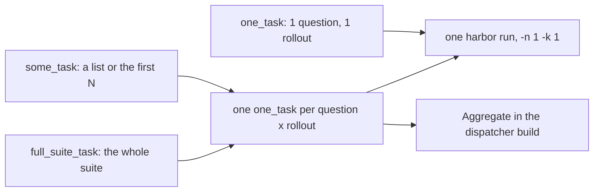
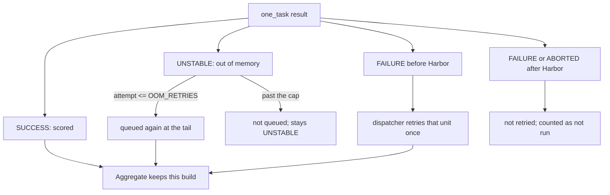

# Evaluation results

One Jenkins `one_task` build scores one question and one rollout. A headline number still needs `N_ROLLOUTS=4`: `some_task` or `full_suite_task` queues that many `one_task` builds per question and merges them. A single `one_task` build is a smoke test.



mac-k3d selects the question and prepares the worker. Harbor runs that one trial, applies `task.toml`, and grades. mac-k3d does not schedule containers. See [architecture.md](architecture.md#evaluation-architecture).

Release and git both mount the supplied iCode at `/opt/icode-host` and run the same single-shot `icode run` (one question × one rollout, no improve-loop). DeepSeek official API uses `ICODE_PROVIDER=DeepSeek` and `ICODE_REASONING_EFFORT=high` (wire fields `thinking.type=enabled` and `reasoning_effort=high`) unless those env vars are already set. `ICODE_API_BASE` is `https://api.deepseek.com/v1`. `ICODE_MODEL` is the catalog id (`deepseek-flash` or `deepseek-v4-pro`). The artifact `model` field is still `openai/<catalog id>` (catalog label, not the provider string). The `env` phase (`env/model_api`) still checks `GET https://api.deepseek.com/models` for that id.

iCode also gets `ICODE_MAX_TOKENS=65536` (output tokens per model reply) and `ICODE_MAX_ITERATIONS=500` unless those env vars are already set. These are the limits the iCode developers' own eval adapter uses. Without them iCode falls back to 8192 output tokens, which cuts a long `write_file` call off mid-JSON: in `deepswe_some_task` #4, ytt and ts-pattern both ended with an 8192-token reply and an empty patch. iCode still caps each continuation at 50 iterations (`ICODE_STREAM_ITERATION_CAP`). `eval_protocol.model_params` records both limits. A run from before they were set shows `-` there, and its cut-off check uses iCode's 8192 default.

**Kept different from the mentor's adapter on purpose.** mac-k3d sends the question unchanged and runs iCode once. The iCode developers' adapter (`agents/icode_agent.py`) also appends "Execution rules for this DeepSWE eval" to the question and runs a build check plus a forced fix turn afterwards. Both are help from outside iCode, so mac-k3d does not copy them, and its numbers are not directly comparable with tables from that adapter.

A headline number needs `N_ROLLOUTS=4` (the job default). A one-rollout run is a smoke test: one cut-off reply or one empty patch moves a question from 1 to 0.

After `icode run`, the Harbor agent force-commits a dirty git tree so DeepSWE can grade `git diff <base> HEAD` and LoLBench submit sees the same tree. That commit does not start another model call.

Each task's `cpus`, `memory_mb` and `storage_mb` come from its own `task.toml` and are **not** overridden: a DeepSWE task gets the 2 CPUs and 8 GB it declares, a LoLBench task gets its 4 CPUs. On Jenkins, Evaluate locks that many cores of this node and Harbor runs `-n 1`. A local run still sets `-n` from `cpu_cores / declared cpus`. The build fails before any container starts if this worker's CPU limit is below what the task declares. `artifact.json` records `resources.declared` against `resources.applied`. See [optimization.md](optimization.md).

Harbor’s agent budget is the task’s `agent.timeout_sec` (often 10800s on DeepSWE) with timeout multiplier 1. A rollout that ends near 5100s is iCode stopping itself, not Harbor cutting the trial.

The `report` phase stores `eval_protocol` on `artifact.json` (iCode mode, source, and `iCode under test`, model params, concurrency, `cpus_each`, the timeout note, `isolation`: what the agent could see at `/opt/icode-host`, and `env_check`: the image each question ran on and its first-time check). `provenance.md`, next to `summary.md`, prints all of it. `summary.md` and `report.html` keep a short Provenance block (pipeline commit, one line per worker, the environment check count, an isolation status) that links to `provenance.md`.

DeepSWE, LoLBench, and SWE-bench Pro all use this path. Question choice: a non-empty `TASKS` list wins; otherwise one `TASK`; otherwise `N_TASKS` is the first N sorted ids, skipping the first `TASK_OFFSET` of them. Full suite sizes are DeepSWE 113, LoLBench 20, and SWE-bench Pro 731. `N_ROLLOUTS` is how many attempts each question gets. Job default is 4.

## Which job to run

Three jobs per suite, nine in total:

| Job | Questions | Rollouts (default) | Use it for |
|---|---|---|---|
| `<suite>_one_task` | `TASK` | 1, editable | smoke test after a code change; cheapest proof the pipeline still works |
| `<suite>_some_task` | `TASKS` list, or first `N_TASKS` | 4, editable | comparing a handful of questions against a known-good result |
| `<suite>_full_suite_task` | whole suite | 4, editable | the real run |

`<suite>_one_task` is the only job that evaluates, and it is exactly one question and one rollout. `some_task` and `full_suite_task` are dispatchers on `agent none`: they queue one `<suite>_one_task` build per question and rollout, at most `MAX_IN_FLIGHT` of them in Jenkins at once (`0` means twice the online executors that can run the suite), and wait. Executors are `cpu_cores / cpus_per_executor` (default 2), so this PC (4 cores) runs 2 builds at once and the cloud worker (16 cores) can run 8. An OOM rollout is queued again at the tail, at most `OOM_RETRIES` times (default 2).



`some_task` and `full_suite_task` in git mode resolve the Jenkins form (branch, tag, commit, or pull request) once in a Pin iCode stage and pass that commit to every shard as `ICODE_GIT_SHA`. A direct `one_task` build leaves that pin empty and resolves the form itself. The report's identity line is `iCode under test`: `git <kind> <ref> -> <sha>` or `release <file> sha256 <hash>`. A worker workspace from a previous job is not an input.

When the shards are done, the same dispatcher build runs an `Aggregate` stage on a worker: it copies each shard's archived trials by build number and merges them. A shard archives only its own build's trials (`eval-runs/harness/harbor_runs/jenkins-<n>/`) and its anti-cheat verdicts (`eval-runs/harness/anticheat/`), not the earlier builds its workspace still holds.

The iCode transcript (`agent/icode-project/sessions/*/events.jsonl`) is about 56 MB of a 57 MB trial, and no metric reads it: `score_results` skips it, and the anti-cheat verdict is already in `agent/anticheat.json`. So the `archive/backup` step gzips each of this build's transcripts in place, with key-shaped values and secret env values masked (`archive_run.py compress --jobs-dir …`, about 7x smaller). The `Aggregate` stage copies the trials without `agent/icode-project/`, and archives `aggregate/` without `aggregate/harness/`, a second copy of the shards' trials. A full suite's download drops from about 26 GB to about 0.2 GB. The merged run's `provenance.md` names the shard builds that keep the transcripts: `Transcripts: in the shard builds' artifacts (deepswe_one_task #67, #68), gzipped under eval-runs/harness/harbor_runs/*/*/agent/icode-project`. The developer parameter `AGGREGATE_LABEL` picks the worker that merges; empty means `AGENT_LABEL`.

A shard's workspace is reused, so a shard build that stops early (for example in `env`) would otherwise ship the previous build's selection, inputs and verdicts. Two things stop that (`deepswe_some_task` #5, where shard #61 shipped build #58's files). First, `env.sh` deletes `eval_protocol_inputs.json`, `eval_resources.json`, `egress_probe.json`, `trial_network.json`, `selected_tasks*.txt`, `suite_tasks.txt`, `icode_git.json`, `icode_release.json`, `icode_bin_path.txt`, `icode_host_root.txt` and `harness/anticheat/{summary.json,report.md,anticheat.jsonl}` at the start of every build; `harness/anticheat_overrides.json` stays. `tasks/icode` deletes the two identity files again and writes only the one for this build's `ICODE_MODE`. Second, the dispatcher writes `shards/plan.txt`, one `index|build|result|offset|count|tasks|rollout|attempts` line per question and rollout (older lines omit the last two), and passes it to the merge with `--plan`. With a plan, a shard's `selected_tasks.txt`, `eval_protocol_inputs.json` and `eval_resources.json` count only when the inputs' `requester.build_url` names that shard's build, and its anti-cheat summary counts only when `harbor_runs/jenkins-<n>/` exists. Anything else prints `WARNING: shard <i> #<n> holds files from <url>; ignored`. Every plan line becomes a shard row, including a shard that archived nothing, and the questions of a shard with no trials count as missing in the report. Without `--plan` (an older dispatcher), every archived shard counts as before.

`full_suite_task`, and `some_task` with only `N_TASKS`, hand each shard a `TASK_OFFSET` slice instead of ids. `tasks/select` writes `suite_tasks.txt`, every task dir in byte order (`LC_ALL=C sort`), and slices it. The order is pinned because `en_US.UTF-8` sorts `sqlfmt-create-table-ddl-formatting` before `sql-formatter-bigquery-pipe-formatting`, so two workers in different locales could otherwise run one question twice and skip its neighbour. An offset shard archives that list. A shard given question ids does not: `selected_tasks.txt` already names them. When an offset shard runs nothing, the merge names its questions as `suite[offset:offset+count]` from the trusted shards' lists, and those questions count as missing like a named shard's. If the lists disagree, or no shard reached the tasks phase, the shard stays counted only, with a WARNING. A recovered question that another shard did run is flagged, because then the shards cut different slices. With a plan, the artifact's `coverage` block (`planned`, `with_trials`, `not_run`, `not_named`, `in_metrics`) gives the report a line under `Tasks with metrics`, and the same line appears under report.html's KPIs: `Coverage: 110 of 113 planned questions have trials; 3 not run (shard 5 jenkins-123 FAILURE)`. When some questions could not be named, it adds `…; 10 not named, so Pass@k covers 103 questions`, and the merge warns that the metrics do not cover the whole selection.

The merge writes one `artifact.json` / `summary.md` / `report.html` under `aggregate/`, archived on the dispatcher build with one combined `backup/<benchmark>/<RUN_GROUP>.tar.gz`. Verdict counts add; shard failures do not hide the shards that worked (`propagate: false`), so a partial suite still produces a report for what finished. If the shards ran different pipeline commits, the merged anti-cheat block is marked `status: mixed_versions` rather than silently averaged. There is no separate aggregate job.

**Build status.** A failure stays at the level where it happened:

- A rollout that failed (Harbor exception, OOM kill, missing `reward.json`) is listed under Unscored with its cause, or scored with the grader's result. Its `one_task` build prints `WARNING: <n> rollouts have no score (causes above; see Unscored in summary.md)` and keeps its result.
- A question that cannot run (a leak-scan hit, see [Leak scan](#same-protocol-for-every-benchmark-and-model); or no image that passed the [environment check](#environment-check-eval_protocolenv_check)) is skipped and named under `Questions without a score`; the shard runs its other questions.
- The dispatcher turns UNSTABLE only when a shard ended `FAILURE`, `ABORTED` or `NOT_BUILT`, and lists it under `Shards that did not succeed`. Its questions count as not run.
- A shard that ended `FAILURE` before Harbor started (no `harbor_runs/jenkins-<n>/`) is queued once more; the dispatcher prints `Retried once after failing before Harbor started: …`. The shard's post step sets `env.HARBOR_STARTED='1'` once that folder exists, and the dispatcher reads it from `run.buildVariables`. A shard that failed after Harbor started, or whose variables cannot be read, is never retried, so no token is spent twice. A user abort is never retried.

The merged `eval_protocol` starts from the protocol the first shard's own report phase wrote on its worker, so the iCode under test and model params are the ones that shard ran with. A shard whose report did not run falls back to its raw `eval_protocol_inputs.json`. The per-shard records are then merged from the shards whose own build ran Harbor:

- `isolation.leak_scan`: the union of `hit_tasks` and the sum of `statuses`. Each shard's `report_sha256` moves to its shard row as `leak_scan_sha256`.
- `isolation.canary`: `pass` only when every such shard recorded `pass`, `fail` when any shard failed (a stopped shard's failure counts too), `missing` when one has no record. Task, failed, warning, node and `fallback_from` lists are unions, and each shard row keeps its canary `status` and `summary_sha256`.
- `isolation.trial_network` (same pool): `free` is the smallest, and `need_by_shard` renders as `need 8 · 1 (by shard)`.
- `env_check`: one entry per merged question. When shards on different workers checked the same question, a pass wins over a fail. Each shard row keeps its own `env_check`, and `provenance.md` prints every shard's checks with a Worker column, so a question proven natively on a Mac and on the published image on Linux shows both, with their counts.
- `resources` and `doc["resources"]`: one node runs its shards one after another, so each node counts once (its largest plan), and nodes add up. Concurrency, `cpu_lock_qty` and the Timing line use the sum; the Resources line gets one sub-line per node. `declared.per_task` is the union, `peak` the maximum, `tasks` the sum.
- `container_mem_max_gb` is the largest shard peak, and `aggregate/container_mem.jsonl` keeps every shard's rows with a `shard` field. `skipped_questions` is the union of the shards' `skipped_tasks.txt`.

`eval_protocol.shards` keeps one entry per shard: `shard`, `builds`, `worker`, `resources`, `model_params`, `icode_version`, `egress_probe`, `trial_network`, `leak_scan_sha256`, `canary`, `env_check` (that shard's environment check per question) and `image_platforms` (the platform of each question's image). With a plan, each entry also has the shard's `result`, plus `not_run` (or `not_run_count` and `not_run_offset`) when it ran no trials. `provenance.md` prints one `Worker (shard N jenkins-M)` line for each, ending with that shard's `egress probe Harbor default <image>` or `egress probe substituted <image>`, then `trial networks <pool> /<prefix> (<free> free)` when that shard checked its trial subnets. A shard with no trials reads like `Worker (shard 2 jenkins-61): FAILURE before any trial · 2 questions not run: wazero-multi-module-snapshots, ytt-jsonpath-query-api`. The merged `Egress probe:` line appears only when every shard that recorded a probe used the same image, and the merged `Trial networks:` line only when every shard that checked used the same mode, pool and prefix. The image table lists only the merged questions; each shard's tasks phase also keeps only its own selection. `Requester` names the dispatcher build (`--build-url`) and the Jenkins user who started it (`--requester-user`). Every job sets `BUILD_USER` from `currentBuild.getBuildCauses('hudson.model.Cause$UserIdCause')`, which also covers an API token's owner for `mac-k3d eval --job`. A dispatcher forwards that user to its shards in the hidden `REQUESTED_BY` parameter. A build that no user started stays `unknown`, and `eval --local` records `local <login>`. The model label is `openai/<model>`, as in a single run's report. When the shards differ in model, API base, provider, reasoning effort, `max_tokens`, `max_iterations` or the iCode commit or release sha256, the merge sets `model_params_status: mixed`, lists the differences in `model_params_mismatch`, prints a WARNING, and adds a `Shards differ` line to `provenance.md` and to the short Provenance block. The short block has one `Worker <node> (shard N jenkins-M): os … · containers …` line per shard. A value a shard did not record, because it stopped before recording it, is unknown rather than different.

Merge an already-collected set of shards by hand:

```bash
python3 pipeline/lib/aggregate_runs.py \
  --shards <dir of shard eval-runs trees> \
  --benchmark deepswe --run-group deepswe_full_suite_task-7 \
  --n-rollouts 4 --out aggregate
```

Add `--plan <dir>/plan.txt --build-url <dispatcher build URL> [--requester-user <user>]` to apply the own-build checks and the coverage line above. In that case each shard tree must sit at `<dir>/<build>/eval-runs`.

## Same protocol for every benchmark and model

A score measures the iCode harness only if every run sees the same rules. So every security, anti-cheat and run control below applies identically to DeepSWE, LoLBench and SWE-bench Pro, and to every LLM. When you compare models, change only `DEEPSEEK_MODEL` / `ICODE_MODEL`; everything else stays fixed and is recorded in `eval_protocol`.

**Rule for changes:** a new control is added for all suites or not at all. A per-suite exception needs a written reason in this section and a matching test. Do not switch a control off to make one suite pass.

| Control | What the pipeline does (step in [pipeline.md](pipeline.md#steps)) | Code |
|---|---|---|
| iCode under test | Git (`pr`, `branch`, `tag`, or `commit`; defaults stay PR 2 of the gitcode URL) or a release drop. The resolved SHA, or the release file's sha256, is printed as `iCode under test:` before the canary and recorded in `provenance.md`. Nothing is pinned to one commit | `icode_input.sh`, `tasks/icode` |
| Runtime stripped of deliverables | Removes `test/`, `idlelib/idle_test`, vendored `tomli` and `backports.zoneinfo`. Replaces the stdlib `tomllib` (the `cpython_5` deliverable) with a `.pyc`-only stub that imports but refuses to parse, because iCode's `alembic` imports `tomllib` on Python 3.11+. `zoneinfo` stays importable as `.pyc` only | `icode_sanitize.py` |
| Sourceless stdlib | The mounted sandbox CPython keeps `.pyc` only, so no stdlib `.py` is readable at `/opt/icode-host`. On for every benchmark | `ICODE_SOURCELESS_STDLIB` (see below) |
| No iCode Python paths in the agent's shell | The launcher exports no `PYTHONPATH` or `VIRTUAL_ENV`; iCode's own interpreter gets its paths from `icode-host.pth` | `icode_input.sh` |
| Runtime still starts | Host probe on the sanitized tree, before any rollout: `icode --help`, a pydantic model build, and an import of the modules `icode run` loads (`agent.factory`, `host.bootstrap`) | `icode_probe_sandbox` |
| One read-only mount | The only agent mount is the iCode tree at `/opt/icode-host`, `read_only: true`. `tasks/isolation` refuses a tree that is, contains or sits inside a benchmark or tasks folder | `agent_mounts.py` |
| Leak scan | Gold lines of every selected task are searched in the mounted tree (`anticheat_leakscan.json`). A hit question is skipped: `tasks/leakscan` writes it to `eval-runs/skipped_tasks.txt` (`<task>\tleak scan hit`), the `evaluate` phase leaves it out of the canary and of Harbor, and the other questions run. The run stops only when every selected question is hit | `anticheat_leakscan.py`, `leakscan.sh` |
| Network allowlist | The agent may reach only the hosts in `pipeline/config/network-allowlist-v1.json` (`--allow-agent-host`); `tasks/isolation` checks that the model API host is on it and records the list version, hosts and file hash in `eval_protocol.isolation.network_allowlist` | `network_allowlist.py` |
| Secrets | Only `DEEPSEEK_API_KEY` reaches the agent, through a 0600 file it loads and deletes before iCode starts, never a command line or exec environment. Clone tokens are unset before Harbor and never written to `.harbor-env`, which is removed when the step ends | `evaluate/harbor_cmd.sh`, `icode_harbor_agent.py` |
| Anti-cheat verdict | The `anticheat` phase gives every rollout `clean`, `flagged` or `rejected` from line/path Jaccard against the gold patch and a transcript scan (mounted-runtime reads, filesystem searches, network and retrieval tools, git archaeology, gold and grader paths). A rollout with no patch, no transcript and no `reward.json` never ran, so it is `not_run`, with Harbor's exception as the reason (`Not run` table in `harness/anticheat/report.md`); a reviewer cannot decide `not_run`. The `report` phase scores `rejected` as unresolved with F2P/P2P zeroed, so `artifact["icode"]` is official and `artifact["icode_raw"]` keeps the raw numbers. Thresholds and rules: `pipeline/config/anticheat-v1.json`; reviewer decisions: `anticheat_overrides.json`. Every run requires the verdicts | `anticheat_verdict.py` |
| Declared base commit | `anticheat/receipts` compares each trial's capture receipt against the base commit the task declares and flags `base_commit_mismatch` when the agent started somewhere else. The check runs on the host because the agent env deliberately does not carry the declared base | `capture_receipt.py` (`base_mismatch`) |
| Pinned pipeline | The pipeline is the one embedded in the worker's `mac-k3d`, and `eval_protocol.pipeline` records its `commit`, `dirty` and `pipeline_hash`. Every Jenkins build extracts it with `--require-clean` (no dirty build, no unknown commit), and an aggregate whose shards ran different pipelines is `pipeline_status: mixed`, which the report check rejects | `jenkins_job.rs` (`eval_bootstrap_sh`), `eval_assets.rs`, `check_report.py` |
| Isolation canary | Before the rollouts, `evaluate/canary` runs `CanaryAgent` with iCode's exact mounts, env and Harbor flags, but no model. In each task container it probes 13 source hosts (must be blocked), the model API (must answer), the task's declared hosts (a reached one warns), a filesystem search for the task's gold file names outside the repo, which fails only when a file has the same contents as a gold file (a shared filename does not), writes to `/opt/icode-host` as the agent and as root, git history beyond `HEAD`, env names that look like secrets, `PYTHONPATH`/`VIRTUAL_ENV`, and the iCode home before and after install. Any failed check stops the run before a token is spent. When a question's canary trial never reaches the probe (no `canary.json`, for example after an image pull failure), the canary moves to the next question and records the skipped one under `fallback_from`; when no question starts, the run stops, because isolation is not proven. Every scored run runs it once per shard | `canary_verdict.py`, `canary_probe.sh` |
| Model protocol | Same `ICODE_PROVIDER`, `ICODE_REASONING_EFFORT`, `ICODE_API_BASE`, `ICODE_MAX_TOKENS` and `ICODE_MAX_ITERATIONS` defaults for every suite | `evaluate/harbor_cmd.sh` |

Sourceless stdlib stays on for every benchmark. `ICODE_SOURCELESS_STDLIB` no longer turns it off.

The isolation canary runs once per shard on every scored build, before any rollout. There is no Jenkins field for it. `CANARY=only` and `CANARY_ALLOW_HOST` exist only as environment variables for `bash pipeline/tools/canary.sh` on a worker: `only` runs the canary on every selected task and then stops, with no rollouts and no model tokens. A scored run refuses `CANARY_ALLOW_HOST` and any `CANARY` value other than unset or `on`.

`CANARY_ALLOW_HOST=<host>` opens one host for that canary-only check, to prove the canary fails. The canary then fails either way: `<host> reached (HTTP …)` is the proof, while `negative test inconclusive` means the opened host never answered, so choose a host this worker can reach. The model API gets 3 tries of 30 s each before `model_api` fails. If it still fails, test HTTPS from a plain container: a VPN tunnel with a smaller MTU than Docker's bridge stalls every TLS handshake, and the `env` phase and the evaluate steps print `WARNING: egress via … has MTU …` when they detect one. The report is `eval-runs/canary/jenkins-<BUILD_NUMBER>/report.md`; each failure prints a `CANARY FAIL task=… check=…` line. Rules and host lists: `pipeline/config/canary-v1.json`.

The canary skips one check: iCode PR 2 has no command that lists its enabled tools, so `tool_list` is `skip`. Web tools are still covered by the network check and by the transcript scan in the `anticheat` phase.

### Recorded proof: `eval_protocol.isolation`

Every run records the controls above in `eval_protocol.isolation` (in `artifact.json`, and as the Isolation, Agent mount, Leak scan and Canary lines of `provenance.md`, with its task image table). `summary.md` and `report.html` end with the short Provenance block after Unscored: `Isolation: mode git · canary pass · leak scan no hits`, and the link to `provenance.md`. `summary.md` ends with the Anti-cheat line. `tasks/isolation` hashes the tree itself when it records them, so the values describe the runtime the agent actually got rather than what the sanitizer claimed.

| Field | Meaning |
|---|---|
| `mode` | `git` (sanitized sandbox CPython) or `release` (binary only, nothing to sanitize) |
| `sanitizer` | Sanitizer version, for example `mac-k3d-icode-sanitize-v3` |
| `sourceless` | `true` when the mounted stdlib has no `.py` files |
| `removed` | How many deliverable paths the sanitizer removed |
| `runtime_sha256` | Fingerprint of the mounted runtime that is the same for every clone of one iCode commit, whatever the workspace path or file times. **Compare this one across runs** |
| `tree_sha256` | Exact bytes of `.venv`. It differs per workspace, because uv writes the clone path into `.venv/bin`. Use it only within a run |
| `manifest_matches_tree` | `true` when both fingerprints still equal what the sanitizer wrote, so nothing changed the tree after sanitizing |
| `mount` | Count, target and `read_only` of the agent mounts |
| `leak_scan` | Scanner version, `hit_tasks`, task counts per status, and the sha256 of `anticheat_leakscan.json` |
| `canary` | Canary rules version, `status`, the tasks it ran on, `failed_tasks`, `warn_tasks`, worker node, and the sha256 of its `summary.json`. A scored run requires `status: pass` |

`runtime_sha256` reads the clone path as `/opt/icode-host` and leaves out what the container never uses: `pyvenv.cfg`, `__pycache__/`, links that leave the tree, and install bookkeeping (`*.dist-info/RECORD`, `uv_cache.json`). Stdlib bytecode is compiled with hash-based invalidation and container paths, so it is byte-identical on every clone. Two independent PR 2 clones (the DeepSWE and LoLBench Jenkins workspaces) gave the same `runtime_sha256`.

**Two runs are comparable** only when they have the same iCode identity (the git SHA, or the release sha256), the same model protocol, one read-only mount and no leak hit among the questions that ran. A git run also needs the same `sanitizer` and `runtime_sha256`, with `sourceless: true` and `manifest_matches_tree: true`. `check_report.py` rejects an artifact that breaks a per-run rule: isolation mode `git` or `release`, one read-only mount, a leak scan with no hit question that still has trials, canary `status: pass`, anti-cheat ran, and a clean pipeline that is not `mixed`. Git mode also requires the sanitizer, sourceless stdlib, both fingerprints and a matching manifest. Release mode requires `eval_protocol.icode.release.sha256`. A merged report passes the hash checks when every shard that ran Harbor carries its own `leak_scan_sha256` and canary `summary_sha256` in its shard row. Shards that resolved different iCode commits or release sha256 values are `model_params_status: mixed`, and the dispatcher console prints `iCode under test (N shards): MIXED: …`. Matching `runtime_sha256` between git runs is checked by comparing their artifacts.

A tree sanitized by an older sanitizer version has already lost its stdlib sources, so it cannot be re-sanitized in place. `tasks/icode_sandbox` then copies the sandbox CPython again from the host interpreter and sanitizes it fresh (the console prints `re-embedding … for the current sanitizer`). Paths already removed outside the sandbox stay listed in the manifest.

**Allowed differences** come from the task, not from the harness: the task image, the agent timeout (`agent.timeout_sec`), the verifier and its declared network, the task path and working folder, LoLBench's `LOLBENCH_SUITE=union` verifier variable and its reward overlay, and the per-suite memory fallback for packing ([optimization.md](optimization.md)).

**Limits to keep in mind:**
- SWE-bench Pro tasks carry no `solution/solution.patch`, so the leak scan reports them as `no_gold` and cannot prove them clean. Every other control still applies.
- Release mode (`ICODE_MODE=release`) mounts only the binary, so there is no sandbox CPython to strip. The drop's sha256 is the version in `provenance.md`. Git mode records the resolved commit.
- SWE-bench Pro has no gold patch, so its verdicts rest on the transcript scan alone (`similarity.status: no_gold`).
- Rescore an old run without changing it: `python3 pipeline/lib/anticheat_verdict.py --run-dir output/<suite>/<run> [--harbor-runs <jenkins harbor_runs/jenkins-N>]`. It writes `artifact.anticheat.json` and `anticheat/report.md` next to the original. Runs from before the anti-cheat scan (report item P0.5) keep their transcripts only in the Jenkins workspace, hence `--harbor-runs`.
- The canary proves isolation on the tasks it ran on, on that worker. `CANARY=on` covers only the first selected task whose trial started; run `CANARY=only` on the whole suite after a Harbor, Docker or kernel change.
- LoLBench task allowlists declare `openrouter.ai`, `api.openai.com` and `api.anthropic.com` for the agent phase. The canary warns when they are reachable; closing them needs a versioned task overlay (tracked in the integration log).
- **Harbor has no contamination gate.** `harbor job summarize` is a removed shim that only prints a deprecation notice, and `harbor analyze` is rubric-only. Neither reads the gold patch, scans a transcript for leakage, or can reject a trial. Every control in this table is therefore mac-k3d's, and delegating scheduling to Harbor did not delegate integrity.
- The environment check below runs for DeepSWE only, as a written exception to the rule above. It proves the task image, not the harness, and its pass rule reads the F2P/P2P counts of DeepSWE's grader. DeepSWE is also the only suite where an arm64 worker swaps the published image for its own build. LoLBench's native builds are not proven this way yet, and SWE-bench Pro runs its published images as they are. The test is `test_images_and_env_checks_must_match_the_task_containers` in `test_report.py`.

### Environment check: `eval_protocol.env_check`

Before any rollout, `tasks/images` proves the image each DeepSWE question will run on, on that worker ([pipeline.md](pipeline.md#deepswe-on-linux-and-macos) has the image choice per host). Harbor's oracle agent applies the reference solution: every fail-to-pass (F2P) test must pass, there must be at least one, and every pass-to-pass (P2P) test must pass. Then its nop agent changes nothing: at least one F2P test must fail, and every P2P test must still pass. No model is called. A patch that does not apply (`apply_failed`), a crashed verifier (`reward.txt` `-1`), a missing `reward.json` or a timeout is a fail. The answer is stored on the worker under `$MAC_K3D_SHARE/env-check/deepswe/<id>.json` and reused while the image id, the task files, `HARBOR_VERSION` and (for a native build) the Dockerfile and the base digest stay the same.

A question with no image that passed is kept out of Harbor: its reason goes into `skipped_tasks.txt` (for example `environment check failed: oracle f2p 35/37 on published linux/amd64`), and the report lists it under `Questions without a score` and in `provenance.md` under `Kept out of Harbor`. The build fails only when every selected question is out.

`eval_protocol.env_check[<id>]` records, for each scored question:

| Field | Meaning |
|---|---|
| `source` | `published` (the image `task.toml` names) or `built` (a native build of `environment/Dockerfile`) |
| `platform` | The platform the check ran on, for example `linux/arm64` |
| `image`, `image_id` | The official name the trials used, and the image id that was checked |
| `pass`, `reason` | The verdict, and why it failed |
| `oracle`, `nop` | `f2p_passed`, `f2p_total`, `p2p_passed`, `p2p_total` and `reward` from each agent's `reward.json` |
| `checked_in`, `checked_at` | The build that ran the check (`deepswe_one_task#12`, `local#0`) and when |
| `reused` | `true` when this build reused the stored answer instead of running Harbor |
| `dockerfile_sha256`, `base_image` | A native build only: the Dockerfile's sha256 and the pinned base (`DEEPSWE_BASE_IMAGE`) |
| `attempts` | Earlier tries in the same build, for example a native build that failed before the published image passed |

`eval_protocol.images[<id>].platform` is the platform of the image the trials used (`docker image inspect`). `provenance.md` prints the check as an `## Environment check` table (Task, Worker, Source, Platform, Image, oracle F2P, oracle P2P, nop F2P, nop P2P, Result, Checked in, Reused). The short block in `summary.md` and `report.html` reads `Environment check: N of T passed (M reused, K kept out)`.

`check_report.py` fails a run when:
- a scored DeepSWE question has no passing `env_check`;
- a passing check ran on another platform than the task containers (`container_platform.json`);
- the image of a scored question has another platform than the task containers. A merged run checks this per shard, against that shard's worker.

To compare a Mac with a Linux worker, read the check counts and rewards in both `provenance.md` files, not the image digests: a native build has its own digest, and an equal grade on the same tests is the proof that it is the same environment.

## Where a run is stored

The `report` phase writes one folder per run under the Jenkins workspace (or `eval-runs` for a local stage run). The folder holds the report files, and also `container_mem.jsonl` and `skipped_questions.txt` when this build wrote them:

```text
eval-runs/output/<benchmark>/jenkins-<BUILD_NUMBER>-<UTC>/
  artifact.json
  summary.md
  report.html
  provenance.md
  cost-token-report.md   (archive phase)
  container_mem.jsonl
  skipped_questions.txt
```

Example: `eval-runs/output/deepswe/jenkins-23-20260923T052713Z/artifact.json`. Jenkins archives that folder and the backup `.tar.gz` described below. Older build pages stay downloadable. A local stage run with no `BUILD_NUMBER` names the folder `<UTC>-<task>` or `<UTC>-n<count>`. `report.pdf` and the long `eval-icode-deepseek-...json` name are not written.

The `archive` phase adds `cost-token-report.md`, then packs the same files plus `tasks.txt`, the anti-cheat verdicts and the per-question trial files into one gitignored archive so a workspace wipe does not remove them:

```text
output/<benchmark>/jenkins-<BUILD_NUMBER>-<UTC>.tar.gz
  <folder>/artifact.json
  <folder>/summary.md
  <folder>/report.html
  <folder>/provenance.md
  <folder>/cost-token-report.md
  <folder>/tasks.txt
  <folder>/icode/<task>/attempt-01/   result.json, reward.json, usage, patches
```

Extracting the archive recreates `<folder>/`. The checkout `output/` directory and the benchmark folder are created when missing. One local question is named like `20260923T023527Z-abs-module-cache-flags.tar.gz`. Several questions use `<UTC>-n<count>.tar.gz`, and `tasks.txt` lists every id. The root is the pipeline's own folder: `$WORKSPACE/mac-k3d-pipeline/output/` on Jenkins (kept across builds), the checkout `output/` for a local run. `MAC_K3D_BACKUP_ROOT` or `MAC_K3D_OUTPUT_ROOT` overrides it. The archive does not include `.harbor-env` or the API key. A `one_task` build also archives it, so it downloads from the build page (**Build Artifacts**). A shard build does not: its `some_task` or `full_suite_task` dispatcher packs the merged `aggregate/` folder once, as `backup/<benchmark>/<RUN_GROUP>.tar.gz` with the same layout under `<RUN_GROUP>/`. That combined archive has every trial file except the transcripts, which stay gzipped in the shard builds named on the `Transcripts:` line of `provenance.md`. Jenkins keeps every build's archived files.

A transcript in a backup is `events.jsonl.gz`, masked: the archive step gzips each plain `events.jsonl` with key-shaped values and secret env values replaced by `***`, and copies one that `archive_run.py compress` already packed as it is.

The JSON is the source for `summary.md` and `report.html`. The harness arm is `icode`. `summary.md` labels the run `<suite>-<build>` (for example `deepswe-25`) and points at `output/<suite>/<folder>.tar.gz`. `pass@1` is the share of questions whose oldest attempt resolved. `pass@k` is the share with at least one resolved attempt in the first k attempts. `macro_pass@1` is the mean of each question’s `c/n`, which is a different number from `pass@1`. `best_attempt_hits` is how many questions had a resolved best attempt. `infra_excluded` is how many selected questions had no trial at all (`questions with no trial` in `summary.md`). `tokens.avg_total_per_task` is `tokens.total` divided by tasks that reported tokens. `dur_s` on a question is the best attempt’s Harbor agent span (`agent_execution` finished minus started, otherwise the trial span, otherwise the chat `usage.json` duration). `timing.wall_seconds` is the span from the earliest attempt start to the latest attempt finish.

## What the fields mean

Pass@k is stored twice. `pass@k` / `macro_pass@1` / `c` / `n` / `pass_frac` are **padded**: a missing attempt counts as not resolved and `n` is `N_ROLLOUTS`. `pass@k_scored` / `macro_pass@1_scored` / `c_scored` / `n_scored` / `pass_frac_scored` are **scored-only**: the denominator is attempts that have a `reward.json`, missing attempts are omitted, and a question with `n_scored == 0` is dropped from that ladder. `pass_methods` on the arm repeats those two formulas. If `N_ROLLOUTS` is k, each arm stores Pass@1 through Pass@k for both methods.

| Field | Meaning |
|-------|---------|
| `c` / `n` | Resolved attempts / requested attempts for that question (padded). |
| `c_scored` / `n_scored` | Resolved attempts / attempts that have a verifier result. |
| `pass_frac` | `c/n`. Macro Pass@1 is the mean of these fractions. |
| `pass_frac_scored` | `c_scored/n_scored`. `macro_pass@1_scored` is the mean of these, over questions with `n_scored > 0`. |
| `first` | The oldest attempt resolved. First-rollout Pass@1 is the share of questions where this is true. |
| `best` | Any attempt resolved. Any-pass is the share of questions where this is true. |
| `reward` | 1 when `best` is true, otherwise 0. |
| `f2p`, `p2p`, `partial` | Rates from the best attempt (resolved, then highest partial). For an empty patch `p2p` and `partial` are null, so the macro and micro P2P and partial averages skip that question. |
| `f2p_pass` / `f2p_total`, `p2p_pass` / `p2p_total` | Counts from that same attempt. Micro rates sum these counts across questions. Micro partial uses only questions that have both F2P and P2P counts. `summary.md` and `report.html` label macro and micro `best rollout per question`. |
| `micro_all` | On the arm: `rollouts`, and F2P/P2P rates and counts summed over every scored rollout, not just each question's best. `summary.md` prints it as `Micro (all N scored rollouts)` under the best-rollout lines; `report.html` as `Micro F2P (all scored rollouts)`. An empty-patch rollout adds its F2P counts but no P2P. |
| `grader_p2p_pass` / `grader_p2p_total` | Present when the best attempt left an empty patch: what the grader reported for P2P on the unchanged repo. DeepSWE runs the base repo's tests and reads N/N; LoLBench reads 0/N because nothing applied. Recorded, never averaged. The `p2p` cell in `summary.md` reads `excluded (grader k/n)`. |
| `p2p_excluded_empty_patch` | Questions left out of the P2P and partial averages because their best attempt left an empty patch. `summary.md` adds a line saying so when it is above 0. |
| `tok_in` / `tok_out` | Sum of tokens across that question’s attempts. |
| `dur_s` | Duration of the best attempt, in seconds. For a Harbor trial this is the agent execution span. |
| `notes` | `empty model.patch`, `infra: model API error (<marker>)`, `infra: no model call completed`, `last reply cut off at max_tokens`, `anticheat rejected`, or `missing reward.json`. A trial with no `reward.json` whose `result.json` holds Harbor's `exception_info` adds why Harbor stopped it: `infra: Docker network pool exhausted` (`fully subnetted`), `infra: Docker image store damaged` (snapshot errors), `infra: image pull failed`, `infra: out of memory (OOM-killed)`, `infra: docker compose failed`, otherwise `infra: <exception type>`; that rollout gets `infra_failure: true`. A rollout whose iCode exited 137 (SIGKILL, most often the trial container's memory limit) gets `iCode killed (exit 137, likely out of memory)` and stays scored: capture and the verifier still ran, so the grader's result stands. A rollout whose verifier log contains `[build failed]` or `FailedBuild` gets `suite did not compile (tests did not run)` and stays unsolved: the reward, F2P and P2P the grader wrote stay in the table, and the note says those tests never ran. Each distinct note appears once per question; with more than one rollout it reads `empty model.patch (k/n)`, k rollouts out of n. `-` when there is nothing to say. |
| `concurrency` | Max live Harbor containers in the slot pool. Stored once on the run, not again inside each arm. Packing is in [optimization.md](optimization.md). |
| `any_pass` | Share of questions with any resolved attempt. Same rate as padded `pass@k` when k is the rollout count. |
| `unscored` / `unscored_frac` | No-response attempts for that question / `n`. A missing `reward.json` is unscored, not a scored fail. |
| `scored_rollouts` | Rollouts with a verifier result that counts (`reward.json` present, no infra failure). `summary.md` prints `scored rollouts: S · unscored rollouts: U`; on a finished run S + U is questions × `N_ROLLOUTS`. |
| `unscored_rollouts` | Sum of per-question `unscored`. `report/render` writes it to `eval-runs/unscored_rollouts.txt` and, above 0, prints `WARNING: U of T rollouts have no score (<causes>); see Unscored in summary.md`. The build result stays as it is (see Build status under [Which job to run](#which-job-to-run)). |
| `oom_killed` / `oom_killed_rollouts` | On a rollout whose iCode exited 137 or whose Harbor exception names an out-of-memory kill; the count across the arm. `summary.md` prints `OOM-killed rollouts (iCode exit 137 or the container ran out of memory): N`, `report.html` adds `OOM-killed rollouts N.` to its summary sentence when above 0, and `evaluate/harbor_run` prints `WARNING: N trials ran out of memory (…): <trials>`. Each trial container has the task's memory limit (`task.toml`, 8192 MB for DeepSWE), so the kill stays inside that trial. |
| `skipped_questions` | `<task>: <reason>` per question the run skipped (no image that passed the environment check, or a leak-scan hit), from `eval-runs/skipped_tasks.txt`; also written as `skipped_questions.txt`. `summary.md` prints `Questions without a score: N — <task> (<cause>) · …`, naming skipped questions and questions none of whose rollouts were scored, with the cause from the skip or from the rollouts' notes. Those questions are also rows in the Unscored table of `summary.md` and `report.html`. Skipped questions stay in `selected_tasks.txt`, so padded Pass@k counts them as failed and scored-only Pass@k leaves them out. |
| `unscored_tasks` | Questions with `unscored > 0`, highest `unscored_frac` first. Clean questions are omitted. |
| `pass_methods` | `padded` and `scored` formula strings for the two Pass@k families. |
| `timing.eta_note` | Present only when the report covers an incomplete Harbor run (`progress.json` `done < needed`). A finished run does not invent an ETA. |
| `tokens.total` | `in` plus `out`. |
| `rollouts` | One object per attempt. Each has `trial` (the Harbor trial folder), `model_calls` and `last_output_tokens` (from iCode's final usage line), and `icode_exit` (from `agent/icode-exit.txt`), plus `cut_off_reply`, `empty_patch` and `empty_patch_cause` when they apply. Omitted when every requested attempt exists and every one has F2P 1 and P2P 1. |
| `cut_off_reply` | On a rollout whose last model reply used all of `max_tokens` (`last_output_tokens >= max_tokens`). Set whether or not the rollout produced a patch. |
| `cut_off_rollouts` | Rollouts with `cut_off_reply`, across the arm. |
| `empty_patch_cause` | Why a rollout left an empty patch. `infra`: iCode completed no model call, or one of its error lines (`caught tool/runtime error`, `fatal provider error`) or its JSON `error` names a provider error (iCode's own `is_fatal_provider_error` markers such as insufficient balance, authentication, 401, rate limit, plus connection errors and timeouts). The final `result` text is the model's own words and is never searched, and a filesystem error quoting the model's file content does not count. The rollout gets `infra_failure: true` and is unscored. `cut_off`: the last reply hit `max_tokens`. `no_edit`: iCode ran and changed nothing. `cut_off` and `no_edit` are scored fails. |
| `empty_patch_rollouts` / `empty_patches` | The count, and one entry per empty-patch rollout in question then rollout order: `id`, `rollout`, `trial`, `cause`, `icode_exit`, `model_calls`, `last_output_tokens`, `tok_in`, `tok_out`, `dur_s`, `f2p_pass`, `f2p_total`, `grader_p2p_pass`, `grader_p2p_total`. Built before all-perfect questions drop their `rollouts`. Not repeated in `icode_raw`. |

`n_tasks`, `n_rollouts`, `concurrency`, and `cpus_each` are stored once at the top of the JSON. `eval_protocol` records iCode under test, `provider`, `reasoning_effort`, `thinking.type`, `max_tokens`, `max_iterations`, and the CPU lock actually used. A merged run adds `eval_protocol.shards` and `model_params_status` (see [Which job to run](#which-job-to-run)).

**Empty patch section.** An empty patch means the capture receipt (`agent/capture.json`) recorded 0 bytes: iCode left the repo identical to its base commit, and the grader tested the unchanged repo. Its F2P still counts as a fail, because the bug is not fixed. Its P2P does not say anything about iCode, so it is recorded and kept out of the averages. `summary.md` lists the counts after the Best-attempt line (`Empty model.patch (repo unchanged after iCode): N of M rollouts (infra a · cut_off b · no_edit c)` and `Cut-off replies (last reply hit max_tokens): N rollouts`), then a `## Empty patch: iCode left the repo unchanged` table after the per-question table with Task, rollout, trial, cause, iCode exit, model calls, last reply tokens, tok_in/out, dur_s, F2P and P2P (grader). With none it prints `empty-patch rollouts: 0`. `report.html` has the same section before Unscored (`None` when empty) and both counts in its summary sentence. The band next to macro Pass@1 is `macro_pass@1_ci`, a 95% confidence interval half-width of the mean of the per-question `c/n` values: `1.96 * sample_sd / sqrt(M)`. `macro_pass@1_scored_ci` is the same for `pass_frac_scored`. Fewer than two questions has half-width 0.

CPU slot packing, the open slots, and the disk floor are in [optimization.md](optimization.md).

## Cost and token report

The `archive` phase writes `cost-token-report.md` into every run folder from that run’s `artifact.json` (list-price estimate, not DeepSeek’s invoice) before packing it. For an older run, or to re-run it, call the script directly:

```bash
cd /path/to/mac-k3d

# Explicit folder (loose extract or workspace copy)
python3 pipeline/lib/cost_token_report.py \
  --run-dir output/deepswe/jenkins-37-20260927T153132Z

# Suite + Jenkins build number (searches output/ and eval-runs/output/)
python3 pipeline/lib/cost_token_report.py --suite deepswe --build 37

# Suite + full folder stem
python3 pipeline/lib/cost_token_report.py --suite lolbench --run jenkins-21-20260929T010830Z

# Compressed backup only
python3 pipeline/lib/cost_token_report.py \
  --tar output/deepswe/jenkins-37-20260927T153132Z.tar.gz
```

Default output is `<run-dir>/cost-token-report.md`. Override with `--out PATH`. A failure here prints a warning and does not stop the backup.
