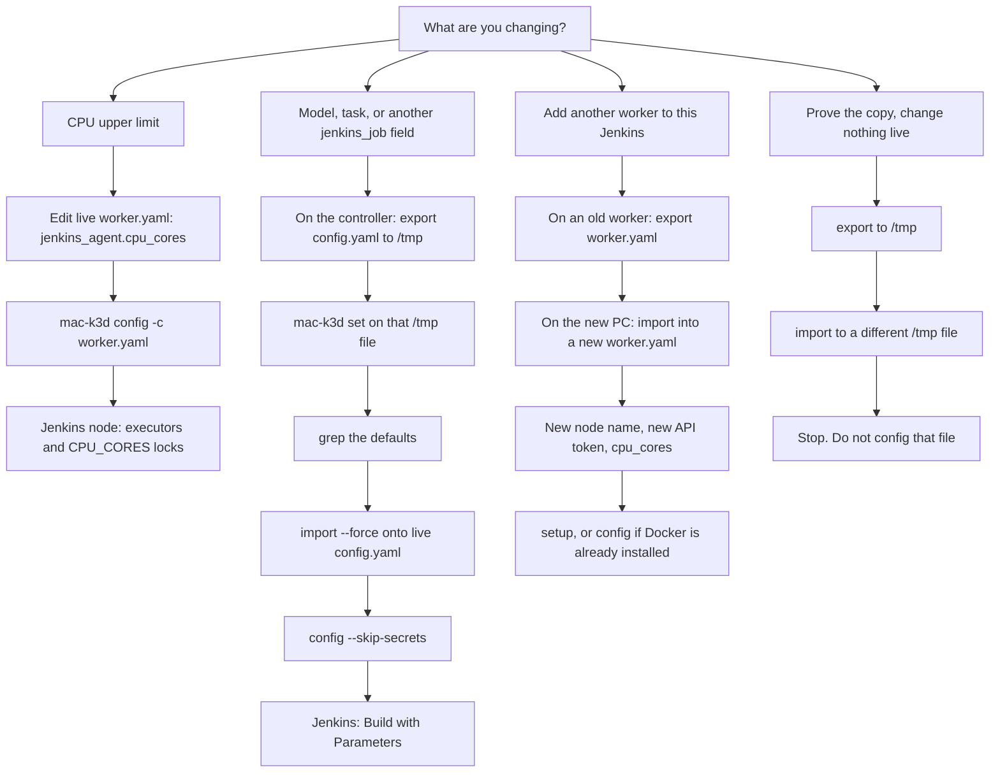
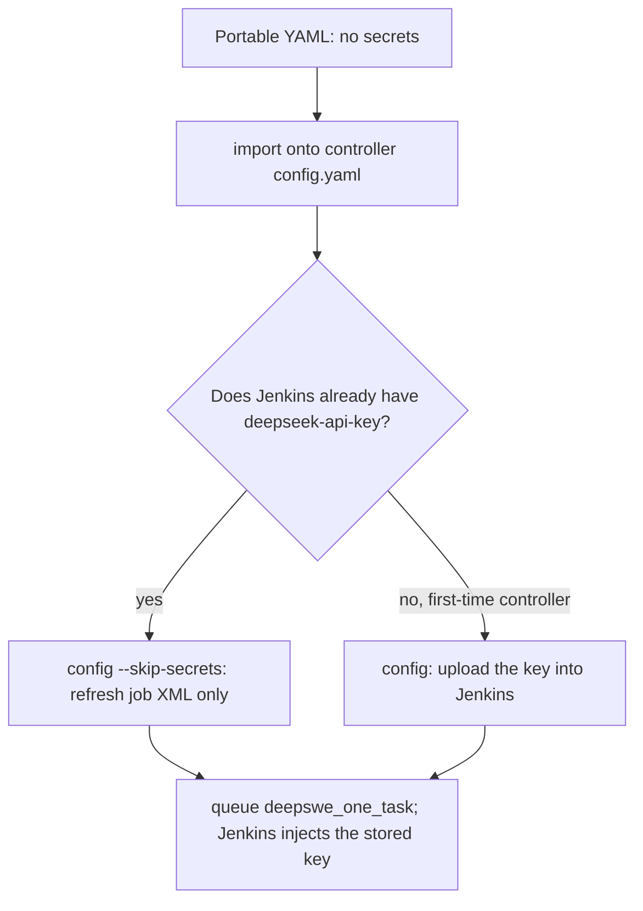

# Export and import config YAML

Copy **one** live config (controller **or** worker) onto another machine or a scratch file. Import is **write only**: it does not start Docker, k3d, or Jenkins, and it does not clone a ready machine. It keeps the lab answers you would otherwise retype (URL, labels, job defaults).

A controller's file is `~/.config/mac-k3d/config.yaml` on the controller; a worker's is `~/.config/mac-k3d/worker.yaml` on that worker. Export on the machine that owns the live file. The commands are the same on Linux and macOS. This lab's machines and the runs checked there: [testing/cloud-eval-runbook.md](testing/cloud-eval-runbook.md#export-import-and-set-in-this-lab).

`mac-k3d set` is part of this flow. It is the editor for job fields. The flag list is below so this page is enough to change a model or a task. The same flags are also in [commands.md](commands.md).

Operator bootstrap: [user-guide.md](user-guide.md). Secrets: [secrets.md](secrets.md).

---

## Workflow



Import sanitizes again. A `cpu_cores` number typed into the exported file is written back as `0`. The CPU limit is an edit of the **live** worker file, then `config`. Model, task, UI profile, in-flight cap, and OOM retries are `jenkins_job` fields: `set` them on a controller scratch file, import that file, then `config --skip-secrets`.

| I want to… | File | Commands |
|------------|------|----------|
| Change a worker's CPU limit | Live `worker.yaml` | Edit `cpu_cores`, then `config`. No export |
| Change default model or TASK on this Jenkins | Controller `config.yaml` | Export, `set`, import `--force`, `config --skip-secrets` |
| Add another eval PC | `worker.yaml` | Export on the old worker, import on the new PC |
| Stand up a new Jenkins server | `config.yaml` | Export on the old controller, import, then `setup` |
| Prove sanitization | `/tmp` only | Export, import to another `/tmp` path, stop |

Do not import a controller file onto `worker.yaml`, or the reverse. Omitting `-c` on import: `role: worker` goes to `~/.config/mac-k3d/worker.yaml`, otherwise `config.yaml`.

`set` on a worker file does not change Jenkins. Job defaults are read from the controller file.

---

## Binary

Use the installed binary, `~/.local/bin/mac-k3d` (`/root/.local/bin/mac-k3d` on a controller run as root).

```bash
ls -l ~/.local/bin/mac-k3d
~/.local/bin/mac-k3d --version
```

A missing file is why `MAC=/tmp/mac-k3d-export` fails with `No such file or directory`. That path exists only after you copy a binary there. Redeploy installs `~/.local/bin/mac-k3d`; point `MAC` at that.

```bash
MAC=$HOME/.local/bin/mac-k3d
```

---

## `set`

`mac-k3d set` edits **non-secret** `jenkins_job` fields on the YAML you pass with `-c`, then saves that file. It does not upload credentials, start Jenkins, or queue a build. Unknown catalog ids are rejected with `allowed: …`.

Use it on the **scratch** file from `export`, then `import`. Do not `sed` `default_task`.

```bash
MAC=$HOME/.local/bin/mac-k3d
$MAC set --list
$MAC set -c /tmp/controller-lab.yaml --model deepseek-flash --benchmark deepswe --task vulture-persistent-analysis-cache
```

A successful `set` prints the fields it wrote and says `YAML only; secrets unchanged`. For example:

```text
Updated /tmp/controller-lab.yaml (YAML only; secrets unchanged).
  harness=icode  llm=deepseek  model=deepseek-flash  benchmark=deepswe
  task=vulture-persistent-analysis-cache
  ui_profile=developer  max_in_flight=0  oom_retries=2
```

`--task`, `--n-tasks`, and `--tasks` are mutually exclusive. `set` changes only the flags you pass. Flags you leave out stay as they were in that file, which is why `ui_profile`, `max_in_flight`, and `oom_retries` survived the example above.

A TTY with no flags asks for harness, LLM family, model, benchmark, then question mode. A non-TTY shell needs flags, or `--list` / `--check-models`.

| Flag | What it writes |
|------|----------------|
| `--list` | Print allowed harness / LLM / model / benchmark values and exit. Does not save |
| `--harness <ID>` | Catalog harness. v1: `icode` |
| `--llm <ID>` | Catalog LLM family. v1: `deepseek` |
| `--model <ID>` | DeepSeek Chat Completions id. `deepseek-flash` or `deepseek-v4-pro`. Not the product name `deepseek-v4.1-flash` |
| `--check-models` | `GET /models` with `DEEPSEEK_API_KEY` from the environment or `.env`. Fail if the YAML or `--model` id is missing. Does not save. Run this on a machine that has `.env`; a controller often has no key |
| `--benchmark <ID>` | `deepswe`, `lolbench`, or `swebenchpro`. Which suite's jobs receive TASK / N_TASKS / TASKS defaults |
| `--task <ID>` | One question id. Sets `default_task` and clears the list / first-N selection |
| `--n-tasks N` | First N sorted questions. Clears TASK and TASKS. `N>1` costs more LLM calls |
| `--tasks a,b` | Those question ids, comma-separated |
| `--ui-profile user\|developer` | `user` is the short job page. `developer` shows the same fields plus `AGENT_LABEL`, `AGGREGATE_LABEL`, the pins, canary, `MAX_IN_FLIGHT`, `OOM_RETRIES`, `TEST_MEMORY_MB`, and `TEST_MEMORY_ATTEMPTS`. Takes effect after controller `config --skip-secrets` |
| `--max-in-flight N` | Builds one dispatcher may have in Jenkins at once. `0` means twice the online executors for the suite |
| `--oom-retries N` | How many times an out-of-memory rollout is queued again. Default `2` (three tries in total) |
| `--icode-release PATH` | Worker iCode `*-full-*` drop. Writes `~/.config/mac-k3d/icode-paths.yaml`, **not** the file passed with `-c` |

`set` has no flag for `cpu_cores`. `TEST_MEMORY_MB` and `TEST_MEMORY_ATTEMPTS` are Jenkins build parameters. `set` does not store a number for them. `--ui-profile developer` is what makes those parameters visible.

Empty `TASK` + empty `TASKS` + `N_TASKS=1` selects the first DeepSWE directory after `sort`. `default_benchmark` selects which suite receives the question defaults. Every suite's jobs still get the harness, LLM family, and `DEEPSEEK_MODEL` choices.

After `set` on a scratch controller file, import and apply:

```bash
$MAC import /tmp/controller-lab.yaml -c ~/.config/mac-k3d/config.yaml --force
$MAC config -c ~/.config/mac-k3d/config.yaml --skip-secrets
```

`--check-models` on a machine with `.env`, before you copy a new model id up:

```bash
$MAC set --list
$MAC set -c /tmp/controller-lab.yaml --model deepseek-flash --check-models
```

To add a model id that is not in the catalog yet: copy `data[].id` from `GET /models`, append that exact string to `MODELS` in `src/eval_catalog.rs`, rebuild, redeploy, then `set --model <id>` and controller `config --skip-secrets`.

---

## Why not `import --force` onto a live worker that already has a token?

The working agent's Jenkins token lives in `~/.config/mac-k3d/worker.yaml` (`jenkins_agent.api_token`). `config` uses it to register the node. The agent process uses it to connect.

`import` always sanitizes. With `--force` it overwrites the whole destination and sets `api_token` empty. Then `config` cannot register the node until you mint a new token in the Jenkins UI and paste it back.

| Dest | `--force`? |
|------|------------|
| `/tmp/imported-….yaml` | Yes, if that scratch file already exists |
| New PC, `worker.yaml` does not exist | No |
| New PC, empty or broken `worker.yaml` (no token) | Yes |
| A working agent's `~/.config/mac-k3d/worker.yaml` | **Never** |
| The live controller `config.yaml` when changing job defaults | Yes. Intended |

`--force` is safe on the controller file because the DeepSeek key and the git credential live in Jenkins Credentials, not in that YAML.

---

## What is saved

Export and import still require an OS, the mac-k3d CLI, Docker (worker) or Docker+k3d+Jenkins (controller), and secrets entered once.

### Worker YAML

| Kept | Meaning |
|------|---------|
| `role: worker` | This machine is an agent, not a controller |
| `jenkins_agent.controller_url` | Jenkins UI, for example `http://<controller-ip>:17070` |
| `jenkins_agent.name` | Node name. Change it on a second PC or the nodes collide |
| `jenkins_agent.labels` | User labels such as `linux`, `docker`, `lolbench` |
| `jenkins_agent.api_user` | Usually `admin`. The token value is not kept |
| `dependencies.*.source` | `install` / `skip` / `existing`. Host binary paths are dropped |
| `resources.cpu_cores_label` | `CPU_CORES` |
| `jenkins_job.*` if the file already has them | Kept on the copy. Jenkins does not read a worker file's task or model |

Not saved: the `api_token` value (the key stays, as `api_token: ''`), disk paths, `cpu_cores` (written as `0`), `remote_fs`, `platform`, the DeepSeek key, the pipeline extract, Docker images.

`cpu_cores: 0` on a worker file is refused by `config` (`worker role expects jenkins_agent.cpu_cores > 0`). Put the number back on the live file before `config`. A full setup wizard fills `0` from the detected CPU count. **Use existing config** does not.

### Controller YAML

| Kept | Meaning |
|------|---------|
| `role: controller` | This host runs k3d Jenkins |
| `jenkins.host_port` | UI port (default **17070**) |
| `cluster.name` / `cluster.ports` | k3d cluster and host port remap |
| `jenkins_job.default_task` | Jenkins **TASK** default for `default_benchmark` |
| `jenkins_job.default_n_tasks` / `default_tasks` | First N, or an explicit id list |
| `jenkins_job.default_benchmark` | Which suite receives those question defaults |
| `jenkins_job.default_harness` / `default_llm` | `icode` / `deepseek` |
| `jenkins_job.default_deepseek_model` | **DEEPSEEK_MODEL** first choice |
| `jenkins_job.default_eval_mode` and the git URL / ref | Git-mode defaults on the form |
| `jenkins_job.ui_profile` | `user` or `developer` |
| `jenkins_job.max_in_flight` / `oom_retries` | Dispatcher cap and OOM requeue cap |
| `dependencies.*.source` | install vs existing for docker / k3d / helm |

Not saved: DeepSeek and git credentials, the Jenkins admin password, `jenkins.remote_trigger_token` (the next `config` writes a token back into the live file), agents, build history, storage paths, tool `binary` / `app`, `platform`. `credentials.pending.yaml` is never copied.

---

## CPU upper limit

This is not an export. The number is `jenkins_agent.cpu_cores` in the **live** worker file. Executors are that number divided by `cpus_per_executor` (default 2). `config` rewrites the node's executor count, the `executors-N` and `fits-*` labels, and the `CPU_CORES` locks in Jenkins. The agent process stays running when the unit file did not change.

```bash
nano ~/.config/mac-k3d/worker.yaml
```

In nano, `Ctrl+W`, search `cpu_cores`. Change the line under `jenkins_agent`. Leave `api_token` and `cpu_cores_label` alone. `Ctrl+O`, Enter, `Ctrl+X`.

```bash
grep -n 'cpu_cores:' ~/.config/mac-k3d/worker.yaml
export PATH="$HOME/.local/bin:$PATH"
mac-k3d config -c ~/.config/mac-k3d/worker.yaml
```

| `cpu_cores` | Executors | What `config` does |
|-------------|-----------|------------------------------|
| `2` | 1 | Labels `executors-1` and `fits-deepswe`. Prunes `core-3` and above. LoLBench and SWE-bench Pro need 4 cores, so those `fits-` labels drop |
| `4` | 2 | Labels `executors-2`, `fits-deepswe`, `fits-lolbench`, `fits-swebenchpro`. Creates `core-1` to `core-4` |

`config` ends with `Config complete` and `Jenkins agent unchanged, left running`. Do not set `0`. On macOS, `config` refuses a value above Docker Desktop's CPU limit. Never `mac-k3d start -c worker.yaml`.

---

## Situation 1 — New worker joins existing Jenkins

**When:** Jenkins already exists. Another Linux or Mac should run the same jobs.

**File:** `worker.yaml` only. This does not change TASK or the model.

### On an existing worker

```bash
export PATH="$HOME/.local/bin:$PATH"
mac-k3d export -c ~/.config/mac-k3d/worker.yaml -o /tmp/worker-lab.yaml
grep -E 'role:|controller_url:|api_token|cpu_cores:' /tmp/worker-lab.yaml
```

Expect `role: worker`, the controller URL, `cpu_cores: 0`, and `api_token: ''`. Copy `/tmp/worker-lab.yaml` to the new PC.

### On the new PC

1. Install the mac-k3d CLI for this OS and architecture.

2. Import only if `~/.config/mac-k3d/worker.yaml` does not exist:

```bash
export PATH="$HOME/.local/bin:$PATH"
mac-k3d import /tmp/worker-lab.yaml -c ~/.config/mac-k3d/worker.yaml
```

If that path exists and has **no** token, add `--force`. If it is a working agent with a token, stop.

3. Edit the live file:

- `jenkins_agent.name` — a new unique name, not the old worker's name while that node is still online. The wizard default is `linux-<hostname>` or `macos-<hostname>`.
- `jenkins_agent.cpu_cores` — this machine's limit. Import left `0`, and `config` refuses `0`.
- `jenkins_agent.api_user: admin`
- `jenkins_agent.api_token` — a **new** API token from Jenkins (the secret, not the token name).

4. Apply one of these:

```bash
# Docker is not installed yet
mac-k3d setup -c ~/.config/mac-k3d/worker.yaml

# Docker already works
mac-k3d config -c ~/.config/mac-k3d/worker.yaml
```

Never `mac-k3d start -c worker.yaml`.

5. Jenkins → Nodes: the new name is Online. DeepSWE needs `cpu_cores` of at least 2 (`fits-deepswe`). LoLBench and SWE-bench Pro need at least 4.

---

## Situation 2 — Controller YAML (Jenkins job defaults)

**File:** the controller's `config.yaml` only. Pick **2a** or **2b**.

### 2a — This controller, change model and task

Run this on the controller. Confirm the binary first (`ls -l ~/.local/bin/mac-k3d`).

```bash
MAC=$HOME/.local/bin/mac-k3d
$MAC export -c ~/.config/mac-k3d/config.yaml -o /tmp/controller-lab.yaml
$MAC set -c /tmp/controller-lab.yaml --model deepseek-flash --benchmark deepswe --task vulture-persistent-analysis-cache
grep -E 'default_deepseek_model:|default_task:|default_benchmark:' /tmp/controller-lab.yaml
```

Stop if the grep is not these three lines:

```text
default_task: vulture-persistent-analysis-cache
default_deepseek_model: deepseek-flash
default_benchmark: deepswe
```

Other edits, instead of or combined with `--task` (still only one of `--task`, `--n-tasks`, `--tasks`):

```bash
$MAC set -c /tmp/controller-lab.yaml --benchmark deepswe --n-tasks 2
$MAC set -c /tmp/controller-lab.yaml --benchmark deepswe --tasks abs-module-cache-flags,abs-stepped-slices
$MAC set -c /tmp/controller-lab.yaml --ui-profile developer --max-in-flight 0 --oom-retries 2
```

Apply:

```bash
$MAC import /tmp/controller-lab.yaml -c ~/.config/mac-k3d/config.yaml --force
$MAC config -c ~/.config/mac-k3d/config.yaml --skip-secrets
```

What a good apply looks like:

- Import says `write only; Docker/k3d/Jenkins were not started`, then prints `setup` and `start`. Those lines are the generic hint. On a controller that is already running, do **not** run `setup` or `start`. The next command is `config --skip-secrets`, which is what the block above does.
- `config` prints `Keeping existing Jenkins credential binds (N id(s))`. The DeepSeek key stayed in Jenkins.
- All ten jobs print `Updated job '…'`.
- The command ends with `Config complete`.

**Check in the UI:** `deepswe_one_task` → Build with Parameters. The first `DEEPSEEK_MODEL` is `deepseek-flash`. `TASK` is `vulture-persistent-analysis-cache`. Leave those fields as they are for the check. The task default applies to the DeepSWE jobs. The model default is on every suite. `--skip-secrets` rewrites job XML. It does not mean the YAML contained the DeepSeek key.

To put a different model back, `set` the scratch file again, import `--force`, and `config --skip-secrets`:

```bash
$MAC set -c /tmp/controller-lab.yaml --model deepseek-v4-pro
$MAC import /tmp/controller-lab.yaml -c ~/.config/mac-k3d/config.yaml --force
$MAC config -c ~/.config/mac-k3d/config.yaml --skip-secrets
```

Optional model check on a machine that has `.env` (a controller often has no key):

```bash
export PATH="$HOME/.local/bin:$PATH"
mac-k3d set --check-models
```

### 2b — Brand-new controller server

On the old controller:

```bash
export PATH="$HOME/.local/bin:$PATH"
mac-k3d export -c ~/.config/mac-k3d/config.yaml -o /tmp/controller-lab.yaml
```

Copy that file to the new VM. Install the mac-k3d CLI there.

On the new VM, when the YAML does not exist yet:

```bash
export PATH="$HOME/.local/bin:$PATH"
mac-k3d import /tmp/controller-lab.yaml -c ~/.config/mac-k3d/config.yaml
mac-k3d setup -c ~/.config/mac-k3d/config.yaml
```

First `setup`: enter DeepSeek, and a git PAT if iCode is a private clone, into **this** Jenkins.

If Docker and k3d already exist on that VM, skip `setup`:

```bash
mac-k3d start -c ~/.config/mac-k3d/config.yaml
mac-k3d config -c ~/.config/mac-k3d/config.yaml --skip-secrets
```

Open security group port **17070**. Workers must use `http://<new-ip>:17070` as `controller_url`. That is a worker-file edit, or a new Situation 1 export from a worker that already points at the new IP.

---

## Credentials: portable YAML vs live Jenkins

The portable YAML never contains credentials. Eval still runs after an import because the DeepSeek key is stored in Jenkins, not in the YAML.

| Store | What it holds | In the portable YAML? |
|-------|---------------|------------------------|
| `/tmp/controller-lab.yaml` or `/tmp/worker-lab.yaml` | Role, ports, job defaults, labels, URL | No `api_token` value, no `deepseek-api-key`, no `credentials.pending.yaml` |
| Live `worker.yaml` | Agent register token | Left as-is unless you `import --force` onto that path, which blanks the token |
| Jenkins Credentials on the controller | `deepseek-api-key`, `gitcode-pat` / `github-pat` | Not in YAML. Survives controller import. `config --skip-secrets` keeps this store |

`--skip-secrets` rewrites job XML from `jenkins_job.*` and does not create or update Jenkins Credentials. `Keeping existing Jenkins credential binds (N id(s))` means those ids were already in Jenkins.

First-time computer, with no Jenkins credential and no worker token: the import file still has no secrets. Enter them once.

- Controller: `mac-k3d config -c ~/.config/mac-k3d/config.yaml` **without** `--skip-secrets` (or with `--update-secrets`) so `deepseek-api-key` is uploaded.
- Worker: paste `api_user` / `api_token` into the live `worker.yaml`, set `cpu_cores`, then `config`.



---

## File-only scratch (no Jenkins)

This touches no live file and no agent.

```bash
export PATH="$HOME/.local/bin:$PATH"
mac-k3d export -c ~/.config/mac-k3d/worker.yaml -o /tmp/worker-lab.yaml
grep -E 'role:|controller_url:|name:|cpu_cores:|api_token:|default_task:' /tmp/worker-lab.yaml
mac-k3d import /tmp/worker-lab.yaml -c /tmp/imported-worker.yaml --force
grep -E 'cpu_cores:|api_token:|controller_url:' /tmp/imported-worker.yaml
```

Expect `role: worker`, `controller_url` kept, the node name kept, `cpu_cores: 0`, and `api_token: ''` in both files. `name: ci-worker` in the grep is the cluster name, not the Jenkins node. A leftover `default_task` on a worker file is kept and ignored by Jenkins.

Import prints `Put jenkins_agent.api_user / api_token in /tmp/imported-worker.yaml` and a `config` command. Do not run that. `config` on the scratch file would try to register another agent, and `cpu_cores: 0` is refused.

The same check as a script:

```bash
MAC_K3D_BIN="$HOME/.local/bin/mac-k3d" \
  ./scripts/env_set_up/05_check_export_import.sh
```

Automated keep/strip: `cargo test` (`export_then_scratch_import_keeps_worker_template`, `export_import_worker_yaml_scratch_dest`).

---

## List DeepSWE task ids

After a `tasks` phase, ids are under `~/jenkins-agent/workspace/deepswe_one_task/eval-runs/deep-swe/tasks`, or `eval-runs/deep-swe/tasks` in the checkout. Pass one of those ids to `set --task`.

```bash
cd <your mac-k3d checkout>
export PATH="$HOME/.local/bin:$PATH"
./scripts/list_deepswe_tasks.sh
```

If the script exits 2, fetch the task directories once (no LLM, no iCode): `BENCHMARK=deepswe bash pipeline/stages/tasks/benchmark.sh`.

---

## Failures

| Symptom | What to do |
|---------|------------|
| `/tmp/mac-k3d-export: No such file or directory` | Use `MAC=$HOME/.local/bin/mac-k3d`. That `/tmp` path is not installed by redeploy |
| `config not found: …/config.yaml` | This machine is a worker. Export `-c ~/.config/mac-k3d/worker.yaml`, or export on the controller |
| Imported a worker file onto `config.yaml`, or the reverse | Dest `-c` must match `role` |
| `already exists; pass --force` | Scratch dest: add `--force`. Live worker with a token: do not. Live controller job-default change: `--force` is intended |
| `export -o would overwrite the source` | Pick another `-o` path |
| `cpu_cores` is still `0` after import | Expected. Edit the live worker file, then `config`. Do not put the number only in the exported file |
| `worker role expects jenkins_agent.cpu_cores > 0` | The live worker file still has `0`. Set `jenkins_agent.cpu_cores` and run `config` again |
| Import printed `setup` / `start` and you are on the existing controller | Ignore that hint. Run `config --skip-secrets` |
| Job TASK / model still the old value | Import was only `/tmp`, or you skipped `config --skip-secrets` on the live controller |
| `Jenkins API token missing` | Live `worker.yaml` has no token, or you imported `--force` onto it. Paste a new token, then `config` |
| `DEEPSEEK_API_KEY missing` on Jenkins | First-time controller: `config` without `--skip-secrets`. An existing controller: add it with `config --update-secrets` |
| `DEEPSEEK_API_KEY missing` on `--check-models` | Run `--check-models` on a machine that has `.env` |
| `model '…' is not returned by GET /models` | The id is a product name. Copy `data[].id` from `GET /models` |
| Two workers, one Offline / same name | The second PC needs its own `jenkins_agent.name` |
