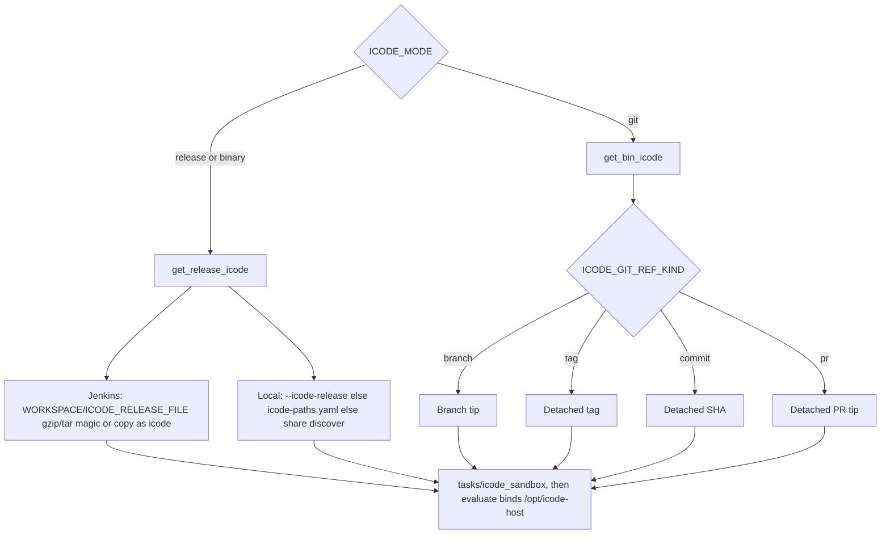

# Two ways to provide iCode for eval

Workers are CI agents. Developers push iCode to GitHub or GitCode; eval never uses a developer checkout on the worker.

DeepSWE, LoLBench, and SWE-bench Pro (all Harbor) accept the same two **iCode inputs**. The `tasks/icode` step ([pipeline.md](pipeline.md#steps)) calls exactly one function:

| `ICODE_MODE` | Function | What you provide |
|--------------|----------|------------------|
| `release` (`binary` is an alias) | `get_release_icode` | Jenkins: **upload** `ICODE_RELEASE_FILE`. Local `--stage` / `--local`: `--icode-release PATH` or persist/discover |
| `git` | `get_bin_icode` | Allow-listed `https://` URL + **branch / tag / commit / pr** |

A GitHub/GitCode **Release page** is not a git clone. Do **not** clone the iCode repo and then hunt for zip assets. `ICODE_MODE=git` with `ICODE_GIT_REF_KIND=tag` checks out that **tag in git**. `ICODE_MODE=release` uses the binary drop you upload (Jenkins) or already downloaded (local).



All three Jenkins jobs (`deepswe_one_task`, `lolbench_one_task`, `swebenchpro_one_task`) offer both modes.

## Persist file (local `--stage` / `--local` only)

After you **type and confirm** a release drop path, mac-k3d stores it in:

`~/.config/mac-k3d/icode-paths.yaml`

```yaml
release: /abs/path/to/icode-linux-x86_64-full-v0.1.41
```

Write it with:

```bash
mac-k3d set --icode-release /path/to/icode-linux-x86_64-full-v0.1.41
```

TTY `mac-k3d eval --local` (no `--yes`) also saves the path you confirm. `--icode-release` / env vars **override** the file for that local run and do **not** rewrite it.

Git URL, ref, and kind stay in Jenkins parameters / `jenkins_job` YAML — not this file. Jenkins **does not** take a worker filesystem path for the release drop. Product path: upload `ICODE_RELEASE_FILE` in the UI.

## 1. Release binary (`ICODE_MODE=release`)

Download the official `icode-<os>-<arch>-full-vX.Y.Z` (`.tar.gz`, same name with no suffix, unpacked `*-full-*` folder, or a file named `icode`).

**Jenkins:** Build with Parameters → `ICODE_MODE=release` → upload that file as `ICODE_RELEASE_FILE`. Jenkins names it after the parameter, so `tasks/icode` treats it by **content**: gzip/tar magic unpacks an archive; otherwise it copies the file as `icode`. An empty upload fails the job (`upload ICODE_RELEASE_FILE on Jenkins Build with Parameters`).

**Local:**

```bash
mac-k3d set --icode-release /path/to/icode-linux-x86_64-full-v0.1.41
# or copy into the discover dir:
cp /path/to/icode-linux-x86_64-full-v0.1.41 "$HOME/.local/share/mac-k3d/"
mac-k3d eval --local --stage tasks --icode-mode release --yes
```

Named-path rules stay for local CLI (`icode` or `*-full-*`). `tasks/icode` prints `resolving iCode (release)`. Harbor keeps the real binary (no git wrapper). There is **no** `icode_git` object on the report.

`mac-k3d eval --job one` (or `--yes` without `--local`) **cannot** queue a release build: it does not attach a file, and stops with `--icode-mode release`. Open the Jenkins UI instead.

## 2. Git clone (`ICODE_MODE=git`)

Clone `https://github.com/…` or `https://gitcode.com/…` (no tokens in the URL). Checkout uses `ICODE_GIT_REF_KIND`:

| Kind | Meaning |
|------|---------|
| `branch` | Tip of that branch (Jenkins/CLI default) |
| `tag` | Detached tag (this is a “git release”, not GitHub Release assets) |
| `commit` | Detached SHA, including a PR commit before merge |
| `pr` | Pull-request number in `ICODE_GIT_REF`. GitHub fetches `refs/pull/<n>/head`. GitCode fetches `refs/merge-requests/<n>/head` (then `refs/pull/<n>/head`). The recorded SHA is that tip, which is the full PR tree |

Leftover `auto` (old queued builds) still maps: 7–40 hex → commit, else branch. Do not pick it on the Jenkins form.

```bash
mac-k3d eval --local --stage tasks --icode-mode git \
  --icode-git-url https://github.com/ORG/icode.git \
  --icode-git-ref main --icode-git-ref-kind branch
```

`tasks/icode` writes `icode_git.json` (`url`, `kind`, `ref`, resolved `sha`, `subject`). The `score` and `report` phases copy it into the report as `icode_git`. Console: `OK iCode git kind=…`. Private repos: gitignored `.env` (`GITCODE_TOKEN` / `GITHUB_TOKEN`) or Jenkins credentials `gitcode-pat` / `github-pat`.

The same PAT builds the clone. `uv sync` fetches iCode's own git dependencies on the iCode host over `https://` with that PAT, including ones iCode pins as `ssh://git@<host>/…` (PR 2 pins `openjiuwen` to `ssh://git@gitcode.com/michaelling/agent-core.git`). The rewrite lives only in the environment of that one command (`GIT_CONFIG_COUNT` + `url.https://<host>/.insteadOf`), so iCode's `pyproject.toml`, `uv.lock` and `.git/config` stay as shipped, and a worker needs no SSH key. Console: `OK icode dependencies fetched over https with the gitcode.com PAT`. Without a PAT, or if the PAT cannot read a dependency, `uv sync` runs once more with the worker's own SSH key (`BatchMode`, never prompts); when that fails too, the error names the SSH-pinned dependency.

Before any rollout, the `tasks` phase strips task deliverables from the clone's `.venv` and makes its sandbox stdlib sourceless (`tasks/icode_sandbox`), mounts it read-only (`tasks/isolation`) and leak-scans it (`tasks/leakscan`). This is the same for every benchmark and model; see [Same protocol for every benchmark and model](evaluation.md#same-protocol-for-every-benchmark-and-model). The clone's tracked files are not changed. Each run records the result in `eval_protocol.isolation`; compare `runtime_sha256` across runs ([Recorded proof](evaluation.md#recorded-proof-eval_protocolisolation)).

The clone lives under the eval workdir (`eval-runs/icode-src`), not a permanent developer tree on the worker. A later git eval wipes that tree first. If Harbor left root/nobody files in `.venv`, `tasks/icode` deletes it with Docker (and `evaluate/harbor_run` hands the tree back to the build user after Harbor) (`removing leftover … via docker`) — do not `sudo rm` by hand. Git-mode Jenkins also deletes a leftover `ICODE_RELEASE_FILE` and does not treat it as an upload.

## Linux and macOS workers

iCode always runs inside the task container, which is Linux on every worker, so the iCode under test must be a Linux build for that container's CPU type. The `tasks/icode` step writes the platform to `container_platform.json` and prints it (`OK task containers linux/arm64 (native)`).

| Benchmark | Linux x86_64 or Intel Mac | Linux arm64 or Apple silicon Mac |
|-----------|---------------------------|----------------------------------|
| DeepSWE | `linux/amd64`, the published image | `linux/arm64`, a native build of the task Dockerfile; the published `linux/amd64` image under emulation when that build cannot be proven ([pipeline.md](pipeline.md#deepswe-on-linux-and-macos)) |
| SWE-bench Pro | `linux/amd64` | `linux/amd64`, emulated: the official images are amd64 only |
| LoLBench | `linux/amd64` | `linux/arm64`, unless a selected task's `environment/Dockerfile` downloads an x86-64-only build |

Emulated means Rosetta in Docker Desktop on a Mac, QEMU on Linux. It keeps the exact image a Linux x86_64 worker runs, with the same digest, so the scores stay comparable.

**Release mode.** The build picks the `icode` whose ELF header matches the task platform. An upload holding only the other CPU type fails before any trial, naming the drop to use. For a Mac, or a suite that mixes platforms, upload one `.tar.gz` holding both `icode-linux-x86_64-full-vX.Y.Z` and `icode-linux-aarch64-full-vX.Y.Z` of the same version:

```bash
tar -czf icode-linux-full-v0.1.41.tar.gz icode-linux-x86_64-full-v0.1.41 icode-linux-aarch64-full-v0.1.41
```

`icode_release.json` records the sha256 of the file you uploaded, so upload the same file to every build you want to compare. Locally, keep both drops in one folder and run `mac-k3d set --icode-release <folder>`; each run takes the one whose name matches.

**Git mode.** On a Linux worker whose CPU type matches the task containers, `uv sync` runs on the host as before. Otherwise (every Mac, or a Linux arm64 worker running an amd64 task) the same `uv sync`, the sandbox CPython, the sanitizer and the probes run inside `ICODE_LINUX_BUILD_IMAGE` (pinned in `pipeline/config/toolchain.env`) on the task platform. The PAT reaches that container by variable name, never on its command line. uv's cache is kept per platform in `~/.local/share/mac-k3d/uv-cache-linux-<arch>`, so the second build of a commit does not download again. The tree, the manifest and the `/opt/icode-host` mount are the same as on Linux.

## Jenkins Build with Parameters

Same fields on **both** jobs. Unused fields stay on the form: leave those controls as they are (do not clear them).

| Field | Release | Git |
|-------|---------|-----|
| `ICODE_MODE` | `release` | `git` |
| `ICODE_RELEASE_FILE` | **required upload** | leave this control as it is |
| `ICODE_GIT_URL` / `REF` / `KIND` | leave these controls as they are | required (`KIND` is `branch`, `tag`, `commit`, or `pr`; for `pr`, `REF` is the pull-request number) |

Vice versa: if you chose git, ignore the file picker; if you chose release, ignore URL / ref / kind.

After changing job XML, run `mac-k3d config --skip-secrets` on the **controller** so the UI shows `ICODE_RELEASE_FILE` (no worker-path `ICODE_RELEASE` string). Extract pipeline on the worker (`mac-k3d config -c worker.yaml`, or any `mac-k3d eval --stage …`).

CLI from the worker (queues Jenkins **git** only):

```bash
mac-k3d eval --benchmark deepswe --n-tasks 1 --icode-mode git \
  --icode-git-url https://github.com/ORG/icode.git --icode-git-ref v0.1.41 \
  --icode-git-ref-kind tag --yes
mac-k3d eval --benchmark lolbench --task ruff_1 --icode-mode git \
  --icode-git-url https://github.com/ORG/icode.git --icode-git-ref v0.1.41 \
  --icode-git-ref-kind tag --yes
```
