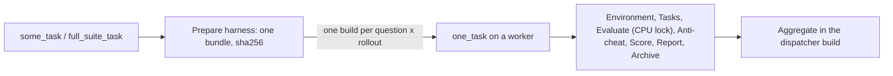

# Jenkins eval jobs

`mac-k3d config` on the controller writes nine jobs: three shapes for each of three benchmarks. Every job evaluates a harness with a DeepSeek catalog model (`DEEPSEEK_MODEL`: `deepseek-flash`, the default, or `deepseek-v4-pro`). The harness is iCode, or on the DeepSWE jobs JiuwenSwarm when `HARNESS=jiuwenswarm` ([jiuwenswarm-harness-inputs.md](jiuwenswarm-harness-inputs.md)). Which one to run: [evaluation.md](evaluation.md#which-job-to-run). Every parameter: [commands.md](commands.md#jenkins-job-parameters).

| Shape | Jobs | What a build does |
|-------|------|-------------------|
| `one_task` | `deepswe_one_task`, `lolbench_one_task`, `swebenchpro_one_task` | Runs one question and one rollout on one worker: the seven pipeline stages, one `harbor run -k 1 -n 1` |
| `some_task` | `deepswe_some_task`, `lolbench_some_task`, `swebenchpro_some_task` | Dispatcher: prepares the harness once, queues one `one_task` build per question and rollout for a `TASKS` list or the first `N_TASKS`, then merges them in its `Aggregate` stage |
| `full_suite_task` | `deepswe_full_suite_task`, `lolbench_full_suite_task`, `swebenchpro_full_suite_task` | The same dispatcher over the whole suite (DeepSWE 113, LoLBench 20, SWE-bench Pro 731 questions) |

`HARNESS` offers `icode` and `jiuwenswarm` on the three DeepSWE jobs, with the controller's default (`mac-k3d set --harness`) first; a dispatcher's shards run the harness it was given. It is fixed to `icode` on the LoLBench and SWE-bench Pro jobs. `config` also deletes the retired `eval_aggregate` and `build_jiuwenswarm_headless` jobs.

## Harness fields on the DeepSWE pages

A DeepSWE page has iCode's fields (`ICODE_*`) and JiuwenSwarm's (`JIUWENSWARM_*`), and shows only the set for the `HARNESS` you pick. The Active Choices plugin (`uno-choice`, installed by `mac-k3d start`) redraws each text and choice field when `HARNESS` changes:

| Field | With its harness | With the other harness |
|-------|------------------|------------------------|
| `ICODE_MODE`, the three `ICODE_GIT_*` | the input and its help | whole row hidden (name included); default kept |
| `JIUWENSWARM_MODE`, the three `JIUWENSWARM_GIT_*`, `JIUWENSWARM_AGENT_MODE`, `JIUWENSWARM_MAX_TURNS` | the input and its help | whole row hidden; default kept |
| `ICODE_RELEASE_FILE`, `JIUWENSWARM_RELEASE_FILE` | real file uploads (Jenkins cannot redraw a file field). The visible `ICODE_MODE` or `JIUWENSWARM_MODE` row also emits CSS that hides the other upload | |

A field left out of a remote trigger (`buildWithParameters`) or a dispatcher's call keeps the job's default through an `environment` block. LoLBench and SWE-bench Pro keep `ICODE_*` only.

The redraw runs a short Groovy script outside the sandbox, which Jenkins runs only once approved. `config` pre-approves exactly these scripts and prints a warning when it cannot. An administrator can then approve them on **Manage Jenkins > In-process Script Approval**; until then those fields read `Could not draw this field. The build uses its default.` On a controller without the plugin, `config` says to run `mac-k3d start` and writes plain fields, each with the `only (HARNESS=…)` label.



## Prepare harness

Every dispatcher starts with a `Prepare harness` stage on an `AGENT_LABEL` worker. It runs `pipeline/tools/prepare_harness.sh`, which resolves the job's harness input once (a git ref to one commit, or the uploaded release), builds the harness for `linux/amd64` (the platform DeepSWE uses on Linux workers), and stores it in that worker's [harness store](pipeline.md#harness-store). Only the `gitcode-pat` and `github-pat` credentials are bound in this stage; no LLM key reaches the build.

The stage archives `eval-runs/harness/bundle.tar.gz` and `bundle.json`, prints `Every shard runs harness bundle <sha256> (git <commit>)` (or `release <sha256>`), and passes every shard:

| Field | Value |
|-------|-------|
| `HARNESS_BUNDLE_SHA256` | the bundle's sha256. A shard runs this bundle and no other |
| `HARNESS_BUNDLE_FROM` | `<job>#<build>`, where the shard copies the bundle from |
| `ICODE_GIT_SHA` / `JIUWENSWARM_GIT_SHA`, or `ICODE_RELEASE_SHA256` / `JIUWENSWARM_RELEASE_SHA256` | the input the bundle was built from, which a shard of another task platform builds its own from |
| `JIUWENSWARM_RELEASE_FROM` | for a JiuwenSwarm wheel or wheelhouse, the build that archived it as `jiuwenswarm-release/JIUWENSWARM_RELEASE_FILE` |

In its Tasks stage, a shard first asks its worker's store for that sha256. On a hit it copies nothing (`harness store: bundle <sha> is already on <node>; not copying it`); otherwise it copies the bundle from the dispatcher once, and `tasks/harness` checks the sha256 and stores it. So each worker copies and unpacks the bundle once per run, however many shards it runs. A bundle with another sha256 stops the shard.

The build page keeps `bundle.tar.gz`, `bundle.json`, and any JiuwenSwarm release upload. The bundle's sha256 is also in `summary.md` and `report.html`. Deleting an archived file from the pipeline needs a Jenkins script approval, so the job leaves them in place. Delete old builds by hand when the controller disk fills.

## What a `one_task` build runs

The Jenkinsfile extracts the worker binary's pipeline (`mac-k3d pipeline --extract-to $WORKSPACE/mac-k3d-pipeline`) and runs `pipeline/stages/run_all.sh` from it, once per stage. Only Evaluate holds a CPU lock: the CPUs the question's `task.toml` declares, on this node (`lock(label: env.NODE_NAME, quantity: <declared cpus>)`). The Harbor command is built in `pipeline/stages/evaluate/harbor_cmd.sh`, not in the job XML. The phases and their outputs: [pipeline.md](pipeline.md).

| Benchmark | Task folders | Notes |
|-----------|--------------|-------|
| DeepSWE | `eval-runs/deep-swe/tasks/<id>` | Pinned by `DEEPSWE_REF`. Harbor pulls `public.ecr.aws/d3j8x8q7/swe-bench-202605:<id>-v1.1` at the trial. A Mac uses the native build `mac-k3d eval prepare` made and proved, else that published image under emulation ([pipeline.md](pipeline.md#deepswe-on-linux-and-macos)) |
| LoLBench | `eval-runs/lolbench/harbor_tasks/<id>` | Pinned by `LOLBENCH_REF`. `tasks/images` uses the Hub tag when its CPU type matches, else builds it. After iCode exits, `lolbench-submit` writes the patch; `agent/capture.json` records it for the anti-cheat check |
| SWE-bench Pro | `eval-runs/swebenchpro/tasks/<instance_id>` | Official `jefzda/sweap-images` (linux/amd64 only). Images are large: start with one `TASK` |

On an Apple silicon Mac, DeepSWE runs each question natively on its prepared build, and under Rosetta on the published amd64 image when there is none; SWE-bench Pro runs its amd64 images under Rosetta; LoLBench runs native arm64: [pipeline.md](pipeline.md#deepswe-on-linux-and-macos).

An eval does no first-time work on any worker: no build, pull or check in the Tasks stage. Harbor pulls a missing published image at the trial, as it always has. A Mac without `mac-k3d eval prepare --benchmark deepswe` ([commands.md](commands.md#eval-prepare)) runs DeepSWE emulated. Its `summary.md` then says `Environment: 0 native, 1 emulated on <node>` and gives the reason with the prepare hint.

The iCode under test is the uploaded `ICODE_RELEASE_FILE` (release mode) or a clone of `ICODE_GIT_URL` at `ICODE_GIT_REF` (git mode): [icode-harness-inputs.md](icode-harness-inputs.md). JiuwenSwarm has the same two modes with its own `JIUWENSWARM_*` fields: [jiuwenswarm-harness-inputs.md](jiuwenswarm-harness-inputs.md). A shard of a dispatcher runs the dispatcher's bundle ([Prepare harness](#prepare-harness)). LLM keys and forge tokens are Jenkins credentials on the controller, injected per build: [secrets.md](secrets.md).

## Where builds run

Each worker's node has `cpu_cores / cpus_per_executor` executors (default 2 CPUs each) and the labels `lolbench docker`, its OS (`linux` or `macos`), `fits-<suite>` for each suite whose largest task fits its CPU limit, and `executors-<n>`. A `one_task` build asks for `AGENT_LABEL` (default `lolbench`) and the suite's `fits-` label, so Jenkins places it on any worker it fits, Linux or macOS. How capacity is counted: [optimization.md](optimization.md#scheduling-on-workers).

## Build result

| Result | Meaning |
|--------|---------|
| SUCCESS | The rollout ran and was scored, whatever its reward |
| UNSTABLE | Out of memory; a dispatcher queues it again at the tail, at most `OOM_RETRIES` times |
| FAILURE | A stage failed. Before Harbor started, a dispatcher retries it once; after, it counts as not run |

The build description and `summary.md` give the question, model and reward. The archived `eval-runs/` holds `artifact.json`, `summary.md`, `report.html`, `provenance.md` and the trials: [evaluation.md](evaluation.md#where-a-run-is-stored).

## Queue a build without the UI

```bash
mac-k3d eval --job one --benchmark deepswe --task abs-module-cache-flags --icode-mode git --dry-run   # print what would be sent
mac-k3d eval --job one --benchmark deepswe --task abs-module-cache-flags --icode-mode git             # queue it; prints the build URL
```

`--job some` and `--job full` queue the dispatchers; `--harness jiuwenswarm` sends `HARNESS=jiuwenswarm` to whichever DeepSWE job it queues. Release mode needs the file upload, which only the job page has. See [commands.md](commands.md#queue-a-jenkins-job-from-the-cli).

## If `config` cannot write a job

`config` prints `Warning: failed to update job …` or `failed to create job …` with the HTTP reply. Delete the job under the Jenkins UI and run `mac-k3d config` again on the controller; it recreates all nine. Do not edit the job XML by hand: the next `config` overwrites it.
