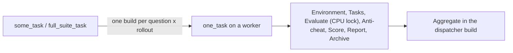

# Jenkins eval jobs

`mac-k3d config` on the controller writes nine jobs: three shapes for each of three benchmarks. Every job evaluates iCode with a DeepSeek catalog model (`DEEPSEEK_MODEL`: `deepseek-flash`, the default, or `deepseek-v4-pro`). Which one to run: [evaluation.md](evaluation.md#which-job-to-run). Every parameter: [commands.md](commands.md#jenkins-job-parameters).

| Shape | Jobs | What a build does |
|-------|------|-------------------|
| `one_task` | `deepswe_one_task`, `lolbench_one_task`, `swebenchpro_one_task` | Runs one question and one rollout on one worker: the seven pipeline stages, one `harbor run -k 1 -n 1` |
| `some_task` | `deepswe_some_task`, `lolbench_some_task`, `swebenchpro_some_task` | Dispatcher on `agent none`: queues one `one_task` build per question and rollout for a `TASKS` list or the first `N_TASKS`, then merges them in its `Aggregate` stage |
| `full_suite_task` | `deepswe_full_suite_task`, `lolbench_full_suite_task`, `swebenchpro_full_suite_task` | The same dispatcher over the whole suite (DeepSWE 113, LoLBench 20, SWE-bench Pro 731 questions) |



## What a `one_task` build runs

The Jenkinsfile extracts the worker binary's pipeline (`mac-k3d pipeline --extract-to $WORKSPACE/mac-k3d-pipeline`) and runs `pipeline/stages/run_all.sh` from it, once per stage. Only Evaluate holds a CPU lock: the CPUs the question's `task.toml` declares, on this node (`lock(label: env.NODE_NAME, quantity: <declared cpus>)`). The Harbor command is built in `pipeline/stages/evaluate/harbor_cmd.sh`, not in the job XML. The phases and their outputs: [pipeline.md](pipeline.md).

| Benchmark | Task folders | Notes |
|-----------|--------------|-------|
| DeepSWE | `eval-runs/deep-swe/tasks/<id>` | Pinned by `DEEPSWE_REF`. Harbor pulls each task's prebuilt `public.ecr.aws/d3j8x8q7/swe-bench-202605` image (linux/amd64 only) |
| LoLBench | `eval-runs/lolbench/harbor_tasks/<id>` | Pinned by `LOLBENCH_REF`. `tasks/images` uses the Hub tag when its CPU type matches, else builds it. After iCode exits, `lolbench-submit` writes the patch; `agent/capture.json` records it for the anti-cheat check |
| SWE-bench Pro | `eval-runs/swebenchpro/tasks/<instance_id>` | Official `jefzda/sweap-images` (linux/amd64 only). Images are large: start with one `TASK` |

On an Apple silicon Mac, DeepSWE and SWE-bench Pro run their amd64 images under Docker Desktop's Rosetta, and LoLBench runs native arm64: [pipeline.md](pipeline.md#linux-and-macos-workers).

The iCode under test is the uploaded `ICODE_RELEASE_FILE` (release mode) or a clone of `ICODE_GIT_URL` at `ICODE_GIT_REF` (git mode): [icode-harness-inputs.md](icode-harness-inputs.md). LLM keys and forge tokens are Jenkins credentials on the controller, injected per build: [secrets.md](secrets.md).

## Where builds run

Each worker's node has `cpu_cores / cpus_per_executor` executors (default 2 CPUs each) and the labels `lolbench docker`, its OS (`linux` or `macos`), `fits-<suite>` for each suite whose largest task fits its CPU limit, and `executors-<n>`. A `one_task` build asks for `AGENT_LABEL` (default `lolbench`) and the suite's `fits-` label, so Jenkins places it on any worker it fits, Linux or macOS. How capacity is counted: [optimization.md](optimization.md#scheduling-on-workers).

## Build result

| Result | Meaning |
|--------|---------|
| SUCCESS | The rollout ran and was scored, whatever its reward |
| UNSTABLE | Out of memory; a dispatcher queues it again at the tail, at most `OOM_RETRIES` times |
| FAILURE | A stage failed. Before Harbor started, a dispatcher retries it once; after, it counts as not run |

The build description and `summary.md` give the question, model and reward. The archived `eval-runs/` holds `artifact.json`, `summary.md`, `report.html` and the trials: [evaluation.md](evaluation.md#where-a-run-is-stored).

## Queue a build without the UI

```bash
mac-k3d eval --job one --benchmark deepswe --task abs-module-cache-flags --icode-mode git --dry-run   # print what would be sent
mac-k3d eval --job one --benchmark deepswe --task abs-module-cache-flags --icode-mode git             # queue it; prints the build URL
```

`--job some` and `--job full` queue the dispatchers. Release mode needs the file upload, which only the job page has. See [commands.md](commands.md#queue-a-jenkins-job-from-the-cli).

## If `config` cannot write a job

`config` prints `Warning: failed to update job …` or `failed to create job …` with the HTTP reply. Delete the job under the Jenkins UI and run `mac-k3d config` again on the controller; it recreates all nine. Do not edit the job XML by hand: the next `config` overwrites it.
