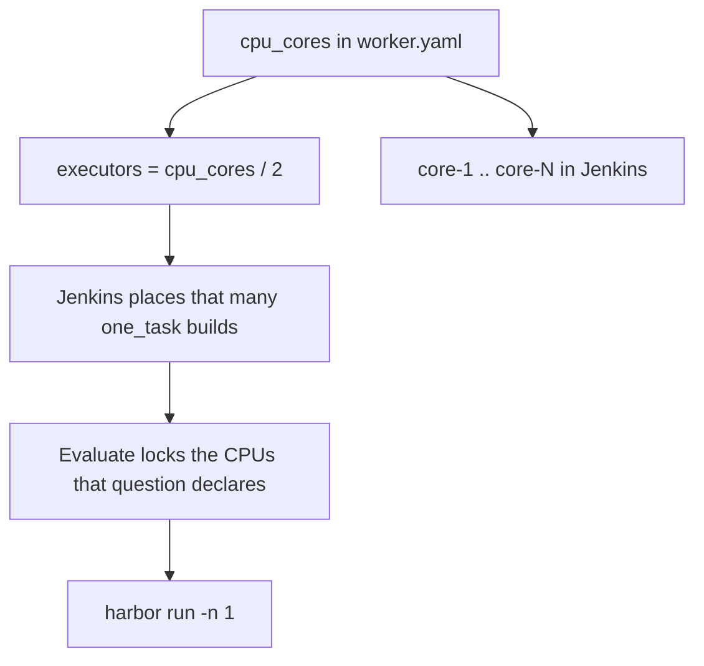
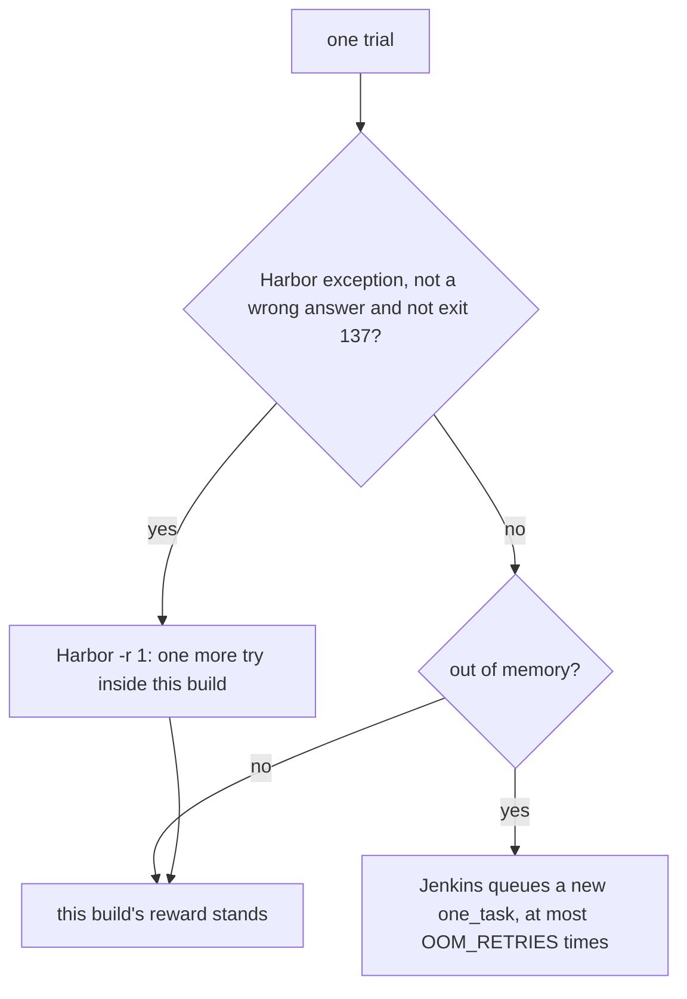

# Eval resource packing

Harbor applies each task's own `cpus` / `memory_mb` / `storage_mb`. mac-k3d's only job is to decide **how many** of those fit on this worker and to refuse a build that cannot run even one. Field meanings (`concurrency`, `cpus_each`, `tokens.total`) stay in [evaluation.md](evaluation.md).

## Declared, not overridden

`pipeline/lib/task_resources.py` reads the `[environment]` and `[verifier.environment]` blocks of every selected `task.toml` and takes the maximum across them, because a verifier can ask for more than the agent phase:

| Suite | `cpus` | `memory_mb` | `storage_mb` |
|---|---|---|---|
| DeepSWE | 2 | 8192 | 20480 |
| LoLBench | 4 | 7168–8192 | — |

The pipeline passes **no** `--override-cpus` and **no** `--override-memory-mb` on the normal path. A task gets what it asks for, so a score is comparable with anyone else's run of the same task.



## How many fit

```text
EVAL_SLOTS = max(1, min(CPU_LOCK_QTY / declared_cpus, trials, disk_floor))
disk_floor = 1 when free disk at WORKDIR < MIN_DISK_GB, else unbounded
```

`MIN_DISK_GB` is 40. On a local run, `EVAL_SLOTS` becomes Harbor's `-n`. A Jenkins `one_task` build is one trial, so Harbor runs `-n 1` and the lock quantity is the task's declared CPUs, not this whole formula.

Memory does not change the slot count. The `env` phase refuses a host below `MIN_RAM_GB` (8 GB), and a trial killed for memory is queued again (see [Retries](#retries)). If the CPUs this build locked are below what a task declares, the build **fails before the first container starts** with the shortfall printed. That is deliberate: a half-resourced run produces numbers nobody can use.

After the question list is chosen, `evaluate/slots` prints the plan and `artifact.json` keeps it:

```json
"resources": {
  "declared": {"peak": {"cpus": 2, "memory_mb": 8192, "storage_mb": 20480}},
  "applied":  {"slots": 2, "cpus_each": 2}
}
```

Inspect a plan without running anything:

```bash
python3 pipeline/lib/task_resources.py plan \
  --tasks-dir eval-runs/deep-swe/tasks \
  --selected eval-runs/selected_tasks.txt \
  --cpu 8 --n-rollouts 4 --workdir eval-runs
```

On Jenkins, `CPU_LOCK_QTY` is not a parameter and it is not the whole machine. The `Evaluate` stage locks `cpusEach` resources of this node (DeepSWE 2, LoLBench 4) and Harbor runs `-n 1`. `mac-k3d config -c worker.yaml` creates `<node>-core-1..N` where N is `jenkins_agent.cpu_cores`, and deletes any `<node>-core-M` above N. A core that a running build holds is reported `busy` and kept until the next `config`. For example, `cpu_cores: 2` gives 1 executor, `executors-1` and `fits-deepswe`, and prunes core-3 and above; `4` gives 2 executors and all three `fits-` labels.

`mac-k3d eval --local` and `mac-k3d eval --stage` plan with the same number, so a local run packs the same `EVAL_SLOTS` as a Jenkins build on that machine. They print one line before the phase starts, for example `CPU_LOCK_QTY=16 (from /home/you/.config/mac-k3d/worker.yaml jenkins_agent.cpu_cores; Jenkins locks the same on this node)`. The number comes from the first of these that is set:

1. `CPU_LOCK_QTY` already in the environment (must be an integer of at least 1)
2. `jenkins_agent.cpu_cores` in `~/.config/mac-k3d/worker.yaml`, when above 0
3. `jenkins_agent.cpu_cores` in the config `eval` loaded, when above 0
4. this host's logical CPU count

To use fewer cores on a shared host, lower `jenkins_agent.cpu_cores` in `worker.yaml` and re-run `mac-k3d config -c worker.yaml` (or `scripts/redeploy.sh`); Jenkins and local runs both follow. `bash pipeline/stages/run_all.sh` started by hand with `CPU_LOCK_QTY` unset still uses 1. Set `EVAL_RESOURCE_CAP=0` only for fixture tests that must ignore RAM.

Later stages do not re-derive any of this: `eval_parallel_degree` reads the `eval_resources.json` that `evaluate/slots` wrote, so the report describes the run that happened rather than a fresh guess about the current machine.

## Scheduling on workers

Jenkins does not watch a worker's CPU or memory. It schedules by three numbers that `mac-k3d config -c worker.yaml` registers:

| Control | Set to | What it does |
|---------|--------|--------------|
| Executors | `cpu_cores / cpus_per_executor` (default 2 CPUs each) | Caps how many `one_task` builds run on the worker at once |
| Labels | `lolbench docker <os>`, `fits-<suite>`, `executors-<n>` | A build goes only to a worker that fits its suite; dispatchers count `executors-<n>` to size `MAX_IN_FLIGHT` |
| Lockable resources | `<agent>-core-1..cpu_cores`, labelled `CPU_CORES <agent>` | Evaluate locks the question's declared CPUs with `lock(label: env.NODE_NAME, quantity: …)` |

The lock names the node, not the shared `CPU_CORES` label, so a build on one worker never holds another worker's cores. Keep exactly one controller: the lock state lives there, and a second controller would lend the same cores twice. Scale by adding workers; the next dispatcher counts their executors without a pipeline change.

On macOS the task containers run in Docker Desktop's VM, so the limits are the VM's, not the Mac's:

| | Linux worker | macOS worker |
|-|--------------|--------------|
| Memory the `MIN_RAM_GB` gate reads | `/proc/meminfo` | Docker Desktop's memory limit (`docker info` `MemTotal`) |
| Default `cpu_cores` | the host's logical CPUs | the smaller of the Mac's CPUs and Docker Desktop's CPU limit |
| `cpu_cores` above Docker's CPU limit | allowed | `config` refuses it and names the fix |

Raise the limits under Docker Desktop > Settings > Resources. A DeepSWE task declares 8 GB and two run at once on a 4-CPU limit, so give Docker Desktop at least 18 GB for that, or expect out-of-memory retries.

## Memory trace

A single `harbor run` has no one "active question", so the memory trace is per build rather than per question. The `evaluate/harbor_run` heartbeat appends a `docker stats` snapshot to `harness/container_mem.jsonl` for containers whose names contain `_icode_` or `__env-main-`, ignoring sidecars. The largest `peak_gb` is kept in `harness/container_mem_peak_gb` and reported as `container_mem_max_gb`. The planner still accepts `--measured-peak-gb` but does not use it: memory does not change the slot count.

```bash
python3 pipeline/lib/task_resources.py sample --harness-dir eval-runs/harness --slots 2
```

## Scaling out instead of up

Packing more trials onto one worker has a ceiling; adding workers does not. `<suite>_some_task` and `<suite>_full_suite_task` queue one `one_task` build per question and rollout. A worker runs `cpu_cores / cpus_per_executor` of them at once, each locking the CPUs that question declares, and takes the next when one finishes. Adding a worker is the whole change — see [evaluation.md](evaluation.md#which-job-to-run).

Time and token cost are reduced by `ICODE_REASONING_EFFORT=high` (less explore soft-stop), not by cutting rollouts.

## Retries

Two different retries:



There is no resume mode. To re-run a suite that aborted, trigger the dispatcher again. Inside one dispatcher build, a unit that fails does not stop the others (`propagate: false`). A failure before Harbor starts is retried once. A failure after Harbor started, or an abort, is not retried. The `Aggregate` stage reports on whatever finished.

## Disk and I/O

Free disk at `WORKDIR` below 40 GB forces one slot. Harbor keeps one jobs tree per run so rollouts of the same task reuse image layers. `PYTHONDONTWRITEBYTECODE=1`. The heartbeat does not scan huge logs.

## Not done

No cgroup I/O weights and no Harbor image-build changes.
