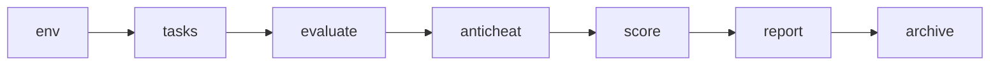
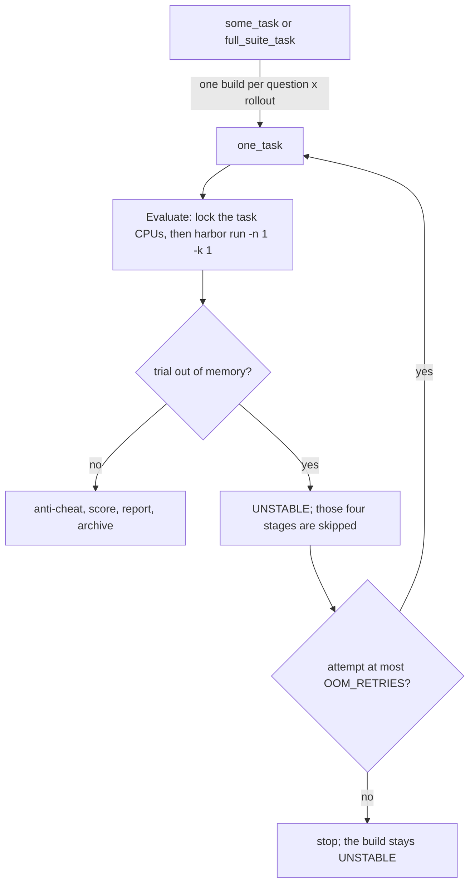
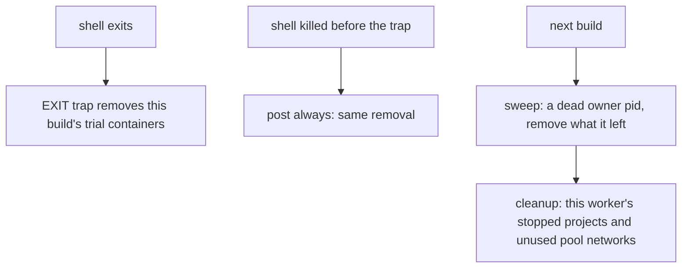
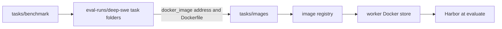

# Evaluation pipeline

One evaluation build runs seven phases in order. mac-k3d prepares the worker and the tasks, Harbor runs the evaluation, and mac-k3d then judges, scores, reports and archives what Harbor left behind. Harbor is treated as a black box: mac-k3d only builds its command line and reads its output folders.

| Phase | Jenkins stage | What it does | CPU lock |
|-------|---------------|--------------|----------|
| `env` | Environment | Bare-metal checks: is this worker fit to run any evaluation? | no |
| `tasks` | Tasks | Per-task setup and checks: benchmark, selection, iCode, isolation, leak scan | no |
| `evaluate` | Evaluate | Trial slots, the isolation canary, then one `harbor run` | **yes** |
| `anticheat` | Anti-cheat | Capture receipts and a verdict per rollout | no |
| `score` | Score | F2P/P2P per rollout from Harbor's `reward.json` files | no |
| `report` | Report | `artifact.json`, `summary.md`, `report.html` | no |
| `archive` | Archive | Cost/token analysis, backup, `tar.gz` | no |

Only Evaluate holds cores, and only as many as the question declares (`lock(label: env.NODE_NAME, quantity: cpusEach)`). A second build on the same worker can prepare its tasks or write its report while the first one runs Harbor.



A Jenkins `one_task` build is one question and one rollout. `some_task` and `full_suite_task` do not run Harbor. They queue one `one_task` build per question and rollout, then merge.



Containers for that build are removed even when the build stops early:



A live trial is kept. The Linux agent unit sets `OOMScoreAdjust=-1000`, so a full machine does not sacrifice the Jenkins agent. A trial container can still be killed, and that path is the requeue above.

## How it runs

The entry point is `pipeline/stages/run_all.sh`. It loops over `PHASES=(env tasks evaluate anticheat score report archive)`. `MAC_K3D_PHASE=<phase>` runs one phase; `all`, the default, runs every phase.

- **Jenkins** runs each phase as its own stage: `MAC_K3D_PHASE=<phase> bash "$MAC_K3D_ROOT/pipeline/stages/run_all.sh"`. The pipeline is the copy embedded in the worker's `mac-k3d` binary. The Environment stage clears `$WORKSPACE/mac-k3d-pipeline/pipeline` and every stage re-extracts it only if it is missing, so a redeploy in the middle of a build cannot change its scripts. `pipeline/BUILD.json` names the commit for the artifact.
- **Locally**, `mac-k3d eval --stage <phase>` runs one phase from this checkout (or the extracted share copy), `mac-k3d eval --local` runs them all, and `mac-k3d eval --stage baseline` runs the optional LLM-only arm (`pipeline/tools/baseline.sh`). The old names `p0`…`p8` are refused with the phase that replaced them.

Every step starts by sourcing `_common.sh`, which loads the pins in `pipeline/config/toolchain.env` and stops with `brew install bash` when bash is older than `BASH_MIN` (macOS `/bin/bash` is 3.2). The worker itself must have Java at least `JAVA_MAJOR` (the controller image's Java), python3 at least `PYTHON_MIN`, git, Docker with compose and buildx, and Harbor at `HARBOR_VERSION`; [dependencies.md](dependencies.md) lists every version and where it comes from.

Each phase script (`pipeline/stages/<phase>.sh`) is only an ordered `STEPS=(...)` list. Each step (`pipeline/stages/<phase>/<step>.sh`) does one job, runs in its own process and sources `_common.sh`. Steps hand state to each other only through files in `$WORKDIR`: `$WORKSPACE/eval-runs` on Jenkins and `<root>/eval-runs` locally (override with `MAC_K3D_EVAL_WORKDIR`).

With `CANARY=only` the build stops after evaluate: the later phases print `canary only: no rollouts to score` and exit 0.

## Steps

| Step | What it does | Writes under `$WORKDIR` |
|------|--------------|-------------------------|
| `env/host` | Checks `BENCHMARK`, bash ≥ `BASH_MIN`, python3 ≥ `PYTHON_MIN`, git, free RAM and disk (`MIN_RAM_GB`, `WORKER_MIN_DISK_GB`; `MAC_K3D_MIN_RAM_GB` / `MAC_K3D_MIN_DISK_GB` override), `docker info`, a VPN MTU smaller than Docker's bridge, that `mac-k3d` lists `eval`, and the agent unit (systemd) or LaunchAgent (macOS) | — |
| `env/compose` | `docker compose` (v2 plugin) and `docker buildx`: an existing plugin is kept, a missing one is downloaded at the version in `pipeline/config/toolchain.env` (worker `setup` does the same) | — |
| `env/harbor` | Harbor at `HARBOR_VERSION` from `pipeline/config/toolchain.env` (the same pin `mac-k3d setup` installs). Reinstalls with `uv tool install --force` only when the version differs | `harbor_version.txt` |
| `env/egress` | Runs Harbor's egress-control kernel probe visibly (Harbor itself only refuses `--allow-agent-host` and `no-network` when it fails). When Docker cannot run Harbor's probe image, the same script runs in Harbor's egress sidecar image, then in a pinned `alpine:3.19`, and the run uses the first that works (see [How Harbor is called](#how-harbor-is-called)). Also checks Harbor's egress sidecar image | `egress_probe.json` |
| `env/network` | Removes this worker's own stopped trials (compose projects named after a trial folder in this agent's Jenkins workspaces; nothing of another user's), then checks that the trial subnet pool (`10.213.0.0/16`, a `/28` per trial) has a free subnet (see [How Harbor is called](#how-harbor-is-called)) | `trial_network.json` |
| `env/model_api` | `DEEPSEEK_MODEL` is served by `GET /models`. Skipped with a note when no key is set | — |
| `tasks/benchmark` | Checks out the benchmark (see [Where the benchmarks come from](#where-the-benchmarks-come-from)). Question images are fetched later, see [Benchmark checkout and question images](#benchmark-checkout-and-question-images) | `deep-swe/`, `lolbench/` or `swebenchpro/` |
| `tasks/select` | Picks the questions from `TASK`, `TASKS`, `N_TASKS` and `TASK_OFFSET`; every later step reads this file. `TASK_OFFSET` counts in `suite_tasks.txt`, every task dir in byte order (`LC_ALL=C`), so all workers cut the same slices | `selected_tasks.txt`, `selected_tasks_offset.txt`, `suite_tasks.txt` |
| `tasks/images` | LoLBench: each selected task's image exists for this CPU architecture, rebuilt from its Dockerfile when it does not. DeepSWE on an x86-64 host and SWE-bench Pro: nothing; Harbor pulls the images at the trial. DeepSWE on an arm64 host: each question runs natively on the build `mac-k3d eval prepare` made and proved, else on the published image under emulation, with the reason; it never builds, pulls or checks ([DeepSWE on Linux and macOS](#deepswe-on-linux-and-macos)). Settles the task containers' platform before `tasks/harness` | `env_check.json` (arm64 DeepSWE) |
| `tasks/harness` | The harness under test (`HARNESS`: `icode`, or `jiuwenswarm` on DeepSWE), ready to mount read-only: the dispatcher's bundle, else the one this worker's [harness store](#harness-store) holds for the same input, else prepared now and stored. iCode: a release drop, or a git clone built with `uv sync`, then its embedded CPython, sanitized venv and wrapper. JiuwenSwarm: [jiuwenswarm-harness-inputs.md](jiuwenswarm-harness-inputs.md). Prints `<harness> under test:` (git SHA or release sha256) and the bundle sha256 before any canary or rollout. Never changes the harness's source | `harness.json`, `harness_host_root.txt`, `icode_bin_path.txt`, `icode_host_root.txt`, `icode_git.json` (git) or `icode_release.json` |
| `tasks/agent` | Harbor's Python can import the harness's agent and canary (`pipeline/lib/harness.py`) and `patch_harbor_agent` | — |
| `tasks/isolation` | Builds the one read-only mount and refuses a tree that overlaps a benchmark; checks the model API host is on the network allowlist; records both | `agent_mounts.json`, `eval_protocol_inputs.json` |
| `tasks/leakscan` | Searches the mounted harness tree for any selected task's gold patch. A hit question is skipped; the build stops only when every selected question is hit | `anticheat_leakscan.json`, `skipped_tasks.txt` |
| `evaluate/slots` | Clears this build's Harbor job, memory samples, and any OOM list left by the previous build in this workspace, then divides `CPU_LOCK_QTY` by each task's declared `cpus` into `EVAL_SLOTS`. Refuses a worker that cannot host one trial | `eval_resources.json` |
| `evaluate/canary` | The isolation canary (see [Anti-cheat](#anti-cheat)) | `canary/jenkins-<N>/` |
| `evaluate/harbor_run` | One `harbor run` for every selected task × rollout, with a 60 s heartbeat and memory sampling; then `meta.json`, and the iCode tree handed back to the build user. A Harbor that exits non-zero before any trial finished fails the step with Harbor's last `…Error:` line | `harness/harbor_runs/jenkins-<N>/`, `harness/harbor.log`, `harness/progress.json`, `harness/meta.json` |
| `anticheat/receipts` | First, every trial in this build's Harbor jobs dir must belong to a selected task (`check-trials`; the build fails otherwise, since that trial would drop out of the score and report). Then, for every trial, the patch the grader read must match the capture receipt, at the task's declared base commit | `<trial>/agent/capture_flags.json` |
| `anticheat/verdict` | `clean`, `flagged` or `rejected` per rollout; `not_run` for a rollout with no patch, transcript or `reward.json` (Harbor stopped it before the agent ran) | `<trial>/agent/anticheat.json`, `harness/anticheat/` |
| `score/score` | F2P/P2P per rollout | `results/score-temp.json` |
| `report/render` | The run folder; rejected rollouts score as unresolved. Counts the rollouts with no score; above 0, Jenkins prints a WARNING and the build result stays as it is | `output/<suite>/<run>/`, `report_dir.txt`, `last_output.txt`, `unscored_rollouts.txt` |
| `archive/analysis` | Tokens, cache hits and estimated cost | `output/<suite>/<run>/cost-token-report.md` |
| `archive/backup` | Copies the run folder, verdicts and per-trial files, then packs them | `<root>/output/<suite>/<run>.tar.gz`, `last_backup.txt` |

`evaluate/harbor_cmd.sh` is not a step. Both evaluate steps source it, and it is the only file that builds a Harbor command line.

## Harness store

A harness is prepared once per input and platform, and each worker keeps what it prepared or received in its harness store (`pipeline/lib/harness_store.py`). A `some_task` or `full_suite_task` build therefore prepares the harness once in its `Prepare harness` stage ([jenkins-jobs.md](jenkins-jobs.md#prepare-harness)), and each worker unpacks that bundle once, however many shards it runs.

**Bundle.** One reproducible gzipped tar (`tar --sort=name`, mtime 0, owner 0, `gzip -n`) of `bundle.json` and `tree/`, the prepared tree a trial mounts read-only. `bundle.json` records the harness, the input it was built from (`git` url, kind, ref, sha and subject, or `release` filename, sha256 and format), the platform, the recipe, the build and node that made it, and for JiuwenSwarm `runtime.json` and `uv pip freeze`. The bundle's name is the sha256 of the tarball.

**Layout.** The store is `$MAC_K3D_HARNESS_STORE`, else `$MAC_K3D_SHARE/harness-store` (by default `~/.local/share/mac-k3d/harness-store`):

```text
harness-store/<harness>/<bundle sha256>/   bundle.json  tree/  entry.json  READY  last_used  [bundle.tar.gz]
harness-store/<harness>/by-input/<key>     the bundle sha256 built from that input
```

The input key is the sha256 of the harness, the commit or release sha256, the platform and the recipe. The recipe names the build image, the Python and wheel platform (JiuwenSwarm) and a digest of the scripts that build the tree, so a change to those scripts builds a new tree instead of reusing an old one. Only the dispatcher's entry keeps `bundle.tar.gz`, to hand on; a shard keeps the tree alone.

**Where a build gets its harness.** `tasks/harness` takes the first that applies and records it as `eval_protocol.harness.source`:

| Source | When |
|--------|------|
| `dispatcher` | A shard given `HARNESS_BUNDLE_SHA256`. That bundle and no other: found in the store, or copied from the dispatcher build, checked against that sha256 and stored. A bundle with another sha256 stops the build |
| `upload` | A mac-k3d bundle uploaded as the JiuwenSwarm release |
| `store` | The store holds a bundle built from the same input (`by-input/`), for example a second direct `one_task` build of the same commit |
| `worker` | Prepared by this build, packed and stored. Also a shard whose task platform differs from the dispatcher's bundle: it prepares its own from the same pinned commit or release |
| `workspace` | Prepared by this build and not stored: a direct iCode release build, whose drop unpacks in seconds |

**Integrity.** `entry.json` holds the bundle sha256 and a digest of the unpacked tree (content, mode and links). Every lookup recomputes that digest, so a tree that changed on disk is never mounted: the entry is removed and the bundle is copied or prepared again (`harness store: a stored … tree was damaged and removed`). An entry is unpacked into a temporary folder under a per-harness lock, made read-only, and renamed into place only after `READY` is written, so a half-unpacked tree is never used and concurrent shards unpack once.

**Eviction.** After each use, the store keeps the newest `MAC_K3D_HARNESS_STORE_KEEP` entries per harness (default 6) and never removes one used in the last 24 hours. Each entry holds the full tree; the console prints its size when it is stored (`harness store: stored … bundle <sha> (<size>)`).

**Console.** A shard prints one of `harness store: bundle <sha> is already on <node>; not copying it`, `harness store: copied bundle <sha> from <job>#<build>` and `harness store: stored the dispatcher's bundle <sha>`. A direct build prints `… is already prepared on this worker (bundle <sha>); nothing built` on a store hit.

## Linux and macOS workers

A build runs the same seven phases, the same steps and the same Harbor command on a Linux or macOS worker, reads the same inputs and writes the same files under `$WORKDIR`. The task containers are Linux on both, so the grader, the anti-cheat checks and the report do not depend on the worker's OS. Where the host differs, each OS uses its usual tool:

| Step | Linux | macOS |
|------|-------|-------|
| `env/host` RAM check | `/proc/meminfo` | Docker Desktop's memory limit (`docker info`) |
| `env/host` VPN MTU hint | `ip link` | `ifconfig` |
| `env/host` agent service | systemd user unit | LaunchAgent |
| `env/network` host routes | `ip route` / `ip addr` | `netstat -rn` / `ifconfig` |
| `tasks/harness` iCode git build | `uv sync` on the host when its CPU type matches the containers | `uv sync` inside `ICODE_LINUX_BUILD_IMAGE` ([icode-harness-inputs.md](icode-harness-inputs.md#linux-and-macos-workers)) |
| `tasks/harness` JiuwenSwarm build | `uv sync` inside `ICODE_LINUX_BUILD_IMAGE` | the same ([jiuwenswarm-harness-inputs.md](jiuwenswarm-harness-inputs.md#git-jiuwenswarm_modegit)) |
| Provenance `Worker` line | `/proc/cpuinfo` | `sysctl` |

SWE-bench Pro always runs `linux/amd64`, because Harbor runs its prebuilt images and those are published for amd64 only. DeepSWE uses that published image on an x86-64 host. On an arm64 host it uses the native build `mac-k3d eval prepare` made of the task Dockerfile, else the published image under emulation ([DeepSWE on Linux and macOS](#deepswe-on-linux-and-macos)). LoLBench runs the Docker host's platform (`linux/arm64` on Apple silicon), unless a selected task's Dockerfile downloads an x86-64-only build. On an arm64 host an amd64 task runs emulated (Rosetta in Docker Desktop, QEMU on Linux). `container_platform.json` records the platform, and the report's `Worker` line ends with `os Darwin · containers linux/arm64` (or `linux/amd64 emulated`). Per-OS command differences for operators are in [dependencies.md](dependencies.md#linux-and-macos).

## Where the benchmarks come from

mac-k3d clones each benchmark itself and hands Harbor the task folders with `-p <dir> -i <task>`. Harbor never downloads a benchmark or uses its dataset registry.

| Benchmark | Source | Task folder (`-p`) |
|-----------|--------|--------------------|
| DeepSWE | `DEEPSWE_GIT_URL` at `DEEPSWE_REF` (pinned in `_common.sh`; 113 tasks checked) | `deep-swe/tasks` |
| LoLBench | `LOLBENCH_GIT_URL` at `LOLBENCH_REF` (pinned; 20 tasks checked). `lolbench_fix_rewards.py` rewrites the local checkout's reward scripts so every `reward.json` carries F2P/P2P counts; the upstream repo is not changed | `harbor_tasks` (Harbor runs from the LoLBench checkout) |
| SWE-bench Pro | Shallow clone of `SWEBENCHPRO_GIT_URL` (not pinned yet); `swebenchpro_tasks.py` writes Harbor task folders | `swebenchpro/tasks` |

For DeepSWE and LoLBench, override a pin per run with the variable of the same name. An existing checkout at another commit is fetched and checked out at the pin, and a task count other than `DEEPSWE_TASK_COUNT` / `LOLBENCH_TASK_COUNT` fails the step.

## Benchmark checkout and question images

A worker needs two different downloads before a question can run, and different parts of the pipeline fetch them at different times. Neither needs a manual pre-download on a new machine.

| | Benchmark checkout | Question image |
|---|---|---|
| What it is | The benchmark's git repo: one text folder per question | A prebuilt container filesystem for one question: OS, toolchain and the project at its base commit |
| Who fetches it | mac-k3d, `tasks/benchmark` (`pin_benchmark_sha` in `_common.sh`) | Harbor, when that question's trial environment starts in `evaluate` (LoLBench: `tasks/images` first, below). A Mac's native DeepSWE builds: `mac-k3d eval prepare`, before any eval |
| From where | GitHub, at the pinned commit | A container registry, at the address in the task's `task.toml` (a native build: the task's Dockerfile on the pinned base) |
| When | The first build in that job's workspace; again only when the pin changes | The first trial of that question on that worker (a native build: when `prepare` runs) |
| Kept in | `$WORKDIR/deep-swe` (`eval-runs/` in the job's Jenkins workspace) | The worker's Docker image store, shared by every job on that worker |
| Covers | All questions at once (DeepSWE: 113 folders) | One question; each question has its own image |



The checkout does not contain the image, only its address. A DeepSWE question folder, for example `deep-swe/tasks/ipython-session-bundle-replay/`, holds:

- `instruction.md`: the question the agent gets
- `tests/`: what the verifier runs to score the patch
- `solution/`: the reference patch (the leak scan checks the iCode tree for it)
- `task.toml`: declared `cpus`/`memory_mb`, verifier settings, and `[environment] docker_image = "public.ecr.aws/d3j8x8q7/swe-bench-202605:<id>-v1.1"`
- `environment/Dockerfile`: the recipe the benchmark authors built that image from

The checkout is the same files on Linux and macOS. The image is not in the clone. Harbor never passes `--force-build` and pulls an image only when its name is missing locally, so a local tag under the official name is the one it starts. The images stay until someone prunes Docker, so disk use grows with the number of different questions a worker has run (`env/host` checks `WORKER_MIN_DISK_GB` before each build).

### DeepSWE on Linux and macOS

Both machines clone `github.com/datacurve-ai/deep-swe` at `DEEPSWE_REF`. Each question's `task.toml` names a published image, `public.ecr.aws/d3j8x8q7/swe-bench-202605:<id>-v1.1`. Those tags are linux/amd64 only. The Dockerfile in `environment/` is the recipe that image was built from, and every one starts `FROM mars-base:latest`. That base is published for amd64 and arm64; `DEEPSWE_BASE_IMAGE` pins its index digest.

```text
clone the question (same files on both machines)
        |
        +-- Linux x86-64 (as before)
        |     nothing in tasks/images
        |     Harbor pulls swe-bench-202605:<id>-v1.1 at the trial (already amd64, so native)
        |
        +-- Apple silicon (or a Linux arm64 host)
              once, before any eval: mac-k3d eval prepare --benchmark deepswe
                build the Dockerfile on arm64, on mars-base at the pinned digest
                tag it mac-k3d/deepswe-native:<id> and with the official name
                oracle + nop on that build, store the result
                   pass -> keep the tag
                   fail, a failed build, or an x86-only Dockerfile
                        (cliffy-config-file-parsing downloads an x86-64 Deno build)
                        -> untag the official name, print the reason
              every eval (no build, pull or check):
                prepared and proven -> tag the official name, run linux/arm64
                anything else       -> untag the official name; Harbor pulls the
                                       published amd64 image and runs it under
                                       Rosetta (QEMU on Linux arm64); the reason
                                       goes into the report
```

`tasks/images` (`deepswe_images` in `pipeline/stages/tasks/images.sh`) makes the eval's choice before `tasks/harness`, so the harness bundle (and an iCode release's drop) matches the platform the questions will run on. On an x86-64 host it does nothing for DeepSWE, as before the native work: the published image is the benchmark's own and is used as is, with no check.

**Prepare.** `mac-k3d eval prepare --benchmark deepswe` ([commands.md](commands.md#eval-prepare)) extracts the pipeline and runs `pipeline/tools/prewarm_task_images.sh`: `env/harbor`, `tasks/benchmark`, then `tasks/select` and `tasks/images` with `MAC_K3D_DEEPSWE_PREPARE=1`, one question at a time. The native build is ours, so it is checked; the published image is the benchmark's, so it is not. The check uses Harbor's oracle agent (applies the reference solution: every fail-to-pass and pass-to-pass test must pass) and then its nop agent (changes nothing: some fail-to-pass test must fail, every pass-to-pass test must pass). The nop runs only after the oracle passes. No model is called, and nothing from iCode is mounted. The check trials use the canary's network setup (egress probe, trial subnets, teardown) under `env-check/<id>/` in the prepare folder.

The result is stored at `$MAC_K3D_SHARE/env-check/deepswe/<id>.json`. Its key is the image id, the sha256 of `task.toml`, of the tests and of the solution, `HARBOR_VERSION`, the Dockerfile sha256 and the base digest. A rerun of `prepare` reuses the result while every part of the key matches, with no Harbor call, so it redoes only what changed. A pass is stored, and so is a fail the grader answered (for example `oracle f2p 35/37`), so a broken build is not checked again. These are not stored, and the next `prepare` tries them again:

- a failed build;
- a trial Harbor stopped before the verifier wrote `reward.json` (a compose error or a timeout);
- a crashed verifier (`reward.txt` holds `-1`, for example after running out of memory);
- a nop that never ran.

`prepare` exits 1 while any of these is left. `--rebuild` (`DEEPSWE_REBUILD=1`) builds even when the build is current, which gives a new image id and so a fresh check.

**Eval.** On an arm64 host a question runs natively only when:

- `mac-k3d/deepswe-native:<id>` exists;
- its labels match the current Dockerfile sha256 and `DEEPSWE_BASE_IMAGE`;
- the store has a pass for its key.

Then `docker tag` points the official name at it; the verifier's `tests/Dockerfile` also starts `FROM` that name. Every other question runs emulated. If the official name points at a non-amd64 image, `docker image rm` removes that tag; the native build stays. Harbor then pulls the published image at the trial, as on Linux. `env_check.json` records each question's choice and reason, and the report prints them:

| Reason | Hint |
|---|---|
| `its Dockerfile downloads an x86-64-only build`, `its Dockerfile is not FROM mars-base:latest (…)` | none: it cannot build natively |
| `native check failed: oracle f2p 35/37` (a stored fail) | none: the grader's answer |
| `not prepared on this Mac`, `prepared for another Dockerfile or base pin`, `prepared for other task files or another Harbor version (now …)`, `native check failed: oracle left no reward.json`, `native build failed (see …/build.log)` | `run mac-k3d eval prepare --benchmark deepswe` |
| `another selected question runs emulated (one iCode build per run)`, `DEEPSWE_DOCKER_PLATFORM=linux/amd64` | none |

Nothing is kept out of Harbor over its image: an emulated question still runs. One iCode build serves the whole run, so if any selected question runs emulated, every question in that run does (`linux/amd64`). A Jenkins `one_task` build is one question, so the choice stays per question. `DEEPSWE_DOCKER_PLATFORM` forces one platform:

- `linux/amd64` on a Mac runs every question emulated, for a side-by-side comparison;
- `linux/arm64` fails the build unless every selected question is prepared and proven.

What this costs:

- **Prepare, once per Mac:** a native build and two test-suite runs (oracle, then nop) per question, which is minutes per question and hours for all 113.
  - On disk, `docker images` reports 4 to 5 GB per image, but about 3 GB of that is layers they share.
  - `docker system df -v` gives each image about 1 GB of its own, so plan on roughly 120 GB for the whole suite.
  - Run it again after changing `DEEPSWE_REF`, `DEEPSWE_BASE_IMAGE` or `HARBOR_VERSION`, or after a Docker prune.
- **An eval:** on a Mac, seconds per question (a `docker tag` or `docker image rm`); on Linux, nothing. An emulated question's first trial waits while Harbor pulls the published image, as on Linux.
- **Run prepare or a forced comparison alone:** the official name points at one image. `prepare`, or a build with `DEEPSWE_DOCKER_PLATFORM=linux/amd64`, re-points it, so run either only when no other DeepSWE build is running on that Mac. `evaluate/harbor_run` inspects the image again after Harbor, so `check_report` fails a run whose name pointed at the other platform's image by then.
- **Parity across OSes:** a native build has its own image digest. Compare a Mac with Linux by the native check's counts in `provenance.md` and by the rewards, not by digests.
- **Docker Desktop:** the base pin goes in through BuildKit's `--build-context mars-base:latest=docker-image://<pin>`.
  - This has run on Linux Docker but not on Docker Desktop yet; the Mac mini's first `prepare` is that test.
  - A builder that rejects the flag fails the native build, and the question runs emulated with that reason.

| Benchmark | Image address | Who makes sure it is there |
|---|---|---|
| DeepSWE | `public.ecr.aws/d3j8x8q7/swe-bench-202605:…`, one per question | Harbor pulls it at the trial. On an arm64 host, `mac-k3d eval prepare` builds it natively on `DEEPSWE_BASE_IMAGE` beforehand, and an eval only tags or untags the official name |
| LoLBench | `docker_image` in `task.toml` (default `smartdub26/lolbench:<id>-1.0.0`) | `tasks/images` before Harbor: keeps a local image built for this CPU, retags a leftover Harbor build, or builds the task's Dockerfile (`ensure_task_image` in `_common.sh`), because the published tags do not cover every architecture |
| SWE-bench Pro | `jefzda/sweap-images:…`, written by `swebenchpro_tasks.py` | Harbor pulls it at the trial |

The `env` phase fetches neither. It checks that the worker can run any evaluation (Docker, compose, Harbor, the egress probe, a free trial subnet, the model API), pulling only the small egress probe image when it is missing. So on a brand-new machine `mac-k3d setup` installs the tools, the first build's `tasks` phase clones the benchmark, and each question's first trial waits while Harbor pulls its image, which can take several minutes for a large image. A pull that fails, for a missing image or a damaged Docker store, fails that question's trial; the build's other questions still run. A Mac worker runs `mac-k3d eval prepare --benchmark deepswe` once after onboarding ([new-machine.md](new-machine.md)); until then its DeepSWE questions run emulated.

## How Harbor is called

`evaluate/harbor_cmd.sh` builds one command for the whole build. A Jenkins build is one question and one rollout, so Harbor runs one trial (`-n 1`, `-k 1`). A local run still sets `-n` from the CPU limit divided by the task's declared CPUs. Harbor retries a trial that errored once (`-r` defaults to 1). A wrong answer is a reward of 0 with no exception, and iCode's own exit 137 exits 0, so Harbor does not retry either of those. An out-of-memory trial is requeued by Jenkins instead, at most `OOM_RETRIES` times (default 2, three tries in all). A direct `one_task` build queues the next attempt itself. A dispatcher appends that unit to the tail. The list is `harness/oom_trials.txt`: iCode exit 137, or Harbor's out-of-memory cause, even when `reward.json` exists. A log search is only the fallback when that list is empty and there is no reward. Environment and slots delete the previous build's copy, and a run that finds no OOM deletes it again, so a scored retry is not marked out of memory:

```bash
harbor run -p <task folder> -i <task> [-i <task> ...] \
  -a icode_harbor_agent:ICodeAgent \
  --job-name icode_<benchmark>_<build> --jobs-dir eval-runs/harness/harbor_runs/jenkins-<build> --no-delete \
  -k "$N_ROLLOUTS" -r "${HARBOR_MAX_RETRIES:-1}" \
  -m "$DEEPSEEK_MODEL" \
  --allow-agent-host api.deepseek.com --allow-agent-host api.deepseek.ai \
  --agent-setup-timeout-multiplier 10 -n "$EVAL_SLOTS" \
  -y --env-file eval-runs/.harbor-env \
  --mounts '[{"type":"bind","source":"<iCode tree>","target":"/opt/icode-host","read_only":true}]' \
  --ae ICODE_MODEL=... --ae ICODE_API_BASE=... --ae ICODE_PROVIDER=... --ae ICODE_REASONING_EFFORT=... \
  --ae ICODE_MAX_TOKENS=65536 --ae ICODE_MAX_ITERATIONS=500 \
  --ae PYTHONDONTWRITEBYTECODE=1 --ae DEEPSEEK_MODEL=... --ae MAC_K3D_BENCHMARK=...
```

| Flag | Why |
|------|-----|
| `-p`, `-i` (once per task) | What to run: the checked-out task folder and the selected task ids |
| `-a icode_harbor_agent:ICodeAgent`, `-m` | The agent under test (`pipeline/lib/icode_harbor_agent.py`) and the catalog model |
| `--job-name`, `--jobs-dir`, `--no-delete` | Where results go; the containers' logs and patches are kept for the later phases |
| `-k N_ROLLOUTS` | Attempts per task |
| `-r HARBOR_MAX_RETRIES` | Harbor retries a trial that errored, once (default 1). A wrong answer and an iCode exit 137 are not exceptions, so Harbor does not retry them. Jenkins requeues an OOM trial, up to `OOM_RETRIES`, whether or not `reward.json` exists |
| `-n EVAL_SLOTS` | Trials at once. `1` on a Jenkins build; a local run uses `cpu_cores / declared cpus` |
| `--override-cpus`, `--override-memory-mb` | Only when `EVAL_OVERRIDE_CPUS` / `EVAL_OVERRIDE_MEMORY_MB` is set. Without them Harbor applies each `task.toml` |
| `--allow-agent-host` | Once per host in `pipeline/config/network-allowlist-v1.json`; the agent can reach nothing else |
| `--mounts` | The one bind mount: iCode read-only at `/opt/icode-host` (`agent_mounts.json`) |
| `--env-file` | A 0600 file with the model key and settings, loaded into Harbor's own process. An `EXIT` trap removes it when the step ends. Clone tokens are unset before Harbor and never written |
| `--ae` | The agent's environment: model, API base, provider, reasoning effort, iCode's limits (`ICODE_MAX_TOKENS` output tokens per reply, default 65536; `ICODE_MAX_ITERATIONS`, default 500), benchmark, and `MAC_K3D_REPO_CANDIDATES` (each selected task's declared repo). Never the key: Harbor passes this environment as `docker compose exec -e KEY=VALUE`, which `ps` shows to every user on the host |
| `--ve LOLBENCH_SUITE=union` | LoLBench only: the verifier's test suite |
| `--agent-setup-timeout-multiplier 10`, `-y` | Plumbing: time to install the agent; no prompts |

The agent takes the key from Harbor's process instead. Before each trial's run it copies the key into the container as `/tmp/.mac-k3d-model.env`, mode 600 and owned by the agent user, and the run command loads that file and deletes it before iCode starts. A key passed with `--ae` anyway is dropped ([secrets.md](secrets.md#never-in-process-arguments)).

The canary uses the same command with `-a canary_harbor_agent:CanaryAgent`, `--ak spec=<canary_spec.json>` and `--disable-verification`, its own `--job-name`/`--jobs-dir`, and no `-k`/`-r` (one trial). `CANARY_ALLOW_HOST=<host>` adds one `--allow-agent-host` for the canary alone, to prove that it notices.

`MAC_K3D_HARBOR_DRY_RUN=1` prints both commands with secret values masked (`harbor dry-run (cwd …): …` and `canary dry-run (cwd …): …`) and runs nothing.

Harbor 0.22 enforces the allowlist and `no-network` only when its kernel probe (`docker container run` of a pinned `alpine:3.23.4`) succeeds. Both evaluate steps re-run `env/egress`'s check after the CPU lock is granted (`ensure_harbor_egress`) and record it as `eval_protocol.isolation.egress_probe`; `provenance.md` shows it as an `Egress probe:` line. Every check tries Harbor's image first. When Docker cannot run it (for example a damaged image store on the host), or Harbor's own 30 s probe fails although the same script passed, the check runs the script in Harbor's egress sidecar image (already on the host, started with `--entrypoint sh`), then in the pinned `alpine:3.19`. Each probe container is named, has `--network none`, and gets 60 s; one that times out is removed with `docker rm -f` and retried once with 180 s. `egress_probe.json` lists every image tried (`tried`), and the console prints one line per attempt. After a substitution `run_cmd` exports `MAC_K3D_EGRESS_PROBE_IMAGE`, and `harbor_probe_override.py`, imported first by the agent module, makes Harbor reuse the answer this check measured, so no Harbor process starts a probe container of its own. Only the kernel check changes; the sidecar, the allowlist and `no-network` are Harbor's own. A probe that runs and fails is a kernel answer and never falls back. Once the store is repaired, Harbor's image passes again and nothing is substituted, with no code change.

Each trial gets its own Docker network, and Harbor 0.22 lets Docker pick its subnet from the daemon's address pools. On a shared worker those run out, and `docker compose up` fails with `all predefined address pools have been fully subnetted` before the trial starts. `harbor_network_override.py`, imported by the agent module right after the probe override, wraps `DockerEnvironment._docker_compose_paths`: the first compose command of an environment reserves a free `/28` from `10.213.0.0/16` (`trial_network.allocate()`), and one more compose file sets it on the `default` network. `stop()` releases it after Harbor's own `docker compose down`, so a retried trial gets a fresh one. A subnet is free when no Docker network, `ip -4 route` or `ip -4 -o addr` entry overlaps it (no `ip`, as on macOS: Docker only) and no live process reserved it in `~/.cache/mac-k3d/trial-subnets.json`, which is changed under an `fcntl` lock. Both evaluate steps check that at least `EVAL_SLOTS` subnets are free (`ensure_trial_network`) and record the check as `eval_protocol.isolation.trial_network`, shown in `provenance.md` as a `Trial networks:` line, and per shard on the `Worker (shard …)` line. When the step's shell exits (finished, Ctrl-C or an aborted build), `teardown_on_exit` removes every container and network of a trial under that build's jobs dir, running or not, and the env file. Nothing else is removed: no prune, no project without a trial folder. `MAC_K3D_TRIAL_SUBNET_POOL` and `MAC_K3D_TRIAL_SUBNET_PREFIX` (`/28` to `/29`) change the pool; `MAC_K3D_TRIAL_SUBNETS=off` leaves Harbor and Docker's pools as they were.

## Anti-cheat

| When | Control | Where |
|------|---------|-------|
| Before Harbor | Sanitized iCode runtime (git builds): task deliverables such as `tomllib` and stdlib tests removed, the sandbox stdlib compiled to `.pyc` without sources. iCode's tracked files stay as shipped | `tasks/harness`, `icode_prepare.sh`, `icode_sanitize.py` |
| Before Harbor | The harness tree is the bundle the build asked for: its sha256, and a digest of the unpacked tree checked on every use ([Harness store](#harness-store)) | `tasks/harness`, `harness_store.py` |
| Before Harbor | One read-only mount that cannot overlap a benchmark or task folder | `tasks/isolation`, `agent_mounts.py` |
| Before Harbor | The model API host is on the network allowlist | `tasks/isolation`, `network_allowlist.py check` |
| Before Harbor | No selected task's gold patch in the mounted tree | `tasks/leakscan`, `anticheat_leakscan.py` |
| During Harbor | Egress limited to the allowlist (`--allow-agent-host`) | `harbor_cmd.sh` |
| During Harbor | Isolation canary: `CanaryAgent` with the harness's exact flags, mounts and env, no model. Probes source hosts (must be blocked), the model API (must answer), gold file names, writes to the harness mount (`/opt/icode-host` or `/opt/jiuwenswarm-host`), git history, secret-looking env. The JiuwenSwarm canary also starts the bundle's Python and the headless runner in the task image. A failure stops the build before any rollout. A question whose canary trial never starts hands the canary to the next one | `evaluate/canary`, `canary_verdict.py`, `pipeline/config/canary-v1.json` |
| After Harbor | Capture receipts: the graded patch is the agent's own work at the declared base commit | `anticheat/receipts`, `capture_receipt.py` |
| After Harbor | Verdict per rollout from gold-patch similarity and a transcript scan; `rejected` scores as unresolved | `anticheat/verdict`, `anticheat_verdict.py`, `pipeline/config/anticheat-v1.json` |

Every scored run makes these binding: the canary runs once per shard (`CANARY_ALLOW_HOST` is refused unless `CANARY=only`, which only `pipeline/tools/canary.sh` sets), a leak-scan hit question is skipped (the build stops only when every question is hit), and the report requires the verdicts, a clean pipeline, and either the git runtime record or the release sha256. Each control is recorded in `eval_protocol.isolation`, including `network_allowlist` (version, hosts, file hash), and shown in `provenance.md`; `summary.md` and `report.html` keep a one-line isolation status. The fields are explained in [evaluation.md](evaluation.md).

## Outputs

- **Report** (`report/render`): `eval-runs/output/<suite>/<run>/` with `artifact.json`, `summary.md`, `report.html`, `provenance.md`, and `container_mem.jsonl` / `skipped_questions.txt` when written. `provenance.md` holds the full provenance (Harbor, benchmark pin, pipeline, each worker, isolation, images, and on a Mac each DeepSWE question's environment, native or emulated, with the reason); `summary.md` and `report.html` keep a short Provenance block that links to it. Jenkins archives the folder (`last_output.txt`).
- **Analysis** (`archive/analysis`): `cost-token-report.md` in the same folder. `pipeline/lib/cost_token_report.py` still runs by hand on older runs.
- **Archive** (`archive/backup`): first gzips and masks this build's transcripts in place (`archive_run.py compress`), then writes `<root>/output/<suite>/<run>.tar.gz`, where `<root>` is the extracted pipeline on Jenkins (`$WORKSPACE/mac-k3d-pipeline`) or the checkout locally. `MAC_K3D_BACKUP_ROOT` or `MAC_K3D_OUTPUT_ROOT` moves it. On Jenkins the step writes the archive's workspace path to `last_backup.txt`, and a `one_task` build archives that file too, so the `.tar.gz` downloads from the build page. A shard skips it. A backup root outside the workspace stays on the worker only.
- **Combined archive** (`some_task`, `full_suite_task`): after the merge, the dispatcher's `Aggregate` stage runs `cost_token_report.py` and `archive_run.py` over `aggregate/`, giving `backup/<suite>/<RUN_GROUP>.tar.gz` (for example `deepswe_full_suite_task-12.tar.gz`) on the dispatcher build page. It holds no transcripts; they stay in the shard builds that the report's `Transcripts:` line names.
- **Retention:** Jenkins keeps every build's archived files (the jobs set no build discarder), so full-suite archives add up on the controller's disk. Delete old builds by hand when it fills.

## Manual tools

`pipeline/tools/` holds scripts that are not phases:

| Tool | Use |
|------|-----|
| `canary.sh` | `CANARY=only MAC_K3D_PHASE=evaluate run_all.sh` on an existing workdir |
| `baseline.sh`, `grade_baseline.sh` | The optional LLM-only arm (no iCode), graded by Harbor's verifier |
| `check_report.sh` | Validate a run's `artifact.json` |
| `e1_reach_jenkins.sh` | This PC can reach the Jenkins login page |
| `prewarm_task_images.sh` | The engine of `mac-k3d eval prepare`: `tasks/images` alone for each selected question, with no iCode and no model. On an arm64 host DeepSWE questions are built natively and checked once ([DeepSWE on Linux and macOS](#deepswe-on-linux-and-macos)); on x86-64 there is nothing to prepare. `BENCHMARK=lolbench` builds the LoLBench images |
| `prepare_harness.sh` | The engine of a dispatcher's `Prepare harness` stage: the harness for `HARNESS_BUNDLE_PLATFORM` (default `linux/amd64`), stored, and left as `harness/bundle.tar.gz`, `bundle.json`, `bundle.sha256` and `pin.txt` for Jenkins to archive |
| `test_icode_input.sh`, `test_icode_build.sh` | Fixture tests for `icode_input.sh` and the iCode build in `tasks/harness` |
| `test_harness_store.sh` | Fixture test for the harness store with fake `git`, `uv` and `docker`: a dispatcher prepares once, a shard on a new worker copies and stores, the next shard copies nothing, a damaged tree is replaced, another platform builds its own, and JiuwenSwarm's git and release inputs |
| `test_env_check.sh` | Fixture test for DeepSWE in `tasks/images`, `prepare` included, with a fake `docker` and `harbor` |

## Old stage names

| Old | Now |
|-----|-----|
| P0 `p0_prereqs.sh`, `ensure_compose.sh` | `env/host`, `env/compose`, `env/model_api` |
| P1 `p1_pier.sh` | `env/harbor` |
| P2 `p2_deepswe.sh` | `tasks/benchmark`, `tasks/select` |
| P3 `p3_icode.sh` | `tasks/harness` |
| P4 `p4_agent.sh` | `tasks/agent` |
| P5 `p5_harness.sh` | `tasks/harness`, `tasks/images`, `tasks/isolation`, `tasks/leakscan`, then `evaluate/slots`, `evaluate/canary`, `evaluate/harbor_run` |
| P5c `p5c_canary.sh` | `pipeline/tools/canary.sh` |
| P6 `p6_baseline.sh` | `pipeline/tools/baseline.sh` (`eval --stage baseline`) |
| P7 `p7_score.sh` | `anticheat/receipts`, `anticheat/verdict`, `score/score` |
| P8 `p8_output.sh` | `report/render`, then `archive/analysis`, `archive/backup` |
| `tasks/icode`, `tasks/icode_sandbox` | `tasks/harness` |
| `MAC_K3D_P5_DRY_RUN=1` | `MAC_K3D_HARBOR_DRY_RUN=1` |
