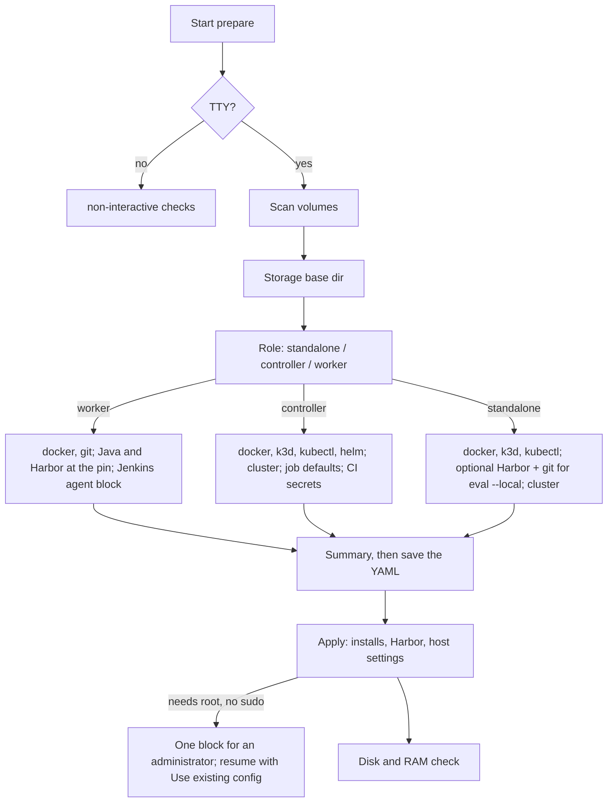

# Setup Guide

How to set up `mac-k3d` on **Linux** (Ubuntu/Debian for auto-install) or **macOS**: the machine roles, what the setup wizard asks, and the three layouts. The step-by-step for one new machine is [new-machine.md](new-machine.md). Config schema: [configuration.md](configuration.md). CLI flags: [commands.md](commands.md).

---

## How the machines fit together

Each machine is self-contained: its Docker, its k3d cluster (controller only) and its `kubectl` context are local. mac-k3d never builds one Kubernetes cluster across machines; Jenkins coordinates them.

| Role | Runs | Config file |
|------|------|-------------|
| Controller | Docker, a k3d cluster with Jenkins in it: the queue, the nine eval jobs, and the credentials ([secrets.md](secrets.md)) | `config.yaml` |
| Worker | Docker, Java, git, the pinned Harbor and the Jenkins agent. Eval builds run their Harbor containers on the worker's Docker. No k3d (`mac-k3d start -c worker.yaml` is rejected) | `worker.yaml` |
| Standalone | Docker and a local k3d cluster, optionally Harbor for `mac-k3d eval --local` | `config.yaml` |

Controller and workers can each be Linux or macOS. A worker's eval builds give the same phases, inputs and outputs on either OS ([pipeline.md](pipeline.md#linux-and-macos-workers)).

```text
                (LAN / VPN / routed network)
+--------------------------+      +--------------------------+
| Controller               |      | Worker 1 (Linux or Mac)  |
| - Docker                 |      | - Docker                 |
| - k3d cluster            |<-----| - Harbor + iCode runs    |
| - Jenkins in the cluster |      | - Jenkins agent          |
+--------------------------+      +--------------------------+
             ^
             |                    +--------------------------+
             +--------------------| Worker 2 (Linux or Mac)  |
                                  | - Docker                 |
                                  | - Harbor + iCode runs    |
                                  | - Jenkins agent          |
                                  +--------------------------+
```

Workers are not Kubernetes nodes of the controller's cluster. Each one connects out to Jenkins as an inbound agent. How Jenkins shares a worker's CPUs between builds: [optimization.md](optimization.md#scheduling-on-workers).

### Network

- Workers must reach the controller's Jenkins URL (`http://<controller-ip>:<jenkins.host_port>`); give the controller a DHCP reservation or a static IP.
- Machines in one room: a shared wired LAN (below). Elsewhere: a VPN or a routed network. Put HTTPS in front of Jenkins if it is reachable beyond the LAN, and never expose an unsecured Jenkins on the public internet.

### Physical LAN (co-located machines)

When several machines share **one Internet Ethernet drop**, put them on a switched LAN. Do not daisy-chain them, and do not use macOS Internet Sharing. Each Mac mini (and most PCs) already has its own RJ45; the constraint is the single uplink.

```text
ISP / wall RJ45  (one uplink)
        |
        v
   Router               <- NAT, DHCP, firewall
        |                 (skip if the ISP box already NATs)
        v
   Ethernet switch      <- unmanaged 5/8/16-port, gigabit or faster
        |          |          |
        v          v          v
   Controller   Worker 1   Worker 2
```

| Situation | What to buy |
|-----------|-------------|
| ISP box is already a router with one free LAN port | Ethernet switch only |
| ISP box is a modem/ONT with a single public IP | Router first, then a switch if the router does not have enough LAN ports |

A gigabit switch is enough for Jenkins agent traffic. Wi-Fi is a fallback only.

---

## Prerequisites

**Users:** download a Release binary and run `mac-k3d setup`. The wizard installs Docker (and k3d, kubectl, helm or Java, as the role needs) when you choose **Install**. See [new-machine.md](new-machine.md).

If auto-install fails, install Docker yourself:

| Linux | macOS |
|-------|-------|
| `sudo apt-get install -y docker.io docker-compose-v2 && sudo systemctl enable --now docker`, then log out and back in | `brew install --cask docker` (or Docker Desktop from docker.com), then open Docker Desktop once |

---

## Install mac-k3d

**Users:** download the GitHub Release binary for this machine (`mac-k3d-linux-x86_64`, `mac-k3d-linux-aarch64`, `mac-k3d-darwin-aarch64` or `mac-k3d-darwin-x86_64`), make it executable, and run `mac-k3d setup`. Rust is not required. See [new-machine.md](new-machine.md).

**Developers** from the repository:

```bash
git clone https://github.com/Toby-Yu/mac-k3d.git
cd mac-k3d
cargo install --path .
mac-k3d --help
```

---

## Wizard questions

`mac-k3d prepare` (and `mac-k3d setup`, which runs it first) asks the questions for this machine when stdin is a terminal, **saves the YAML**, and only then applies it: storage directories, the installs you chose, the pinned Harbor, host settings, and a final disk and RAM check. Nothing is installed until your answers are on disk, so a failed install never loses them.

```bash
mac-k3d prepare                    # interactive wizard (default on a terminal)
mac-k3d prepare --init-config      # write defaults without prompts (scripting)
mac-k3d prepare --non-interactive  # validate only; no prompts, no config changes
```

When the file already exists, an interactive run offers **Use existing config** (finish pending installs, then validate), **Re-run wizard** (ask every question again) or **Cancel**.



### Storage

Heavy artifacts go on a volume with enough free space; small config and state files stay in the home directory.

| Artifact | Typical size | Config key | Default under `storage.base_dir` |
|----------|--------------|------------|-----------------------------------|
| Docker images and layers | 10–100+ GB | `storage.docker` | `docker/` |
| k3d cluster data / image cache | 1–10 GB | `storage.k3d` | `k3d/` |
| Jenkins Helm charts and plugins | 500 MB–2 GB | `storage.jenkins` | `jenkins/` |
| Agent downloads | varies | `storage.downloads` | `downloads/` |
| mac-k3d config | KB | `~/.config/mac-k3d/` | *(not relocatable)* |
| Runtime state | KB–MB | `~/.local/state/mac-k3d/` | *(not relocatable)* |

The wizard lists the mounted volumes and defaults to the one with the most free space:

| Linux | macOS |
|-------|-------|
| `/`, `/mnt/*`, `/media/*`, `/data*` | `/`, `/Volumes/*` |

mac-k3d does not move Docker's data; apply prints `storage.docker` as the recommended place. To use it, set Docker's `data-root` in `/etc/docker/daemon.json` (Linux), or the disk image location under Docker Desktop > Settings > Resources (macOS).

### Role and tools

The role is stored as `role: standalone | controller | worker` (`jenkins.enabled` is true only for a controller), and the OS as `platform: linux | macos`. Each role is asked only about the tools it uses; a tool that is not asked is recorded as `skip`, or `existing` if found.

| Role | Asked | Not asked |
|------|-------|-----------|
| worker | docker, git | Java and Harbor (installed at the pin); no k3d, kubectl, helm or LoLBench (a worker hosts no cluster, and the pipeline clones each benchmark itself) |
| controller | docker, k3d, kubectl, helm | Harbor, java, git (a controller never runs an evaluation) |
| standalone | docker, k3d, kubectl; then "Run evals on this machine with `mac-k3d eval --local`?" (Harbor at the pin and git) | helm, java |

For each asked tool: use what was found (recommended), install it, point at a binary, or skip where that is allowed. Installs use `apt-get` on Linux and Homebrew on macOS.

**Harbor** is not a question. The pipeline's `env` phase asserts one version, `HARBOR_VERSION` in `pipeline/config/toolchain.env` (0.22.0), so setup installs that version with `uv tool install --force harbor==<pin>` into `~/.local/bin`, as you, without root (`uv` first if missing). After that, prepare puts `~/.local/bin` on this process's `PATH` and, if your shell config lacks it, asks before appending `export PATH="$HOME/.local/bin:$PATH"` (to `~/.zshrc`, `~/.bash_profile` / `~/.bashrc`, or `fish_add_path` for fish).

**Java** on a worker is pinned the same way: a Java at or above `JAVA_MAJOR` (21) if one is found (`JAVA_HOME`, PATH, `/usr/lib/jvm/*`, macOS `java_home -v 21+`), otherwise an install. A worker apply also downloads a missing `docker compose` / `docker buildx` plugin at the pin into `~/.docker/cli-plugins`. See [dependencies.md](dependencies.md).

| | Linux | macOS |
|-|-------|-------|
| Java install | `openjdk-21-jre-headless` (apt) | `temurin@21` (Homebrew cask) |
| bash 4.4+ and python3 3.11+ on the agent PATH | the distribution's packages | `brew install bash` / `brew install python` when the agent PATH has older ones |

### Worker: the Jenkins agent

```text
Jenkins controller URL [http://<controller-ip>:17070]:
Jenkins API user (Enter to skip and fill in worker.yaml later):
Jenkins API token (stored plaintext in config for now):
Agent name [{os}-<hostname>]:
Agent labels (space-separated) [{os} docker lolbench]:
Agent remote root directory [~/jenkins-agent]:
```

The agent-name default is `linux-<hostname>` or `macos-<hostname>`. `MAC_K3D_JENKINS_URL` or `JENKINS_URL` changes the URL default. Pressing **Enter** at the API user skips both keys: `worker.yaml` still gets them, empty, so you can see where they go and fill them in later:

```yaml
jenkins_agent:
  api_user: ''
  api_token: ''
```

The wizard does not register the agent; `mac-k3d config -c worker.yaml` does (setup runs it after apply). See [Step 3](#step-3-what-config-registers-on-the-controller). The token needs permission to run `/scriptText` (admin is fine). It is stored in plaintext for now; `mac-k3d export` blanks it.

### Controller: cluster, job defaults, secrets

1. Cluster name, k3d agent nodes (default `0`), Jenkins UI host port (default `17070`). Busy host ports are remapped before the summary.
2. Job defaults: `ICODE_MODE` (`release` or `git`), `TASK`, `ICODE_RELEASE`, `ICODE_GIT_URL`, `ICODE_GIT_REF`, `ICODE_ARGS`, saved under `jenkins_job`.
3. CI secrets (DeepSeek key, GitCode/GitHub PAT) go to `~/.config/mac-k3d/credentials.pending.yaml` (mode 0600), **not** into `config.yaml`. `config` turns them into Jenkins Secret text credentials ([secrets.md](secrets.md)).

### Apply, root steps and disk check

Apply installs in the order docker, git, java, k3d, kubectl, helm, harbor. A tool that appeared since the wizard ran (root installed it) is recorded instead of installed. `sudo` is asked at most once, and only when something needs it.

What a worker's host needs, and what apply checks:

| Linux | macOS |
|-------|-------|
| Docker runs, you are in the `docker` group, and `loginctl enable-linger` is on so the agent survives logout | Docker Desktop runs. Nothing needs root; `config` warns when automatic login is off or the Mac sleeps (see [new-machine.md](new-machine.md#mac-mini-worker)) |

When you cannot use `sudo` on Linux, apply does not stop half-way: it saves what it did install and prints one block for an administrator, listing only what is missing, for example:

```text
Ask an administrator to run these as root on this machine:

  apt-get install -y openjdk-21-jre-headless   # install java
  usermod -aG docker <you>                     # let <you> use Docker without sudo (then log out and back in)
  loginctl enable-linger <you>                 # keep the Jenkins agent running after you log out

Your answers are saved in ~/.config/mac-k3d/worker.yaml. Afterwards log out and back in (so a new
docker group applies), then run:
  mac-k3d setup -c ~/.config/mac-k3d/worker.yaml
and choose "Use existing config"; setup carries on from the installs.
```

Harbor never appears there: it installs per user with `uv`.

**Disk and RAM (hard fail).** Free space on `storage.base_dir`'s volume (on a worker also at `jenkins_agent.remote_fs`, where builds clone and run), and at least `MIN_RAM_GB` (8) GB of memory. On macOS that memory is Docker Desktop's limit, not the Mac's RAM.

| Role | Minimum free (default) |
|------|------------------------|
| standalone | `WORKER_MIN_DISK_GB` (40 GB) |
| controller | 60 GB |
| worker | `WORKER_MIN_DISK_GB` (40 GB; plan on about 100 GB: Harbor task images are multi-GB) |

`MIN_RAM_GB` and `WORKER_MIN_DISK_GB` are in `pipeline/config/toolchain.env`, which each build's `env` phase reads too, so both checks use the same numbers. Override with `prepare --disk-min-gb N` for labs (discouraged), or per build with `MAC_K3D_MIN_RAM_GB` / `MAC_K3D_MIN_DISK_GB`.

Validation of a worker also fails when the agent's Java is older than `JAVA_MAJOR`: the controller would refuse that agent. An old bash or python3 on the agent PATH is a **warning** here and in `mac-k3d config`, so setup still finishes and the agent comes up; each build's `env` phase then refuses to run until it is fixed.

`prepare --non-interactive` loads the existing config, checks that every tool the role needs is present (a tool still marked `install` fails with "run `mac-k3d setup` and choose \"Use existing config\""), runs the disk check, and exits 0 or 1. It registers nothing.

### Config written

```yaml
role: worker   # standalone | controller | worker
platform: linux   # linux | macos

dependencies:
  harbor:
    source: existing
    binary: /home/you/.local/bin/harbor
  java:
    source: existing
    binary: /usr/bin/java
  git:
    source: existing
    binary: /usr/bin/git

jenkins_agent:        # worker only
  controller_url: http://<controller-ip>:17070
  api_user: ''        # always present; empty until you fill it in
  api_token: ''
  name: linux-worker-1
  labels: ["linux", "docker", "lolbench"]
  remote_fs: /home/you/jenkins-agent
  agent_jar: /data/mac-k3d/downloads/jenkins-agent/agent.jar
  cpu_cores: 16       # logical CPUs at prepare time (macOS: capped at Docker Desktop's CPU limit)

resources:
  cpu_cores_label: CPU_CORES
```

### Source map

| Module | Does |
|--------|------|
| `src/prepare/wizard/mod.rs` | Storage, role, summary, the existing-config choice |
| `src/prepare/wizard/{worker,controller,standalone}.rs` | The questions for one role, and nothing else |
| `src/prepare/wizard/prompts.rs` | Shared prompts: one dependency, storage, ports, the pinned Harbor, the summary |
| `src/commands/prepare.rs` | Wizard, save, then apply and validate |
| `src/prepare/apply.rs` | Storage directories, installs in order (Harbor last), worker host settings, disk/RAM check |
| `src/prepare/root_steps.rs` | Collects what needs root into one printed block |
| `src/prepare/toolchain.rs` | The Harbor pin compiled in from `pipeline/config/toolchain.env`; installs it with `uv` |

---

## Scenario A: One machine, local k3d only

Use this when you want a local Kubernetes cluster without Jenkins.

```bash
mac-k3d prepare      # the wizard; choose "Local development only"
mac-k3d start        # starts Docker if needed, then creates or starts the k3d cluster
mac-k3d config       # merges kubeconfig and selects the k3d context
mac-k3d status
kubectl get nodes
```

End of day: `mac-k3d teardown`. To remove the cluster: `mac-k3d clean --yes`.

---

## Scenario B: One machine, Jenkins controller

Use this when one machine runs both the k3d cluster and Jenkins.

```bash
mac-k3d prepare --init-config
```

Edit `~/.config/mac-k3d/config.yaml`:

```yaml
cluster:
  name: ci-controller
  agents: 0

jenkins:
  enabled: true
  host_port: 17070
```

```bash
mac-k3d start --jenkins in-cluster
mac-k3d config --show-jenkins
```

Open `http://localhost:17070` and complete the Jenkins setup wizard.

### Jenkins plugins

`mac-k3d start` on the **controller** is the only plugin-install path. Helm `upgrade --install` with `overwritePlugins: true` adds these on top of the chart defaults (Kubernetes, Pipeline, Git, Configuration as Code):

- `lockable-resources` — per-worker `<agent>-core-N` capacity locks
- `plain-credentials` — Secret text for LLM keys and forge PATs
- `file-parameters` — `ICODE_RELEASE_FILE` upload onto the agent workspace
- `copyartifact` — the `some_task` / `full_suite_task` `Aggregate` stage copies each shard's `eval-runs/`
- `pipeline-utility-steps` — `nodesByLabel`, so a dispatcher counts the online executors for `MAX_IN_FLIGHT` and stops at once when no online worker carries `AGENT_LABEL`
- `hidden-parameter` — `ui_profile: user` hides developer parameters while keeping their defaults

`mac-k3d config` rewrites the job XML ([jenkins-jobs.md](jenkins-jobs.md)) and credentials. It does not Helm-upgrade plugins. Workers never install plugins, and the per-core lock entries are created when a worker runs `mac-k3d config -c worker.yaml`. Do not create them by hand under Manage Jenkins, and do not install extra plugins from the Jenkins UI.

```bash
mac-k3d status
kubectl get pods -n jenkins
```

---

## Scenario C: Controller and workers

Use this when one machine runs Jenkins and the others run Jenkins agents. Connect them as in [Physical LAN](#physical-lan-co-located-machines) when they share a room.

### Step 1: Set up the controller

Follow [Scenario B](#scenario-b-one-machine-jenkins-controller), and add a longer Docker start timeout:

```yaml
docker:
  startup_timeout_secs: 180
```

Workers must reach the controller's Jenkins. Choose one:

| Option | Workers use |
|--------|-------------|
| Shared LAN (co-located) | the controller's LAN IP or hostname, for example `http://192.168.1.10:17070` |
| VPN or private overlay (not co-located) | the controller's VPN IP or hostname |
| Reverse proxy with TLS | a stable public hostname in front of port 17070 |
| SSH tunnel (development only) | `ssh -L 17070:localhost:17070 user@controller` on the worker, then `http://localhost:17070` |

### Step 2: Set up each worker

```bash
mac-k3d setup -c ~/.config/mac-k3d/worker.yaml
# Role: CI worker
# Docker / git: Install if not found (Java 21+ and Harbor are installed at the pin, not asked)
# Jenkins controller URL: http://<controller-ip>:17070
# API user / token: admin + an API token from the controller, or Enter to skip
```

Skipped the token? Fill in `api_user` and `api_token` in `worker.yaml`, then run `mac-k3d config -c ~/.config/mac-k3d/worker.yaml`. A Mac worker needs a few one-time settings first (automatic login, no sleep, Docker Desktop resources): [new-machine.md](new-machine.md#mac-mini-worker). Full walkthrough: [new-machine.md](new-machine.md#b-worker--jenkins-agent).

Never run `mac-k3d start -c worker.yaml`; it is rejected on purpose.

### Step 3: What `config` registers on the controller

`mac-k3d config -c worker.yaml` is the only command that registers an agent. Using the API token it:

1. Downloads `agent.jar` from `{url}/jnlpJars/agent.jar` and swaps it in only when the bytes differ.
2. Creates or updates the node: executors = `cpu_cores / cpus_per_executor`, the agent labels (default `<os> docker lolbench`) plus `fits-<suite>` and `executors-<n>`, launch method **Inbound**; reads the connection secret.
3. Creates the lockable resources `<agent>-core-1..N` (N = `cpu_cores`), labelled with the shared `CPU_CORES` label and the agent name, and deletes any above N.
4. Writes `launch-agent.sh` and installs the agent service, restarting it only when the jar, script or service file changed.

| Linux | macOS |
|-------|-------|
| systemd user unit `mac-k3d-jenkins-agent.service` | LaunchAgent `com.mac-k3d.jenkins-agent` (`~/Library/LaunchAgents/com.mac-k3d.jenkins-agent.plist`) |

Do not create nodes or lock entries by hand. Each eval build locks the CPUs its question declares, only for its Evaluate stage ([optimization.md](optimization.md#scheduling-on-workers)).

### Step 4: Verify

| Check | Command / action |
|-------|------------------|
| Controller cluster | `mac-k3d status` on the controller |
| Jenkins reachable from a worker | `curl -sS -o /dev/null -w '%{http_code}\n' http://<controller-ip>:17070/login` on the worker |
| Agent online | Jenkins UI → Nodes → the agent shows **online**. Executors are `cpu_cores / 2` (a 4-core worker shows 2) |
| Worker toolchain | `harbor --version` prints the pin (0.22.0); `REQUIRE_WORKER=1 ./scripts/env_set_up/03_check_worker.sh` |
| Job runs on the worker | Run `deepswe_one_task`; the console says `Running on <agent>` and shows seven stages with the lock only around Evaluate |

The agent service on the worker:

| Linux | macOS |
|-------|-------|
| `systemctl --user status mac-k3d-jenkins-agent` (want `Active: active (running)`) | `launchctl print gui/$(id -u)/com.mac-k3d.jenkins-agent` (want `state = running`) |

The agent's log is the same file on both: `tail -n 50 ~/jenkins-agent/jenkins-agent.stdout.log` (and `.stderr.log`), under `jenkins_agent.remote_fs`.

---

## Daily operations

On the controller after a reboot:

```bash
mac-k3d start --jenkins in-cluster
mac-k3d config
```

Workers need no command:

| Linux | macOS |
|-------|-------|
| The agent starts at boot (linger) | The agent and Docker Desktop start at login, so turn on automatic login |

If a worker stays offline, run `mac-k3d config -c ~/.config/mac-k3d/worker.yaml` on it.

End of day on the controller: `mac-k3d teardown` (add `--stop-docker` to quit Docker too). Status anywhere: `mac-k3d status`.

---

## Troubleshooting

| Symptom | Likely cause | Fix |
|---------|--------------|-----|
| `docker info` fails | Docker not running | Linux: `sudo systemctl start docker`. macOS: open Docker Desktop. Then re-run `mac-k3d start` |
| k3d cluster not found | First run or after `clean` | `mac-k3d start` recreates it |
| Jenkins pod not ready | Helm install still rolling out | `kubectl get pods -n jenkins -w` |
| Worker agent offline | Network, blank API keys, or agent process stopped | Check VPN/firewall; fill `api_user` / `api_token` in `worker.yaml`; `mac-k3d config -c worker.yaml` |
| Mac worker offline after a restart | Automatic login is off, so neither Docker Desktop nor the LaunchAgent started | Turn on automatic login ([new-machine.md](new-machine.md#mac-mini-worker)); `mac-k3d status` prints the warning |
| Agent log: `UnsupportedClassVersionError` (class file version 65 vs 61) or "Connection was broken"; node offline although the service is running | The worker's Java is older than the controller's (`JAVA_MAJOR`, 21) | `mac-k3d setup -c worker.yaml` → **Use existing config**: switches to a Java 21 already on the machine, or installs one (an administrator block without sudo). `mac-k3d config` prints `java 21: ok` when fixed |
| Jobs queue forever on a worker | Agent offline, or no `<agent>-core-N` resources | Check Nodes and Lockable Resources; re-run `mac-k3d config -c worker.yaml` |
| Port already in use | Conflicting service on host port | Change `jenkins.host_port` or `cluster.ports` in config |

Debug logging: `RUST_LOG=debug mac-k3d -vv start`.

---

## Cleanup

```bash
mac-k3d clean --yes                  # remove the cluster and state on this machine
mac-k3d clean --yes --purge-config   # also remove the config
```

On the controller, delete worker nodes before decommissioning a worker.
