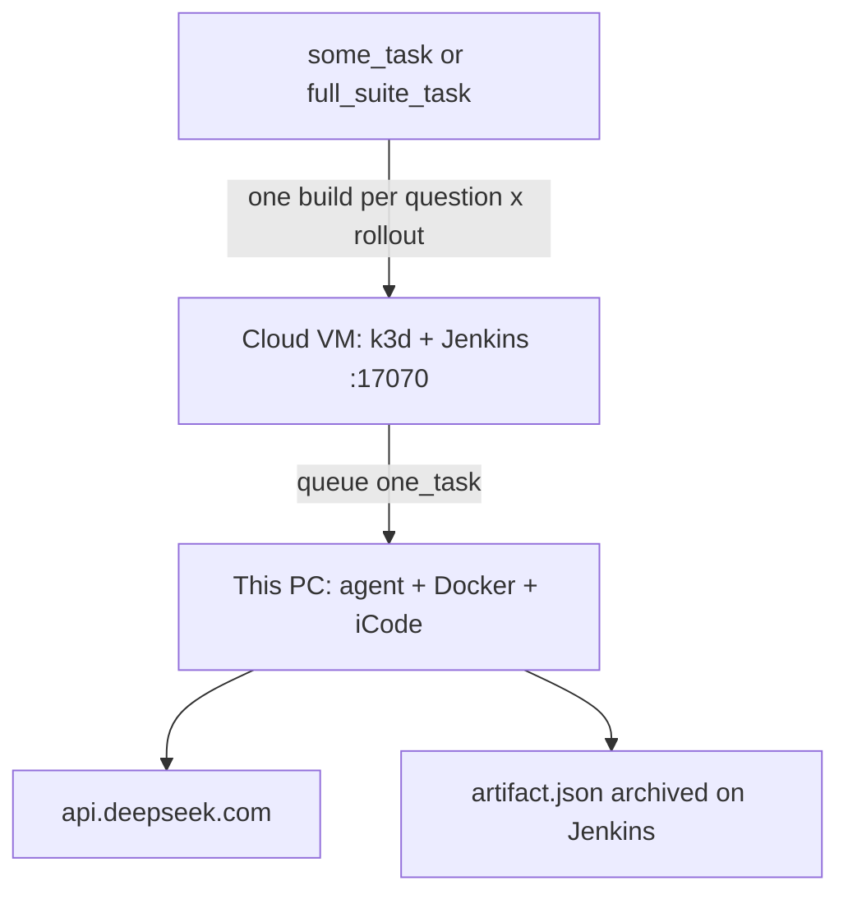

# Testing the iCode eval pipeline (phases / E0–E8)

Lab runbook (this team), not the user start-here. **Users:** [user-guide.md](../user-guide.md). This lab’s IPs: [cloud-eval-runbook.md](cloud-eval-runbook.md).

Per-phase CLI checks for Process 2 (Harbor + iCode). The phases, their steps and every Harbor flag are in [pipeline.md](../pipeline.md). A full eval does not run the LLM-only baseline; `mac-k3d eval --stage baseline` still exists and is not a published result.  
Machine bootstrap first: [testing-binary-initializer.md](testing-binary-initializer.md) and [workflow.md](../workflow.md).  
**This lab (cloud root + this PC):** copy-paste phases and flowcharts in [cloud-eval-runbook.md](cloud-eval-runbook.md). **Users:** [user-guide.md](../user-guide.md).

**Sign-off:** DeepSWE **E0–E7** with `--n-tasks 1` (Harbor path). LoLBench and SWE-bench Pro are separate jobs with the same phases. E8 is optional N>1. Keep `env` and `tasks` cheap (no LLM).

Phase and step scripts live under [`pipeline/stages/`](../../pipeline/stages/), manual tools under [`pipeline/tools/`](../../pipeline/tools/), helpers under [`pipeline/lib/`](../../pipeline/lib/). The CLI runs one phase with `--stage <phase>`:

```bash
export PATH="$HOME/.local/bin:$PATH"
export DEEPSEEK_MODEL=deepseek-v4-pro
mac-k3d eval --stage env
mac-k3d eval --stage tasks --n-tasks 1
mac-k3d eval --stage evaluate --n-tasks 1 --model deepseek-v4-pro
mac-k3d eval --local --n-tasks 1    # every phase, after the single phases pass
mac-k3d eval                        # interactive → Jenkins job deepswe_one_task
```

Default workdir: `./eval-runs` (override with `MAC_K3D_EVAL_WORKDIR`).  
Default iCode for CI: `ICODE_MODE=release` (alias `binary`) and `~/.local/share/mac-k3d/icode` or `icode-*-full-*`, or `ICODE_MODE=git` (clone URL + ref). See [icode-harness-inputs.md](../icode-harness-inputs.md). `ICODE_MODE=git` clones an allow-listed `https://` URL at `ICODE_GIT_REF` using `ICODE_GIT_REF_KIND` (`branch` / `tag` / `commit`, including a PR SHA, or `pr` for a pull-request number) then bind-mounts a wrapper at `/opt/icode-host`. The eval JSON records `icode_git` (url, kind, ref, resolved sha, subject). Private clones need `GITCODE_TOKEN` / `GITHUB_TOKEN` in gitignored `.env` (TTY PAT prompt) or Jenkins `gitcode-pat` / `github-pat`.  
Default model: `deepseek-flash` (`DEEPSEEK_MODEL` or `--model`). Catalog also allows `deepseek-v4-pro` (`mac-k3d eval --model deepseek-v4-pro`, Jenkins **DEEPSEEK_MODEL** choice, or `mac-k3d set --model`). API `model` in the response is stored as `model_served`.

---

## Topology (cloud controller + this PC as worker)

Jobs must **not** run inside the controller’s k3d nodes. Jenkins on the cloud VM only queues; this PC (Docker + Harbor + iCode) executes.



Worker wizard default is `http://43.107.42.252:17070`. Type a new `http://<ip>:17070` or export `JENKINS_URL` for another controller. Never `mac-k3d start -c worker.yaml`.

After changing **job XML** (parameters, timeout, stages) refresh on the **cloud** controller:

```bash
mac-k3d config -c ~/.config/mac-k3d/config.yaml --skip-secrets
```

Whatever changed (job XML, `pipeline/`, agent registration), `bash scripts/redeploy.sh --controller <user>@<controller> --worker <user>@<worker>` from your checkout does both: it installs the new binary everywhere and runs this `config` on the controller and `config -c worker.yaml` on each worker. See [../workflow.md](../workflow.md#development-loop-commit-push-redeploy).

---

## Required information (collect before E4)

| Item | Notes |
|------|--------|
| Cloud VM public IP or DNS | SSH access; ~8 GB+ RAM |
| Ports | **17070** (and optionally 18080) open to this PC |
| Jenkins admin password | After cloud `setup` |
| Jenkins API token | **Secret**, not the token *name*, for worker register |
| Credential `deepseek-api-key` | Stored on the **cloud** controller |
| iCode on this PC | Downloaded `*-full-*` drop under `~/.local/share/mac-k3d/`, or `ICODE_MODE=git` |
| mac-k3d redeployed | Jenkins runs the pipeline inside each worker's `mac-k3d`; run `scripts/redeploy.sh` after each commit and push so every host prints the same `mac-k3d --version` |
| API model string | Catalog `deepseek-flash` (default) or `deepseek-v4-pro` (`DEEPSEEK_MODEL` / `--model` / Jenkins choice) |
| N for smoke | **1**; larger N later (E8) |

Do not commit API keys. Do not commit leftover Harbor-named `launch-agent.sh` directories.

---

## E0–E8 tracking

Copy-paste commands. Use `--n-tasks 1` until E4–E6 are green.

| Check | Command | Expected | Pass (y/n) | Notes |
|-------|---------|----------|------------|-------|
| **E0** Cloud controller | On the **cloud** VM: Release binary, first-run wizard, role **CI controller**, Jenkins **17070**, Harbor skip, credential `deepseek-api-key`. Open security group **17070**. Then `JENKINS_URL=http://127.0.0.1:17070 ./scripts/env_set_up/02_check_controller.sh` | Browser `http://<cloud-ip>:17070` HTTP 200; job `deepswe_one_task` present | | Once per VM |
| **E1** This PC as worker | On this PC: `setup -c worker.yaml`. Enter keeps `http://43.107.42.252:17070`. User `admin`, API **secret**, distinct agent name. Never `start -c worker.yaml`. `JENKINS_URL=http://43.107.42.252:17070 ./pipeline/tools/e1_reach_jenkins.sh` then `REQUIRE_WORKER=1 JENKINS_URL=http://43.107.42.252:17070 ./scripts/env_set_up/03_check_worker.sh` | `e1`: HTTP 200; start rejected; unit active; node **online** in **cloud** Jenkins → Nodes | | |
| **E2** `env` + `tasks` (no LLM) | See commands below | Every step prints its `OK` line; `tasks/agent` prints `icode_harbor_agent:ICodeAgent`; `tasks/isolation` prints the agent hosts | | Fast |
| **E3** Report schema (no LLM) | `./pipeline/tools/check_report.sh pipeline/lib/testdata/report-min.json` | `OK report schema` | | Instant |
| **E4** `evaluate` n=1 (paid) | `mac-k3d eval --stage evaluate --n-tasks 1` with gitignored `.env` (or Jenkins bind `deepseek-api-key`), after E2 | `OK slots`, then `PROGRESS n% evaluate`; minutes of Harbor/Docker/LLM; `reward.json`. CLI usage errors fail the phase | | |
| **E5** Baseline, manual only | `DEEPSEEK_MODEL=deepseek-v4-pro mac-k3d eval --stage baseline --n-tasks 1` | Not part of `run_all`. A hand run still writes `baseline/<task>/agent.patch` and `baseline/summary.json`. That output is not published | | |
| **E6** Report fields | `mac-k3d eval --stage anticheat`, then `--stage score`, `--stage report --n-tasks 1` and `--stage archive`; then `./pipeline/tools/check_report.sh` | `eval-runs/output/deepswe/<run>/artifact.json` with `icode`, plus `summary.md`, `report.html` and `cost-token-report.md`; `output/deepswe/<run>.tar.gz` | | |
| **E7** Jenkins `deepswe_one_task` | UI **Build with Parameters**: `ICODE_MODE=release`, upload `ICODE_RELEASE_FILE`, `DEEPSEEK_MODEL=deepseek-v4-pro`, `AGENT_LABEL=lolbench`. Git: same UI with `ICODE_MODE=git` (or `mac-k3d eval --icode-mode git … --yes` without `--local`). Release `--yes` cannot attach a file | Build on **this** node; seven stages, `lock` only around Evaluate; archived JSON; same schema | | |
| **E8** optional N>1 | Same as E6/E7 with `--n-tasks` > 1 | Same schema; `n_tasks` matches N | | After E6 green |

### E2 commands

```bash
export PATH="$HOME/.local/bin:$PATH"
export DEEPSEEK_MODEL=deepseek-v4-pro
mac-k3d eval --stage env
mac-k3d eval --stage tasks --n-tasks 1
```

One step on its own, after its phase has run once (each step reads the files the earlier steps left in `eval-runs/`): `bash pipeline/stages/tasks/isolation.sh`.

Schema unit test (no network): `python3 pipeline/lib/test_report.py`

iCode fixtures (no Jenkins):

```bash
bash pipeline/tools/test_icode_input.sh
bash pipeline/tools/test_icode_build.sh
```

### Git-mode iCode in the `tasks` phase (same path a user runs)

Do **not** use `MAC_K3D_ICODE_FETCH_DIR`. Rebuild the CLI first so the PAT prompt exists.

```bash
cargo build --release
export PATH="$PWD/target/release:$HOME/.local/bin:$PATH"
# Hidden PAT prompt if .env has no GITCODE_TOKEN. Do not paste the PAT into chat.
mac-k3d eval --stage tasks --n-tasks 1 --icode-mode git \
  --icode-git-url https://gitcode.com/ORG/icode --icode-git-ref main \
  --icode-git-ref-kind branch
```

Expected: `Saved GITCODE_TOKEN to .env (mode 600)` on first run (or `Using GITCODE_TOKEN from env or .env`); clone finishes (or fails within 90s with a PAT hint); `eval-runs/icode_bin_path.txt`, `icode_host_root.txt`, and `icode_git.json` exist; console prints `OK iCode git kind=branch ref=main sha=…`. A leftover clone may print `removing leftover …/icode-src via docker` then continue — that is expected, not a failure.

Jenkins (after the local `tasks` phase works): on the **controller**, `mac-k3d config --update-secrets` and enter the GitCode PAT into `gitcode-pat`. Then UI **Build with Parameters**: `ICODE_MODE=git`, the same URL/ref, `ICODE_GIT_REF_KIND=branch` (or `tag` / `commit` for a PR SHA, or `pr` with the pull-request number in `ICODE_GIT_REF`), no PAT in those fields. To test unreleased pipeline code, commit, push and run `scripts/redeploy.sh` first; the job has no pipeline field.

---

## LoLBench track (Harbor)

`lolbench_one_task` is Harbor + iCode, same runner as DeepSWE and SWE-bench Pro. `tasks/agent` checks that `icode_harbor_agent` imports. Jenkins **SUCCESS** means `reward.json` exists (the pipeline ran). It does **not** mean `pass_at_1=1`. Match Harbor’s Resolved/Reward column: F2P 0.368 with Resolved 0.0 is a valid score.

Jenkins runs the `pipeline/` embedded in the worker's installed `mac-k3d`, extracted once per build to `$WORKSPACE/mac-k3d-pipeline`. To test changes: commit, push, `bash scripts/redeploy.sh …`, then build. The console prints `mac-k3d pipeline <sha>` and `artifact.json` keeps it under `eval_protocol.pipeline.commit`; to rebuild that exact commit later, check it out and redeploy. Full loop: [../workflow.md](../workflow.md#development-loop-commit-push-redeploy).

| Check | Command | Expected | Pass (y/n) | Notes |
|-------|---------|----------|------------|-------|
| **L2** `env` + `tasks` (no LLM) | `mac-k3d eval --benchmark lolbench --task ruff_1 --stage env` then `--stage tasks` | Every step `OK`; `tasks/images` prints `OK task images ready for lolbench`; `tasks/agent` prints `icode_harbor_agent:ICodeAgent` | | Fast |
| **L3** Schema | `./pipeline/tools/check_report.sh pipeline/lib/testdata/report-min.json` and `python3 pipeline/lib/test_report.py` | `OK report schema`; unit tests include nested Harbor `ruff_1` rates | | Instant |
| **L4** `evaluate` n=1 (paid) | `mac-k3d eval --benchmark lolbench --task ruff_1 --icode-mode binary --stage evaluate` | `PROGRESS n% evaluate`; `harbor_runs/…/reward.json`; local image or docker build. Missing `reward.json` fails; reward `0.0` is a score | | |
| **L5** Baseline, manual only | `mac-k3d eval --benchmark lolbench --task ruff_1 --stage baseline` | Not part of `run_all`. A hand run still writes `baseline/ruff_1/agent.patch`. That output is not published | | |
| **L6** Report | `mac-k3d eval --benchmark lolbench --task ruff_1 --stage anticheat`, then `score`, `report`, `archive`; `./pipeline/tools/check_report.sh` | Same schema as DeepSWE (`suite=lolbench`); `f2p` / `p2p` rates from Harbor; `reward` from reward.json; `wall_minutes` | | |
| **L7** Jenkins `lolbench_one_task` | UI **Build with Parameters**: `TASK=ruff_1`, `ICODE_MODE=release`, upload `ICODE_RELEASE_FILE`, `DEEPSEEK_MODEL=deepseek-v4-pro`, `AGENT_LABEL=lolbench`. Git: same UI or `mac-k3d eval --benchmark lolbench --task ruff_1 --icode-mode git … --yes` without `--local`. Release `--yes` cannot attach a file | Build on **this** node (not a k3d agent); Evaluate is one `harbor run`; archived JSON; SUCCESS ≠ resolved | | |

L2 commands:

```bash
export PATH="$HOME/.local/bin:$PATH"
export DEEPSEEK_MODEL=deepseek-v4-pro
mac-k3d eval --benchmark lolbench --task ruff_1 --stage env
mac-k3d eval --benchmark lolbench --task ruff_1 --icode-mode binary --stage tasks
```

---

## SWE-bench Pro track (Harbor)

`swebenchpro_one_task` is Harbor + iCode, same runner as DeepSWE. `tasks/benchmark` writes a Harbor task whose `docker_image` is the official `jefzda/sweap-images:…` tag. The Dockerfile clears the image `ENTRYPOINT` so Harbor's keepalive can start. The verifier scores `FAIL_TO_PASS` / `PASS_TO_PASS` into `reward.json`. Images are 1–3 GB; first live job is **one** `TASK` (`instance_id`).

| Id | What | Pass when | Notes |
|----|------|-----------|-------|
| **S2** `env` + `tasks` (no LLM) | `mac-k3d eval --benchmark swebenchpro --n-tasks 1 --stage env` then `--stage tasks` | Every step `OK`; task dir has `task.toml` | Fast after the first clone |
| **S4** `evaluate` n=1 (paid + large image) | `mac-k3d eval --benchmark swebenchpro --n-tasks 1 --icode-mode binary --stage evaluate` | `harbor run` with `icode_harbor_agent:ICodeAgent`; `reward.json` | Slow |
| **S7** Jenkins | UI **Build with Parameters** on `swebenchpro_one_task`; same iCode git/release as DeepSWE | Build on this node; archived JSON `suite=swebenchpro` | |

---

## JSON report fields

Written by [`pipeline/lib/score_results.py`](../../pipeline/lib/score_results.py) in the `score` and `report` phases. Same schema for `deepswe_one_task`, `lolbench_one_task`, and `swebenchpro_one_task` (`suite` differs). Validate with [`pipeline/tools/check_report.sh`](../../pipeline/tools/check_report.sh).

| Field | Meaning |
|-------|---------|
| `suite`, `harness`, `n_tasks`, `n_rollouts` | `deepswe`, `lolbench`, or `swebenchpro`; `icode`; N questions; **1** attempt per question |
| `model` / `model_served` / `api_base` | Requested catalog id (default `deepseek-flash`), API-served id, endpoint |
| `access_date_utc` | When the run was recorded (UTC) |
| `wall_seconds` / `wall_minutes` | Harbor wall clock on the `score` scratch JSON |
| `pass_at_1` | Mean of `c_t/n_t` (resolved attempts; n=1 → 0 or 1 per task) |
| `macro.f2p` / `p2p` / `partial` / `reward` | Mean per-task rates (`null` if the verifier has no value) |
| `tokens.in` / `out` / `total` | Harness API prompt/completion. Missing → `null` |
| `tasks[].id` | Question dir name |
| `tasks[].c` / `n` / `pass_frac` / `first` | Resolved rollouts, attempts, `c/n`, first-rollout resolved |
| `tasks[].reward` | 1.0 resolved, 0.0 not (Harbor `reward.json`) |
| `tasks[].f2p` / `p2p` | FAIL_TO_PASS / PASS_TO_PASS **rates** in `[0,1]`, never test-name lists |
| `tasks[].f2p_pass` / `f2p_total` | Optional counts when the verifier exposes them |
| `tasks[].tok_in` / `tok_out` / `dur_s` / `dur_min` | Harness API tokens and time for this question (`null` if unknown) |
| `tasks[].baseline` | Only on the `score` scratch JSON. Empty unless the baseline was run by hand. The published `artifact.json` has no second arm |

---

## `env` — is this worker fit to run an evaluation?

**Why:** Without Docker, the pinned Harbor and a served model, nothing later can run.

```bash
mac-k3d eval --stage env
# or one step: bash pipeline/stages/env/harbor.sh
```

**Expected:** `OK RAM`, `OK disk`, `OK docker Server section present`, `OK mac-k3d=… lists eval`, `OK docker compose …`, `OK docker buildx …`, `OK harbor=… version=0.22.0` (the pin in `pipeline/config/toolchain.env`; another version is replaced with `uv tool install --force harbor==0.22.0`), `OK egress control: Harbor default probe alpine:3.23.4@sha256:…` and `OK egress sidecar harbor-prebuilt:harbor-docker-egress-control-sidecar--… present` (or `note: Harbor builds its egress sidecar … on the first trial`). A host whose Docker cannot run Harbor's probe image prints `WARNING: Harbor's probe image … cannot run on this host (<docker error>); using harbor-prebuilt:harbor-docker-egress-control-sidecar--… for the kernel check. Network isolation is unchanged.` (or `using alpine:3.19@sha256:6baf4358…` when the sidecar is absent or cannot run either), then one `  tried <image>: <result>` line per image, and the run's `summary.md` shows `Egress probe: substituted …`. A probe container that does not finish prints `egress probe in <image> timed out after 60s: docker container run --rm; removed mac-k3d-egress-probe-…, retrying with 180s`. When `DEEPSEEK_API_KEY` is set (local `.env` or Jenkins credential), `env/model_api` also calls `GET /models` and fails if `DEEPSEEK_MODEL` is not a `data[].id` (cheap; not a paid completion). A VPN with a smaller MTU than Docker's bridge prints `WARNING: egress via … has MTU …`.

## `tasks` — per-task setup and checks

**Why:** Tasks (Dockerfile, instruction, tests) are not in this git repo, and the iCode under test must be built, sandboxed and mounted read-only before any container starts.

```bash
mac-k3d eval --stage tasks --n-tasks 1
# release / binary drop
ICODE_MODE=release ICODE_RELEASE=/path/to/icode-*-full-*.tar.gz mac-k3d eval --stage tasks --n-tasks 1
# git clone
mac-k3d eval --stage tasks --n-tasks 1 --icode-mode git \
  --icode-git-url https://github.com/ORG/icode.git --icode-git-ref main --icode-git-ref-kind branch
```

**Expected, step by step:** `tasks/benchmark` prints `OK deepswe tasks dir … (113 task dirs)` after checking out `https://github.com/datacurve-ai/deep-swe` at its pin; `tasks/select` prints `OK selected <ids>`; `tasks/icode` prints `OK icode helps (…)`; `tasks/agent` prints `icode_harbor_agent:ICodeAgent`; `tasks/isolation` prints `OK isolation: mount …, agent hosts api.deepseek.com api.deepseek.ai`; `tasks/leakscan` prints `OK leak scan: no task gold in …`.

## `evaluate` — slots, canary, one `harbor run` (N=1)

**Why:** End-to-end harness path (expensive: image build + LLM). This is the only phase under the CPU lock on Jenkins.

```bash
# key from gitignored .env — do not export DEEPSEEK_API_KEY
mac-k3d eval --stage evaluate --n-tasks 1
# print the canary and Harbor commands without running them
MAC_K3D_HARBOR_DRY_RUN=1 mac-k3d eval --stage evaluate --n-tasks 1
```

**Expected:** `OK slots: EVAL_SLOTS=…`; the canary report (`canary: pass`) before any rollout; then `PROGRESS n% evaluate` lines from one `harbor run` with `-k N_ROLLOUTS` and `-n` slots planned from the locked cores ([optimization.md](../optimization.md)). The agent runs `icode -p … run -t <instruction> -C <repo> -a code --json`, plus `ICODE_API_BASE` / `ICODE_PROVIDER` / `ICODE_MODEL`. `--allow-agent-host` is `api.deepseek.com` and `api.deepseek.ai`, from `pipeline/config/network-allowlist-v1.json`. A missing `reward.json` on one unit is a scored miss; reward `0.0` is a score. `harness/meta.json` (timing/model/tokens). `No such option` / usage errors **fail** the phase. Jenkins `mac-k3d eval --yes` uses the `pipeline/` embedded in the **installed binary**, so redeploy (`scripts/redeploy.sh`) after changing the Harbor agent.

## Baseline — manual only, not part of a full eval

**Why:** The no-harness chat arm is not published. `run_all` does not call it. A later comparison harness can replace it.

```bash
mac-k3d eval --stage baseline --n-tasks 1
```

**Expected:** A hand run posts `instruction.md` to DeepSeek and writes `.patch` under `baseline/`. That folder is not copied into `output/` and is not the Jenkins artifact.

## `anticheat` and `score`

**Why:** Every rollout gets a capture check and a `clean` / `flagged` / `rejected` verdict, then a scratch score. The scratch file is not the published report.

```bash
mac-k3d eval --stage anticheat
mac-k3d eval --stage score
```

**Expected:** `<trial>/agent/capture_flags.json` and `<trial>/agent/anticheat.json` per trial, `harness/anticheat/summary.json`; then `OK wrote eval-runs/results/score-temp.json` with per-task `reward`, `f2p`/`p2p` rates, `pass_at_1`, tokens, `wall_minutes`, and `model` (rates may be `null` if the verifier only exposes resolved).

## `report` and `archive`

**Why:** One folder names which eval ran, and one compressed copy outlives the workspace.

```bash
mac-k3d eval --stage report --n-tasks 1
mac-k3d eval --stage archive
./pipeline/tools/check_report.sh
```

**Expected:** `eval-runs/output/<benchmark>/<run>/artifact.json`, `summary.md` and `report.html`, then `cost-token-report.md` in the same folder and `OK backup …/output/<benchmark>/<run>.tar.gz`. The harness arm is `icode`. `check_report.sh` prints `OK report schema`. `archive` before `report` stops with `no report in …; run the report phase first`.

---

## Full runner

After every phase / E6:

```bash
mac-k3d eval --local --n-tasks 1 --model deepseek-v4-pro
# flash: mac-k3d eval --local --n-tasks 1 --model deepseek-flash
# or trigger Jenkins on the cloud controller (runs on this worker):
mac-k3d eval --n-tasks 1 --icode-mode release --model deepseek-v4-pro
```

**Expected:** Jenkins `deepswe_one_task` (or local) runs the harness, prints progress, and archives `artifact.json`, `summary.md`, and `report.html`. `check_report.sh` passes.

---

## Troubleshooting

| Message | What to do |
|---------|------------|
| harbor not found | Re-run `--stage env` (installs the pinned Harbor) |
| DeepSWE clone fails | Network / git; retry `--stage tasks` |
| `uv sync failed: iCode pins a git dependency over SSH`, or `Host key verification failed` / `Permission denied (publickey)` in `tasks/icode` | iCode pins a dependency as `ssh://git@gitcode.com/…`. Store the GitCode PAT as `gitcode-pat` on the controller (`mac-k3d config --update-secrets`) or `GITCODE_TOKEN` in `.env`; `uv sync` then fetches it over https. A worker without a PAT needs its own GitCode SSH key ([icode-harness-inputs.md](../icode-harness-inputs.md#2-git-clone-icode_modegit)) |
| DEEPSEEK_API_KEY missing | Copy `.env.example` → `.env` (chmod 600). Do not export the key. E7: store `deepseek-api-key` on the **cloud** controller ([secrets.md](../secrets.md)) |
| No such option: --agent-dir | Old Pier flags. This tree runs `harbor run -a icode_harbor_agent:ICodeAgent`. |
| Docker OOM / disk | DeepSWE images are large; free disk; lower N |
| Worker offline | Finish E1; for local-only tests use `--local` |
| Job still uses `deepseek-chat` | Re-run `mac-k3d config --skip-secrets` on the **cloud** controller after pulling this tree |
| Worker points at localhost | For this lab set `controller_url: http://43.107.42.252:17070` (or export `JENKINS_URL` before setup); restart the agent unit if it was already running |
| No such option / docker compose unknown | `env/compose` installs the Compose v2 user plugin; re-run `--stage env`. `evaluate` fails when Harbor writes no `reward.json`. |
| `--stage p5 is gone` | The old stage names were replaced by phases; the message names the phase to use ([pipeline.md](../pipeline.md#old-stage-names)) |
