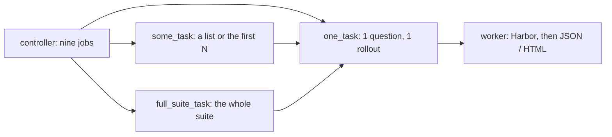

# User guide: cloud controller, worker, and eval

Copy-paste these blocks. Every command has a `#` comment. This page uses placeholders (`CONTROLLER_IP`). This lab’s real IP and SSH: [testing/cloud-eval-runbook.md](testing/cloud-eval-runbook.md).

Two different downloads:

- **mac-k3d CLI** — GitHub asset `mac-k3d-linux-x86_64` (or `linux-aarch64` / `darwin-aarch64` / `darwin-x86_64`). Used in steps 1–2.
- **iCode release** — official `icode-<os>-<arch>-full-vX.Y.Z` from the iCode project. Jenkins **uploads** it on **Build with Parameters**. Local `--stage` / `--local` still uses a worker path or `~/.local/share/mac-k3d/` discover. Not the same file as mac-k3d.

Prefer **v0.5.3** Latest (or this checkout’s `cargo build --release`). **v0.5.1** DeepSWE Pier used the wrong iCode CLI and often exited in ~20s. **v0.5.0** still has the old iCode step: it only accepts a file named `icode` or a `*.tar.gz` / `*.tgz`. An extensionless `icode-…-full-…` download needs v0.5.1+.

Eval jobs cover three benchmarks, all Harbor + iCode + DeepSeek catalog model (default `deepseek-flash`; also `deepseek-v4-pro`). `setup` installs the Harbor version pinned in `pipeline/config/toolchain.env` (0.22.0), and every build's `env` phase checks it again. How each Harbor flag is used: [pipeline.md](pipeline.md#how-harbor-is-called). Release and git mount that iCode the same way and run one `icode run` per rollout with `ICODE_PROVIDER=DeepSeek`, `ICODE_REASONING_EFFORT=high`, `ICODE_API_BASE=https://api.deepseek.com/v1`, `ICODE_MAX_TOKENS=65536` and `ICODE_MAX_ITERATIONS=500` (the iCode developers' eval limits). The Jenkins model choice stays the catalog id. The report labels it `openai/<id>` and records the real provider and reasoning effort under `eval_protocol`.

- **DeepSWE** via **Harbor** (`icode_harbor_agent:ICodeAgent`). Same worker `icode-*-full-*` bind-mount and the same iCode CLI (`run -t … -C … -a code --json`).
- **LoLBench** via **Harbor** (same agent; bind-mounts the same worker drop). Hub `smartdub26/lolbench` tags are arm64-only; on x86_64, the `tasks` phase builds or retags a local image (do not use Harbor `--force-build`).
- **SWE-bench Pro** via **Harbor**. The `tasks` phase writes a task whose image is `jefzda/sweap-images:…`. The verifier scores `FAIL_TO_PASS` / `PASS_TO_PASS` into `reward.json`. Images are 1–3 GB each; first live job should set **one** `TASK` (`instance_id`).

Each benchmark has three job shapes.



Start with `_one_task`. Use `_some_task` for a handful of questions and `_full_suite_task` for the whole suite. Both queue one `_one_task` build per question and rollout, then merge. Details: [evaluation.md](evaluation.md#which-job-to-run). The seven phases and the out-of-memory requeue are in [pipeline.md](pipeline.md).

Workers do **not** create a `.env` or store the DeepSeek key. The key lives on the **cloud Jenkins** credential `deepseek-api-key`.

The worker wizard has a default Jenkins URL (press Enter to keep it). Type `http://<CONTROLLER_IP>:17070` for your controller. Same-PC controller: `http://localhost:17070`.

---

## What you need

- Cloud Linux VM (`CONTROLLER_IP`) with **root**, ~8 GB RAM, **60 GB** free, security group **17070** open to the worker.
- New Linux or Mac worker, ~8 GB RAM (on a Mac: Docker Desktop's memory limit, 18 GB recommended), **40 GB** free, Docker allowed. Linux: **sudo** helps; without it, `setup` saves your answers and prints the few commands an administrator must run as root (installing Java/git/Docker, the `docker` group, and the Linux-only `loginctl enable-linger`) — see [new-machine.md](new-machine.md#what-root-must-run). Mac: Homebrew installs as you; set automatic login, no sleep and Docker Desktop's resources first ([new-machine.md](new-machine.md#mac-mini-worker)).
- **mac-k3d CLI** GitHub asset matching the machine (`mac-k3d-linux-x86_64`, `mac-k3d-linux-aarch64`, `mac-k3d-darwin-aarch64`, `mac-k3d-darwin-x86_64`).
- **iCode release** `icode-linux-<arch>-full-vX.Y.Z` (or a standalone executable named `icode`) to **upload in Jenkins** when you start a release-mode job. iCode runs inside the Linux task container, so it is a Linux drop on every worker; for a Mac, upload one `.tar.gz` holding the x86_64 and aarch64 drops ([icode-harness-inputs.md](icode-harness-inputs.md#linux-and-macos-workers)). For local `--stage` / `--local` only, copy it onto the worker after setup.

Developer checkout + `.env` is optional (appendix). Users run eval through Jenkins.

iCode is an **agent harness**. The job scores iCode with DeepSeek on DeepSWE, LoLBench, or SWE-bench Pro, all through Harbor. Read pass@1, resolved, tokens, and time in `artifact.json` and `report.html`. The agent may reach the DeepSeek API and nothing else (`--allow-agent-host`, from `pipeline/config/network-allowlist-v1.json`).

---

## 1. Create the controller on the cloud

```bash
# SSH to the cloud VM as root (use your IP if it is not this lab)
ssh root@CONTROLLER_IP

# Put the mac-k3d CLI on PATH (not the iCode release)
export PATH="$HOME/.local/bin:$PATH"
mkdir -p "$HOME/.local/bin"

# Download the mac-k3d CLI (change tag/arch if needed)
curl -fsSL -o /tmp/mac-k3d \
  "https://github.com/Toby-Yu/mac-k3d/releases/download/v0.5.3/mac-k3d-linux-x86_64"
chmod +x /tmp/mac-k3d
cp /tmp/mac-k3d "$HOME/.local/bin/mac-k3d"

# First-run wizard: role CI controller, Jenkins 17070 (a controller is not asked about Harbor)
# When asked for CI secrets, enter the DeepSeek key as credential deepseek-api-key
mac-k3d setup -c ~/.config/mac-k3d/config.yaml

# Confirm Jenkins and the eval jobs on this VM
JENKINS_URL=http://127.0.0.1:17070 ./scripts/env_set_up/02_check_controller.sh
```

If you already cloned this repo on the VM, run `02_check` from that checkout. After upgrading the binary, refresh the job XML:

```bash
# Re-apply Jenkins jobs without re-entering secrets (keeps existing credential binds)
export PATH="$HOME/.local/bin:$PATH"
mac-k3d config -c ~/.config/mac-k3d/config.yaml --skip-secrets
```

Open `http://CONTROLLER_IP:17070` (or `http://127.0.0.1:17070` on that VM). User **admin**. Password from `mac-k3d config --show-jenkins` on the controller. Create an **API token** (admin → Configure → API Token). Copy the **secret**, not the token name.

---

## 2. Create a worker on a new Linux or Mac

Pick the asset for the worker:

| Linux | macOS |
|-------|-------|
| `ASSET=mac-k3d-linux-x86_64` (or `mac-k3d-linux-aarch64`) | `ASSET=mac-k3d-darwin-aarch64` (or Intel `mac-k3d-darwin-x86_64`) |

```bash
# On the worker: mac-k3d CLI on PATH (not the iCode release)
export PATH="$HOME/.local/bin:$PATH"
mkdir -p "$HOME/.local/bin"
curl -fsSL -o /tmp/mac-k3d \
  "https://github.com/Toby-Yu/mac-k3d/releases/download/v0.5.3/$ASSET"
chmod +x /tmp/mac-k3d
cp /tmp/mac-k3d "$HOME/.local/bin/mac-k3d"
mac-k3d --help   # must list setup and eval

# Worker wizard. Enter keeps the printed default, or type http://CONTROLLER_IP:17070
# Type http://<new-ip>:17070 if you created another controller
# Docker / git: Install if not found. Java and Harbor are not asked: setup uses or installs
# Java 21+ (the controller's Java) and the pinned Harbor
# API user: admin   API token: the secret from step 1
#   (or press Enter to skip; worker.yaml keeps api_user: '' and api_token: '' to fill in later)
# Never run: mac-k3d start -c worker.yaml
mac-k3d setup -c ~/.config/mac-k3d/worker.yaml

# Skipped the token? Fill api_user / api_token in worker.yaml (nano), then register:
# nano ~/.config/mac-k3d/worker.yaml
# Agent refresh without re-wizard also extracts ~/.local/share/mac-k3d/pipeline
# Does not overwrite an iCode drop (icode or icode-*-full-*) in that folder
mac-k3d config -c ~/.config/mac-k3d/worker.yaml
```

Copying a YAML onto another machine, changing the model or the default task, or changing a worker's CPU limit: [export-import.md](export-import.md). Import never keeps the agent token or `cpu_cores`. Do not `import --force` onto a worker file that already has a token.

| Linux | macOS |
|-------|-------|
| Without sudo, setup stops before installing Docker and prints the root commands; after an administrator runs them, re-run `setup` and choose **Use existing config**. As **root**, Docker is ready without a logout. As a normal user, log out/in after the `docker` group is added, then re-run `setup` | Open **Docker Desktop** until it is idle. Setup installs Java (`temurin@21`), bash and python with Homebrew as you (no root) |

Worker tools and versions (all in [dependencies.md](dependencies.md)): Docker with compose and buildx, Java 21 or newer (the controller image's Java; Linux `openjdk-21-jre-headless`, macOS `temurin@21`), git, python3 3.11+, bash 4.4+, Harbor 0.22.0. A Mac worker's first run: compare it with a Linux worker once, as in [testing/mac-mini-worker.md](testing/mac-mini-worker.md).

```bash
# Optional: confirm this machine can reach cloud Jenkins
JENKINS_URL=http://CONTROLLER_IP:17070 \
  bash -lc 'echo "check Jenkins login"; curl -sS -o /dev/null -w "%{http_code}\n" "$JENKINS_URL/login"'
```

| Linux | macOS |
|-------|-------|
| `systemctl --user status mac-k3d-jenkins-agent` (want `active (running)`) | `launchctl print "gui/$(id -u)/com.mac-k3d.jenkins-agent" \| grep state` (want `state = running`) |

In Jenkins: **Manage Jenkins → Nodes**. This machine must be **online** with label **`lolbench`**.

---

## 3. Provide iCode (after the node is Online, before eval)

Details: [icode-harness-inputs.md](icode-harness-inputs.md). Both methods work for DeepSWE and LoLBench.

1. **Release binary (typical)** — download `icode-<os>-<arch>-full-vX.Y.Z`. **Jenkins:** Build with Parameters → `ICODE_MODE=release` → upload `ICODE_RELEASE_FILE` (the original `*-full-*` name is lost; `tasks/icode` uses gzip/tar magic or copies a standalone binary as `icode`). **Local `--stage` / `--local`:** copy to `~/.local/share/mac-k3d/` or `mac-k3d set --icode-release /path/to/that-drop`. This is **not** a git clone of GitHub Release assets.
2. **Git clone** — `ICODE_MODE=git` plus URL + `ICODE_GIT_REF` + `ICODE_GIT_REF_KIND` (`branch` / `tag` / `commit` / `pr`). A tag checkout is a git tag, not a downloaded zip. Kind `pr` takes the pull-request number and checks out that tip. Report field `icode_git` records the resolved SHA. The clone is under the eval workdir, not a permanent developer tree.

```bash
# Local only (not Jenkins): discover under the worker share
mkdir -p "$HOME/.local/share/mac-k3d"
# Browser often saves this with no .tar.gz — that is OK:
cp /path/to/icode-linux-x86_64-full-v0.1.41 "$HOME/.local/share/mac-k3d/"
```

- A `*.tar.gz` / `*.tgz` or unpacked `*-full-*` **folder** must contain a file named `icode`.
- Do **not** copy `.venv/bin/icode` (tiny Python wrapper) into the drop folder. Do **not** put iCode inside `pipeline/`.

```bash
# Persist the binary drop path (once)
mac-k3d set --icode-release /path/to/icode-linux-x86_64-full-v0.1.41

# Git tag (clone, not Release assets)
mac-k3d eval --stage tasks --icode-mode git \
  --icode-git-url https://github.com/ORG/icode.git \
  --icode-git-ref v0.1.41 --icode-git-ref-kind tag
```

Extract the pipeline on the worker (`mac-k3d config -c worker.yaml`, or any `mac-k3d eval --stage …`) so `pipeline/lib/icode_input.sh` is present.

---

## 4. Run evaluation (N=1)

### Jenkins UI (recommended)

1. Open `http://CONTROLLER_IP:17070` → job **`<benchmark>_one_task`** for a first run (all Harbor + iCode). Do not flip `BENCHMARK` across jobs. For more than one question use `<benchmark>_some_task`, and for the whole suite `<benchmark>_full_suite_task`.
2. **Build with Parameters**. Each job lists only what its shape needs; `HARNESS`, `LLM` and `BENCHMARK` are always first so the build says what it evaluates, and the build is named `#<n> <harness>/<model>/<benchmark>`:

| Field | Jobs | Value |
|-------|------|--------|
| HARNESS / LLM / BENCHMARK | all | `icode` / `deepseek` / `deepswe`, `lolbench` or `swebenchpro` (fixed on that job) |
| TASK | `_one_task` | One question id. Empty runs the first sorted id. LoLBench default `ruff_1` |
| TASKS | `_some_task` | Comma-separated ids. Wins over N_TASKS. Example: `ruff_1,fastapi_1` |
| N_TASKS | `_some_task` | Used only when TASKS is empty: first N sorted ids. Full suite: DeepSWE `113`, LoLBench `20`, SWE-bench Pro `731` |
| N_ROLLOUTS | `_some_task`, `_full_suite_task` | Attempts per question. `4` by default. `_one_task` is always one rollout; several rollouts of one question go through `_some_task` with `TASKS` set to that id |
| ICODE_MODE | all | Choose `release` (upload a drop) or `git` (clone URL + ref). Fill only the fields for that choice; leave the other group as it is. On `_some_task` and `_full_suite_task` a release upload is hashed on the dispatcher and copied to each shard |
| ICODE_RELEASE_FILE | all | **release:** choose the `icode` / `icode-*-full-*` drop here. **git:** do not choose a file; leave this control as it is. |
| ICODE_GIT_URL | all | **git:** https URL on github.com or gitcode.com. **release:** leave it as it is. |
| ICODE_GIT_REF | all | **git:** branch name, tag, commit SHA, or pull-request number when KIND is `pr`. **release:** leave it as it is. |
| ICODE_GIT_REF_KIND | all | **git:** pick `branch`, `tag`, `commit`, or `pr` (no auto). **release:** leave it as it is. |
| DEEPSEEK_MODEL | all | `deepseek-flash` (catalog default; or `deepseek-v4-pro`). iCode sends this id to `https://api.deepseek.com/v1` with provider `DeepSeek` and reasoning effort `high` |

A `_one_task` build locks the CPUs that question declares and runs one container ([optimization.md](optimization.md)). `AGENT_LABEL`, pins, `MAX_IN_FLIGHT`, `OOM_RETRIES`, `TEST_MEMORY_MB` and `TEST_MEMORY_ATTEMPTS` are developer parameters: they show only when the controller has `jenkins_job.ui_profile: developer`, and otherwise keep their config defaults. The developer page is this same table followed by those extras, each labelled `Developer (testing):`. The pipeline itself is not a parameter: each worker runs the one built into its installed `mac-k3d`, and every build refuses a binary built from uncommitted `src/` or `pipeline/`. `artifact.json` names that commit. See [workflow.md](workflow.md#development-loop-commit-push-redeploy) and [commands.md](commands.md#jenkins-job-parameters).

Before the canary or any rollout, the console prints one line: `iCode under test: git <kind> <ref> -> <sha> (<subject>)`, or `iCode under test: release <file> sha256 <hex>`. The same line is the first bullet of `summary.md` and a sentence in `report.html`. A sharded run prints `iCode under test (N shards): <sha>` after the merge, or `MIXED:` when the shards disagree. For a release drop, `eval_protocol.icode.version` is that sha256.

Git-mode CI: set `ICODE_MODE=git`, fill `ICODE_GIT_URL` / `ICODE_GIT_REF` / `ICODE_GIT_REF_KIND`. The archived JSON includes `icode_git` (resolved SHA + subject). Full split: [icode-harness-inputs.md](icode-harness-inputs.md).

Release-mode CI: **upload** `ICODE_RELEASE_FILE` on any of the three jobs. `mac-k3d eval --job` cannot attach a file. On `_some_task` and `_full_suite_task` the dispatcher hashes the upload and each shard copies that file and checks the sha256. After the shards have it, the dispatcher build drops the file. The finished build keeps the sha256 in `summary.md` and `report.html`, not the drop and not a `sha256.txt`.

3. Click **Build**. Console must say `Running on <this-worker-name>`. The build is allowed **96 hours**. Re-run `mac-k3d config` on the controller so the Jenkins job picks up that limit; an already installed job still has the old cap.
4. Download **Build Artifacts** → `eval-runs/output/<benchmark>/jenkins-<build>-<UTC>/artifact.json`, plus `summary.md` and `report.html` in that same folder. Token totals are input, output, and the sum.
   The Archive stage adds `cost-token-report.md` to that folder and keeps a compressed copy at `$WORKSPACE/mac-k3d-pipeline/output/<benchmark>/jenkins-<build>-<UTC>.tar.gz`, kept across builds (override with `MAC_K3D_OUTPUT_ROOT`). The workspace copy Jenkins shows is still the loose folder at `$HOME/jenkins-agent/workspace/<job>/eval-runs/output/` (or `{remote_fs}/workspace/<job>/eval-runs/output/` if `jenkins_agent.remote_fs` was changed).
   The same `.tar.gz` is also under **Build Artifacts** as `mac-k3d-pipeline/output/<benchmark>/jenkins-<build>-<UTC>.tar.gz`, so anyone who can open the build can download the whole run: the report plus each attempt's patches, masked transcripts, `trial.log` and anti-cheat verdicts. `tar -xzf jenkins-<build>-<UTC>.tar.gz` recreates the run folder. A `some_task` or `full_suite_task` build offers one combined `backup/<benchmark>/<RUN_GROUP>.tar.gz` for all its shards instead.

### CLI from any machine with the API token (queues Jenkins; no `--local`)

The same three jobs, with the same fields as the table above. Only the fields you pass are sent; the rest keep the job's defaults, as pressing **Build** with the form untouched does. Uses `jenkins_agent` from the loaded config, else `~/.config/mac-k3d/worker.yaml`. Harbor does not run in this shell: the command prints the build URL to watch.

```bash
export PATH="$HOME/.local/bin:$PATH"
# Check what would be sent; nothing is queued:
mac-k3d eval --job some --tasks ruff_1,fastapi_1 --benchmark lolbench --n-rollouts 1 --dry-run
# One question, git mode:
mac-k3d eval --job one --task abs-module-cache-flags --icode-mode git \
  --icode-git-url https://github.com/ORG/icode.git --icode-git-ref main --icode-git-ref-kind branch
# A list, or the whole suite:
mac-k3d eval --job some --tasks a,b,c --n-rollouts 4
mac-k3d eval --job full
# Developer fields go through --param (or the developer page):
mac-k3d eval --job some --tasks a,b --param AGENT_LABEL=lolbench
# Release mode: open any of the three job pages and upload ICODE_RELEASE_FILE; the CLI cannot attach a file.
```

All flags and what each job refuses: [commands.md](commands.md#queue-a-jenkins-job-from-the-cli). `--yes` without `--local` is the same as `--job one`.

Expect: build **SUCCESS**, artifact present. `pass@1` may be `0.0` on N=1 — that is a task result, not a setup failure. Missing F2P/P2P rates are `null`, not empty test-name lists.

```bash
# Optional: schema check on the downloaded JSON (from a checkout or extracted pipeline)
./pipeline/tools/check_report.sh /path/to/artifact.json
```

---

## 5. Developer only (this git checkout)

```bash
# Every phase locally, without Jenkins. Needs .env (gitignored), not for workers.
cd /path/to/mac-k3d
cp .env.example .env
chmod 600 .env
# put DEEPSEEK_API_KEY and DEEPSEEK_MODEL=deepseek-v4-pro in .env
# catalog also allows DEEPSEEK_MODEL=deepseek-flash
export PATH="$HOME/.local/bin:$PATH"
mac-k3d eval --local --benchmark deepswe --n-tasks 1 --icode-mode binary
# mac-k3d eval --local --benchmark lolbench --task ruff_1 --icode-mode binary
# All three benchmarks use Harbor in the evaluate phase; the tasks phase resolves the iCode drop for the bind-mount
# One phase at a time: mac-k3d eval --stage env|tasks|evaluate|anticheat|score|report|archive
# or ICODE_MODE=git to clone from GitHub/GitCode
```

---

## Failures

| Symptom | What to do |
|---------|------------|
| Waiting for executor | Worker node offline; do not `start -c worker.yaml` |
| Node offline, agent log `UnsupportedClassVersionError` (class file 65 vs 61) or "Connection was broken" | The worker's Java is older than the controller's Java 21 (`JAVA_MAJOR`). Run `mac-k3d setup -c ~/.config/mac-k3d/worker.yaml`, choose **Use existing config**: it switches to an installed Java 21 or installs one (Linux: `openjdk-21-jre-headless`, printed for an administrator without sudo; macOS: `brew install --cask temurin@21`). `mac-k3d config` then shows `java 21: ok` |
| `bash … is older than 4.4` | macOS `/bin/bash` 3.2. `brew install bash` (setup does it); the agent PATH puts `/opt/homebrew/bin` first |
| `python3 … is older than 3.11` | macOS `/usr/bin/python3` 3.9: `brew install python` (setup does it). Linux: python3 3.11+ ahead of `/usr/bin` on PATH |
| `pipeline/stages/run_all.sh` missing | Worker: `mac-k3d config -c worker.yaml` (extracts) **or** `mac-k3d eval --stage env` |
| iCode not found | Jenkins release: upload `ICODE_RELEASE_FILE`. Local: drop official `icode-*-full-*` or a file named `icode` in `~/.local/share/mac-k3d/` (see §3), or use `ICODE_MODE=git`. All three benchmarks bind-mount that tree at `/opt/icode-host`. |
| `cannot remove leftover … icode-src` | Old pipeline on the worker. Rebuild/install CLI, then `mac-k3d eval --stage env` (or `config -c worker.yaml`) so `~/.local/share/mac-k3d/pipeline` has `icode_force_rm`. Do not `sudo rm` as a routine step. |
| First LoLBench image is slow | Expected: the `env` phase installs the pinned Harbor and `docker buildx` if missing. Hub `smartdub26/lolbench` tags are **linux/arm64**. On x86_64, `tasks/images` runs `docker build --progress=plain` once (not Harbor `--force-build`, which hangs after the image is tagged). A local tag of the other architecture (for example from an earlier `docker pull`) is rebuilt the same way: iCode's x86-64 runtime cannot start in an emulated arm64 image (`python3.13: not found`). |
| `WARNING: egress via … has MTU …`, or every HTTPS call from a container times out (canary `model_api` `curl exit 28`) | A VPN tunnel (for example Surfshark WireGuard, MTU 1280) is smaller than Docker's 1500-byte bridge, so TLS replies are dropped. Disconnect the VPN, or add `"mtu": 1280` and `"default-network-opts": {"bridge": {"com.docker.network.driver.mtu": "1280"}}` to `/etc/docker/daemon.json` and restart Docker. |
| `DEEPSEEK_API_KEY missing` on Jenkins | Add credential `deepseek-api-key` on the **controller** |
| `--stage p0 is gone` | Phases replaced the old stage names; use the phase the message names ([pipeline.md](pipeline.md#old-stage-names)) |
| `no config at …; run mac-k3d setup -c … first` | The `-c` path does not exist (check the user name in the path); run `setup` with it first |
| `Left jenkins_agent.api_user / api_token empty` | Fill both in `worker.yaml`, then `mac-k3d config -c worker.yaml` |
| Disk/RAM preflight | Free space (`docker system df`); keep `N_TASKS=1` |
| `--yes` ran a local eval | Old CLI; install v0.5.2+ |
| Job still `deepseek-chat` or Toby paths | Controller: install new binary, `config --skip-secrets` |

E8 (N>1) is optional after N=1 is green. Lab operator notes: [cloud-eval-runbook.md](testing/cloud-eval-runbook.md).
